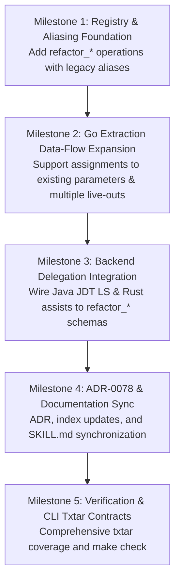

<!-- Handover document for Luna agents implementing the shared refactoring intent taxonomy and refactor_ tool family. -->
# Luna Agent Implementation Handover: Shared Refactoring Intent Vocabulary and `refactor_*` Tool Family

* **Target Implementer**: Luna Autonomous Coding Agent
* **Context**: [RQ-0024](docs/research/RQ-0024-ide-edit-and-refactoring-capability-taxonomy.md) (Capability Taxonomy), [ADR-0007](docs/adr/0007-semantic-mcp-tool-naming-and-descriptions.md) (Tool Naming), [ADR-0055](docs/adr/0055-tool-parameter-schema-harmonization.md) (Schema Harmonisation), [ADR-0056](docs/adr/0056-go-call-statement-extraction.md) (Go Extraction), [ADR-0065](docs/adr/0065-lenient-in-precise-out-input-resolution.md) (Lenient In, Precise Out), and [ADR-0078](docs/adr/0078-shared-refactoring-intent-vocabulary-and-naming.md) (Planned).
* **Date**: 2026-10-19

---

## 1. Executive Summary & Design Principles

The design in [RQ-0024](docs/research/RQ-0024-ide-edit-and-refactoring-capability-taxonomy.md) establishes a **shared intent vocabulary with language-specific capabilities**:

1. **Shared Intent Vocabulary with Language-Specific Capabilities**:
   * Agents request operations grouped by canonical refactoring families: `extract_callable`, `extract_value`, `move_declaration`, `move_file`, `inline_callable`, `change_signature`, and `implement_contract`.
   * Each backend (Go, Java, Rust, Scala, etc.) advertises only the concrete variants and parameter constraints it can safely perform without promising unsupported behavior.
2. **Mandatory `refactor_` Prefix for All Refactoring Tools**:
   * All refactoring tools exposed to agents (MCP tools and registry keys/CLIs) MUST start with the prefix `refactor_` (e.g. `refactor_extract_callable`, `refactor_extract_value`, `refactor_inline_callable`, `refactor_change_signature`, `refactor_move_declaration`, `refactor_implement_contract`).
   * This cleanly separates pure structural mutations (`semantic_insert_construct`, `semantic_replace_construct`, `semantic_remove_construct`) and lifecycle utilities from high-intent semantic refactorings.
3. **Identical Execution Path and Schema for Direct Calls and Batches**:
   * Direct calls and batch children dispatch to the identical registered operation schema, parser, validator, and handler.
   * The sole difference is context: individual calls execute against a fresh request buffer, whereas batch children share a `sourcebuf.Buffer` overlay where edits are staged in memory and flushed atomically at the batch boundary.
4. **Exact Selection & Refusal Semantics**:
   * Extraction accepts an exact contiguous statement or expression selection.
   * The backend derives inferred inputs and outputs, validates lexical scope and control flow, and returns explicit, actionable refusals when encountering unsupported control flow or data-flow shapes.
   * A structured selection handle (e.g. semantic coordinates or candidate paths) takes precedence over brittle line-number guessing.
5. **Prefer Native Server Refactorings Over Ad-Hoc Reimplementation**:
   * Reuse native LSP and server-grade engines where they exist and cover the request (JDT LS for Java, rust-analyzer assists for Rust, Metals for Scala).
   * Fall back to AST/type-aware implementations (e.g. native `go/ast` + `go/types` for Go) when needed.
   * Note: The upstream survey in RQ-0024 indicates that an LSP is not inherently more capable than the corresponding IntelliJ product for the same language; documented capabilities and gaps must be verified against executable fixtures rather than inferred from product labels.
6. **Preserve Explicit Refusals for Unsafe Patterns**:
   * Do not guess or permit unsafe transformations without formal proofs. Unmodelled patterns must remain fail-closed refusals.
   * Specifically, address the benchmark failure pattern in Go: support straight-line writes and assignments to an existing parameter plus returned values, while maintaining strict fail-closed safeguards for branch exits, named results, `defer`, evaluation order, and inferred types.

---

## 2. Continuity Requirements (Parameters, Descriptions, and Schemas)

Continuity across existing tools, schemas, and agent expectations is non-negotiable:

### 2.1 Backward Compatibility & Continuation Invariant (ADR-0055 & ADR-0065)

* **Parameter Harmonisation**:
  * One logical concept retains one canonical parameter name and value format across all tools.
  * `symbol`: Primary operation target (e.g. name of new helper, function being changed). Never an owner or search selector.
  * `in_function`: Scope selector identifying an enclosing callable.
  * `file`: Workspace-relative file path.
  * `discriminator`: Exact source snippet for expression selection.
  * `construct_path`: Hierarchical 0-based path for structural or ambiguous nodes.
  * `expected_revision`: SHA-256 file revision token used for optimistic concurrency control.
* **Ingress Leniency vs Output Precision (ADR-0065)**:
  * Ingress: Accept existing aliases and synonyms (e.g. legacy tool names such as `semantic_extract_function`, `semantic_change_signature` mapped as aliases or forwarded to `refactor_*`), strip balanced outer braces, and normalize path representations.
  * Ingress parameter aliasing must support existing automated callers without breaking scripts.
  * Output: Strictly emit canonical, typed structured output matching registered schemas. Emitted continuations in receipts must use canonical target parameter names matching downstream inputs.

### 2.2 Continuity in Tool Descriptions & Guidance

* **Agent Steering (ADR-0007 & RQ-0027)**:
  * Tool descriptions must maintain explicit routing clauses instructing LLM planners to select the semantic tool over raw text diffs (`replace_file_content` / `write_to_file`).
  * Descriptions must declare exact parameter roles, default behaviors, and named upstream producers (`SourceFields`).
  * When a refactoring is refused (e.g. non-contiguous lines, named results in Go extraction), the failure message must clearly explain why and provide actionable next steps (such as using declaration insertion or simplifying the selection) rather than leaving the agent in an unguided retry loop.

### 2.3 Skill and Reference Guide Synchronization Invariant

Per the repository's Section 7 Invariant (*Tooling Interface, Capability Expansion, & Skill Synchronisation*), updating public operations requires updating the agent skills and language references in the **exact same change**:

* **Update Primary Routing in `skills/semedit/SKILL.md`**:
  * Update the intent-to-operation routing table (`Choose the operation by intent`) to recommend canonical `refactor_*` tools (`refactor_extract_callable`, `refactor_extract_value`, `refactor_inline_callable`, `refactor_change_signature`, `refactor_move_declaration`, `refactor_move_file`, `refactor_implement_contract`, `refactor_extract_interface`, `refactor_rename`).
  * Note supported aliases for continuity so legacy planner patterns remain operative.
  * Update the catalog profile documentation (`--tool-profile base` and `full`) to reflect the new canonical operation keys.
* **Update Language Reference Guides (`skills/semedit/references/<lang>.md`)**:
  * **`golang.md`**: Document `refactor_extract_callable`'s extended capabilities (straight-line assignment to existing parameters, multiple live-outs) alongside safety boundaries (`defer`, named results, address-taken variables). Update signature, move, and inline examples to use `refactor_*`.
  * **`java.md`**: Document JDT LS refactoring delegation under the canonical `refactor_*` names (`refactor_extract_callable`, `refactor_extract_value`, `refactor_change_signature`, `refactor_implement_contract`, `refactor_extract_interface`, `refactor_move_declaration`).
  * **`rust.md`**, **`scala.md`**, and others: Update capability matrices and assist mapping to reference `refactor_*` tool keys.
* **Test Synchronisation**: Ensure test suites validating skill references (e.g. `TestSupportedLanguagesHaveSkillReferences`) pass cleanly with no dangling or broken links.

---

## 3. Tool Family Architecture & Vocabulary

All refactoring operations must be registered under the canonical `refactor_*` naming convention:

| Family / Intent | New Canonical Operation Name | IntelliJ IDEA Documented Name | Alignment Notes |
| :--- | :--- | :--- | :--- |
| **Extract Callable** | `refactor_extract_callable` | **Extract Method** | IntelliJ uses "Extract Method" (for Java/Kotlin/GoLand). In `semedit`, `refactor_extract_callable` handles both functions and receiver methods via `kind: "function" \| "method"`. Ingress aliases `refactor_extract_method` and `refactor_extract_function` to this tool. |
| **Extract Value** | `refactor_extract_value` | **Extract Constant**, **Extract Field**, **Introduce Variable** | IntelliJ splits value extraction into distinct actions ("Extract Constant", "Extract Field", "Introduce Variable"). `semedit` unifies value extraction into one tool family parameterized by `kind: "variable" \| "constant" \| "field"`. Ingress aliases `refactor_extract_variable`, `refactor_extract_constant`, and `refactor_introduce_variable`. |
| **Inline** | `refactor_inline_callable` / `refactor_inline_value` | **Inline...** | IntelliJ uses a single context-sensitive action ("Inline...") that inlines methods, variables, or constants depending on cursor position. `semedit` models callable vs value inlining explicitly (`refactor_inline_callable`, `refactor_inline_value`), with ingress alias `refactor_inline`. |
| **Change Signature** | `refactor_change_signature` | **Change Signature** | **Exact match**. Maps 1:1 with IntelliJ's "Change Signature" refactoring dialog. |
| **Rename** | `refactor_rename` | **Rename** | **Exact match**. Maps 1:1 with IntelliJ's "Rename" refactoring (with `semantic_rename` aliased). |
| **Move** | `refactor_move_declaration`, `refactor_move_file` | **Move...** / **Move Static Members** | IntelliJ groups these under "Move / Copy" and "Move Static Members". `semedit` separates declaration relocation from file moves to bound reference updating and module scoping. |
| **Safe Delete** | `semantic_remove_construct(safe_delete=true)` | **Safe Delete** | Per ADR-0057 and RQ-0024, Safe Delete is implemented as a safety preflight option (`safe_delete: true`) on structural removal, rather than a separate refactoring tool. |
| **Extract Interface** | `refactor_extract_interface` | **Extract Interface** | **Exact match**. Maps 1:1 with IntelliJ's "Extract Interface". |
| **Implement Contract** | `refactor_implement_contract` | **Implement Methods** / **Override Methods** | In IntelliJ, this is typically under Code Generation ("Implement Methods"). In `semedit`, it acts as a semantic contract refactoring generating missing interface/trait methods. |

---

## 4. Go Extraction Capability Extension (Addressing Benchmark Failures)

### 4.1 Benchmark Root Cause Analysis

In benchmark task `grpc__grpc-go-2735` and hard luna evaluation arms, extraction failed 21 out of 22 calls with the refusal:
`"only one leading := declaration with matching named results is supported"`.
The model attempted to extract standard helper patterns such as:

```go
kind = strings.TrimSpace(kind)
kind = strings.ToLower(kind)
return kind
```

The existing Go AST extraction engine only supported contiguous function calls preceded by at most one `:=` short variable declaration.

### 4.2 Required Go Engine Extension

1. **Straight-Line Assignments to Existing Variables**:
   * Allow `ast.AssignStmt` (both `:=` and `=`) within the contiguous selection.
   * Track definition-use chains and live-in variables: any variable defined prior to the selection and read within it is an input parameter to the extracted helper.
   * Track live-out variables: any variable written within the selection that is subsequently read after `end_line` in the owner body must be returned by the helper.
2. **Preserve Sound Refusals**:
   * Refuse branching statements (`if`, `for`, `switch`) whose exits cross the region boundary.
   * Refuse when named result variables are assigned in the selection while `defer` is present in the owner.
   * Refuse when forwarded parameters or locals are address-taken (`&val`).
   * Refuse if expression evaluation order cannot be guaranteed.

---

## 5. Architectural Decision Record (ADR) Requirements

The implementing agent must draft and commit a new ADR to formalise this architectural shift, and update the ADR index in the same change:

1. **New ADR**: Create `docs/adr/0078-shared-refactoring-intent-vocabulary-and-naming.md`:
   * **Title**: `ADR-0078: Shared Refactoring Intent Vocabulary and refactor_* Tool Family`
   * **Status**: Accepted
   * **Context**: Explain the motivation from RQ-0024 and the need for a unified refactoring prefix (`refactor_*`) distinct from generic AST editing tools.
   * **Decision**: Record the canonical `refactor_*` naming convention, aliasing of legacy `semantic_*` operations for continuity, identical batch/direct dispatch contracts, and backend capability filtering.
   * **Invariants**: All refactor tools use `refactor_*`; shared dispatch code for direct and batch; lenient alias ingestion with canonical output contracts; strict fail-closed safety proofs.
   * **Consequences**: Enhanced LLM routing precision, elimination of duplicate tool schemas, and zero breaking changes for existing workflows.
2. **ADR Index Atomicity**:
   * Update `docs/adr/README.md` to index ADR-0078 in the table and summary.
3. **Research Index Atomicity**:
   * Update `docs/research/RQ-0024-ide-edit-and-refactoring-capability-taxonomy.md` and `docs/research/README.md` to reference ADR-0078 and mark the research gates addressed.

---

## 6. Luna Implementation Roadmap

Workers must operate in isolated worktrees (e.g. `.scratch/worktrees/refactor-intent`) and execute the following sequential milestones:



### Milestone 1: Registry & Aliasing Foundation

* Define canonical keys with the `refactor_` prefix in `internal/operation/`:
  * `refactor_extract_callable` (aliases: `semantic_extract_function`, `extract_function`)
  * `refactor_extract_value` (aliases: `semantic_extract_variable`, `semantic_extract_constant`)
  * `refactor_inline_callable` (aliases: `semantic_inline_function`, `semantic_inline_variable`)
  * `refactor_change_signature` (alias: `semantic_change_signature`)
  * `refactor_move_declaration` (alias: `semantic_move_construct`)
  * `refactor_move_file` (alias: `semantic_move_file`)
  * `refactor_implement_contract` (alias: `semantic_implement_contract`)
* Ensure `NormalizeInput` and registry lookup accept both legacy and new names seamlessly.

### Milestone 2: Go Extraction Engine Expansion

* In `internal/astedit/extract.go`:
  * Expand `selectExtractStatements` and `planExtraction` to support assignments to existing parameters/variables.
  * Derive `live-ins` and `live-outs` using `go/types` and AST variable analysis.
  * Return actionable diagnostic messages when refusing control-flow or named-result hazards.

### Milestone 3: Batch Overlay & Capability Verification

* Ensure all `refactor_*` operations are marked `Batchable: true` and `BufferedBatch: true`.
* Verify that mutations apply to `sourcebuf.Buffer` in-memory without early disk flushes.

### Milestone 4: ADR-0078, Documentation, & Skill Synchronisation

* Author `docs/adr/0078-shared-refactoring-intent-vocabulary-and-naming.md`.
* Atomically update `docs/adr/README.md` and `docs/research/README.md`.
* Update `skills/semedit/SKILL.md` and `skills/semedit/references/*.md` to document the new `refactor_*` tool family and routing rules.

### Milestone 5: Verification

* Add comprehensive CLI txtar contracts in `testdata/scripts/refactor_*.txtar` covering direct calls, batch sequences, and refused shapes.
* Run `make check` to verify full workspace health, linter compliance, and passing test suites.
