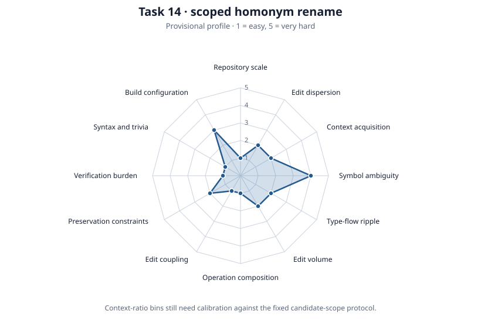

# RQ-0015: Multi-Dimensional Benchmark Matrix & Evaluation Runner

* **Status**: Open
* **Category**: Benchmarks & Empirical Evaluation
* **Last Updated**: 2026-10-06

---

## 1. Problem Context

Benchmarking `semedit` against baseline text-diff workflows requires evaluating multiple interacting variables. Different agent harnesses (Antigravity, Claude Code, Cursor, Aider, OpenHands) incorporate distinct system prompt designs, context pruning heuristics, and automated error-recovery loops.

Furthermore, model reasoning budgets (extended thinking allocations from 0 to 32k tokens) alter agent behavioral profiles: models with higher reasoning allocations plan multi-file refactorings upfront, whereas models without reasoning tokens engage in immediate iterative trial-and-error editing.

Evaluating `semedit` across these disparate dimensions demands a formalized evaluation matrix, an unambiguous testcase fixture design, and a multi-level correctness oracle.

### Measurement Boundaries

This research question separates two performance measurements that are easy to conflate:

1. **Solution effectiveness**: whether the agent plus `semedit` completes the requested semantic edit, measured by AST correctness, compilation, first-completion oracle pass, turns, tokens, and agent wall time.
2. **Validation and harness overhead**: how long the repository's own checks take after an edit, measured by `make check`, package scheduling, documentation generation, and cache state.

The text-editing agent (`baseline-diff`) is the control for solution effectiveness. Direct `semedit` invocation runs the same `txtar` task and correctness oracle without an LLM; it is a calibration baseline for transformation and verification overhead, not the agent control. `make check` timings are a separate CI and validation baseline; they must not be presented as the speed or effectiveness of `semedit` itself.

---

## 2. The Evaluation Matrix Formulation

Every benchmark execution represents an evaluation tuple across harness, model,
supported reasoning effort, arm, task, context, and repeat:

$$\mathbf{Run} = \langle \text{Harness}, \text{Model}, \text{Effort}, \text{Arm}, \text{Task}, \text{Context}, \text{Repeat} \rangle \longrightarrow \mathbf{Result}$$

This is a conditional matrix, not a full Cartesian product: reasoning effort is
included only where the selected model and provider support it. Pair arms within
the same harness/model/effort/context/task/repeat block. The measured treatment
is access to the semedit toolset; actual semantic-tool use is a mediator and must
be recorded per call. The baseline receives the harness's ordinary search/read/
edit tools. Native editing primitives differ by harness, so attribute treatment
effects within a harness rather than treating those tools as identical across
harnesses.

```text
   INPUT DIMENSIONS                                 OUTPUT RESULT
┌────────────────────────────────────┐           ┌────────────────────────────┐
│ Harness: agy | codex | OpenCode    │           │ Outcome                    │
│ Model: provider/model              │           │ - Compilation and AST      │
│ Effort: provider-supported value   │ ────────► │ - First-completion pass     │
│ Arm: baseline                      │           │ - Final pass and repairs   │
│      semedit-implicit              │           │ - Turns and tool calls     │
│      semedit-explicit              │           │ - Agent / tool / oracle    │
│ Task: source, prompt, oracle        │           │   latency and token usage  │
└────────────────────────────────────┘           └────────────────────────────┘
```

---

## 3. Dimension Specifications

### A. Harness ($H$)

Harnesses introduce distinct middleware layers that influence agent trajectory:

* **`direct-api`**: Minimalist headless runner (Python/Go) executing a raw tool loop directly against model APIs with a neutral system prompt. It is a harness condition, not the solution-effectiveness control; `baseline-diff` is the control toolset.
* **`agy` (Antigravity)**: Production IDE/CLI harness featuring rich tool schemas, subagent orchestration, and session transcripts.
* **`claude-code` / `aider`**: CLI harnesses with built-in diff patchers, compact error reporting, and git integration.
* **`local-runner`**: Direct driver communicating with `llama.cpp` or Ollama servers for zero-cost, local Apple Silicon runs.
* **`codex-cli`**: OpenAI Codex CLI harness with native file-edit tools, structured diff application, and built-in retry loops. Routes through `--message` prompts with embedded tool schemas; supports both streaming and non-streaming evaluation modes.

### B. Model ($M$)

Record the exact provider and model identifiers from the run plan. These
examples describe an earlier seed matrix, not a current or exhaustive catalog.

* **Frontier Cloud**: Claude 3.5 Sonnet, Claude 3.7 Sonnet, GPT-4o, Gemini 2.0 Flash / Pro.
* **Local Open-Weights**: Qwen 2.5 Coder (7B, 14B, 32B), DeepSeek-Coder V2.

### C. Reasoning Level ($R$)

Reasoning effort is a provider-specific conditional parameter, not a common
token budget. Record the exact supported effort and sampling parameters for each
model. Do not assume that `none`, `low`, `medium`, and `high` have equivalent
semantics or that every model accepts each value. Temperature and seed are
separate sampling parameters; record them independently and honor provider
constraints when reasoning is enabled.

### D. Benchmark Arm and Toolset ($I$)

* `baseline-diff`: Harness-native search/read/edit tools, including its ordinary
  patch path, with no semedit tools.
* `semedit-implicit`: The same harness tools plus the semedit MCP tools and
  ordinary server instructions. Do not prescribe a tool sequence in the task
  prompt.
* `semedit-explicit`: The same tools and server instructions as
  `semedit-implicit`, with a task prompt that specifies the matching semantic
  tool calls, order, and arguments. Keep skills disabled until a separate
  treatment adds them.

The implicit and explicit arms have the same tool availability; they differ in
prompt specificity. Record whether the agent used semantic operations, whether
each operation succeeded, and which edits were made through native text tools.
A run with zero semantic calls remains an intention-to-treat observation, but it
does not measure semantic operation performance. A restricted semantic-only
condition is a separate experiment and must not replace one of these arms.
The three-arm design estimates semantic-tool access under ordinary prompting
(`baseline-diff` versus `semedit-implicit`) and explicitness conditional on
semantic-tool access (`semedit-implicit` versus `semedit-explicit`). It does not
estimate whether ordered procedural prompts help a native-only baseline; that
would require a separate `baseline-explicit` condition, outside this comparison.

*Note on Controls*: Direct `semedit` execution without an LLM provides a baseline calibration for transformation and verification overhead, but is **not** the control group. The text-tool agent (`baseline-diff`) is the actual control.

### E. TestCase Dimension ($T$) & Fixture Design Trade-Offs

The benchmark suite balances hermetic execution against real-world repository scale through two distinct fixture architectures:

#### 1. Synthetic `txtar` Scenarios

* **Properties**: Single-file multi-part archives containing `go.mod`, package sources, and any public fixture tests. The oracle configuration is parsed by the harness and is not extracted into the agent workspace. Exclude `want/` golden directories. Fixture tests are visible acceptance tests, not hidden tests.
* **Advantages**:
  * Near-instant instantiation (<50ms) in temporary directories (`t.TempDir()`).
  * Zero external network or package repository dependencies.
  * Precise, hermetic attribution of failure modes.
* **Trade-Offs**: Omits the large symbol tables, deep vendor trees, and cross-module link times present in enterprise repositories.

#### 2. Real-World Open-Source Go Repositories

* **Target Subsystems**: Pinned Git commits of established open-source libraries:
  * `go-chi/chi`: Lightweight HTTP router exercising interface implementations and middleware handlers.
  * `gin-gonic/gin`: Web framework featuring extensive test suites and context trees.
  * `kubernetes/kubernetes` (sub-packages such as `staging/src/k8s.io/client-go`): Deep package graphs and massive symbol tables.
* **Advantages**:
  * Exposes agent search heuristics to realistic code layouts and cross-package references.
  * Validates whether semantic tools maintain low latency on non-trivial AST parse trees.
* **Trade-Offs**: High disk usage; slower test execution (`go test` takes seconds to minutes); external dependency fetch requirements.

#### 3. Two-Tier Suite Strategy

* **Tier 1 (Hermetic Core Suite)**: The original 10-task seed suite was a historical starting point. The current suite has since grown; use the harness fixture catalog as the source of truth for active tasks. Fixtures remain in `testdata/bench/`.
* **Tier 2 (Real-World Benchmark Suite)**: 5 real repository tasks using pinned Git submodules, evaluated during dedicated release benchmarking.

---

## 4. Initial 10-Task Benchmark Suite Specification

This table records the original 10-task seed suite. The active benchmark suite
has grown; use the current harness fixture catalog when selecting tasks. The
seed tasks span rename, declaration insertion, import optimization, and
diagnostic recovery:

| Task ID | Category | Initial Source Fixture | Description & Natural Language Prompt | Semantic Invariants Checked |
| :--- | :--- | :--- | :--- | :--- |
| `task-01-rename-local` | Rename | `testdata/bench/task_01_rename_local.txtar` | "Rename the unexported method `Server.oldName` to `Server.newName` and update call-sites." | `Server.newName` exists; `oldName` absent; clean compile. |
| `task-02-rename-cross-pkg` | Rename | `testdata/bench/task_02_rename_cross_pkg.txtar` | "Rename public function `auth.ValidateToken` to `auth.VerifyToken` across all consuming packages." | Call sites in `cmd/main.go` resolve to `VerifyToken`; clean test pass. |
| `task-03-rename-interface` | Rename | `testdata/bench/task_03_rename_interface.txtar` | "Rename interface method `Storage.Save` to `Storage.Persist` along with all struct implementations." | Concrete struct receivers and interface callers updated consistently. |
| `task-04-insert-public` | Insert | `testdata/bench/task_04_insert_public.txtar` | "Add public constructor `func InitServer() *Server` placed before private helpers." | Constructor placed in public declarations section; package builds cleanly. |
| `task-05-insert-method` | Insert | `testdata/bench/task_05_insert_method.txtar` | "Add a new method `func (s *Server) Stop()` after `Server.Start`." | Method receiver attaches to `Server`; the current oracle checks declaration order, not immediate adjacency. |
| `task-06-imports-cleanup` | Imports | `testdata/bench/task_06_imports_cleanup.txtar` | "Clean up unused standard library imports and group third-party imports." | Unused imports removed; stdlib precedes third-party; `goimports` clean. |
| `task-07-imports-qualify` | Imports | `testdata/bench/task_07_imports_qualify.txtar` | "Import the local `pkg/mockuuid` vendor package and initialize a UUID inside `GenerateID()`." | Import statement inserted; `mockuuid.NewString()` resolves without diagnostics. Network disabled. |
| `task-08-delta-recovery` | Recovery | `testdata/bench/task_08_delta_recovery.txtar` | "Repair signature mismatch compile errors between caller and callee in `service/`." | Compiler diagnostic count drops from $N > 0$ to $0$; tests pass. |
| `task-09-composite-refactor` | Multi-Step | `testdata/bench/task_09_composite_refactor.txtar` | "Rename `Config.Port`, insert helper `func DefaultConfig()`, and clean imports." | All three operations succeed without reverting intermediate states. |
| `task-10-disambiguate-var` | Semantics | `testdata/bench/task_10_disambiguate_var.txtar` | "Disambiguate shadowing variable `ctx` in handler without altering package context." | Shadowed variable renamed; parent scope variables and external references remain untouched. |

---

### 5. Correctness Oracle Architecture

Evaluating agent task completion requires strict semantic validation that treats the model-controlled workspace as **hostile**. A robust oracle must verify correctness without relying on superficial exit codes or brittle line diffs.

```text
                     Agent Output Code
                            │
                            ▼
              ┌───────────────────────────┐
              │  Level 1: Preconditions & │ ──► FAIL: Unauthorized modifications
              │           Mutation Policy │           (e.g. go.mod, tests, build)
              └─────────────┬─────────────┘
                            │ PASS
                            ▼
              ┌───────────────────────────┐
              │  Level 2: Parse & AST     │ ──► FAIL: Syntax parse or semantic
              │  - Structural assertions  │           identities missing or
              │  - Names and call shapes  │           stale references persist.
              └─────────────┬─────────────┘
                            │ PASS
                            ▼
              ┌───────────────────────────┐
              │  Level 3: Isolated Build  │ ──► FAIL: Syntax or typecheck errors
              │  - Fresh workspace copy   │           in a network-free box.
              └─────────────┬─────────────┘
                            │ PASS
                            ▼
              ┌───────────────────────────┐
              │  Level 4: Fixture Tests   │ ──► FAIL: Behavioral test assertion
              │  - Public tests in copy   │           failure
              └─────────────┬─────────────┘
                            │ PASS
                            ▼
              ┌───────────────────────────┐
              │  Level 5: Diff Audit Log  │ ──► PASS: Record line churn and
              │  - For metrics only       │           patch footprint
              └───────────────────────────┘
```

### Oracle Level Comparison

1. **Preconditions & Mutation Policy**:
   * Ensures the agent did not cheat by deleting callers, modifying `go.mod`, or removing testing logic. Verifies the exact starting state hasn't been bypassed.
2. **AST Semantic Invariant Verification**:
   * *Strengths*: The current harness parses the target file with `go/parser` and checks configured declarations, identifiers, imports, calls, and declaration order.
   * *Limitations*: These checks do not generally resolve compiler objects through `go/types`; they require task-specific assertions and may report a parse error at this stage before the later build check.
3. **Isolated Compilation (`go build ./...`)**:
   * *Strengths*: Catches syntax errors, unresolved identifiers, and type mismatches in a clean environment where the agent has no network access to download alternative packages.
4. **Fixture Test Suite (`go test ./...`)**:
   * *Strengths*: Runs the public tests present in the copied fixture and checks behavior beyond structural postconditions. These tests are visible to the agent. The current harness does not inject a separate hidden-test suite; any such suite would need to be stored and mounted outside the agent-visible workspace after execution.
5. **Golden Diff Comparison (`cmp` / `git diff`)**:
   * Used strictly for audit telemetry rather than pass/fail gating.

**Adversarial Oracles**: Every oracle should be explicitly tested against cheating strategies (e.g., no-ops, dummy declarations, commenting out tests).

---

## 6. Harness Non-Determinism Management in Matrix Evaluations

Stochastic variability in language model outputs requires systematic statistical controls across matrix evaluations:

1. **Sampling Parameters**: Record temperature and provider-supported seeds separately from reasoning effort. Do not claim that repeated temperature-zero runs are independent stochastic samples. When an API does not honor seeds or deterministic decoding, record that limitation.
2. **Replication Budget**: Use at least 15 matched trials per exploratory cell, randomize arm order within repeat blocks, and report the achieved sample size. Fifteen is a starting floor, not a power guarantee; confirmatory sample sizes require a power or precision target.
3. **Statistical Robustness**:
   * Report median and interquartile range (IQR) for token counts and execution latency to minimize outlier skew.
   * Calculate 95% bootstrap confidence intervals across repeated runs.
4. **Success Probability Metrics**:
   * **$Pass@1$**: Proportion of runs that pass the full required oracle at the agent's first completion/submission signal. This includes all planned tool turns before that signal; it does not mean success on the first tool call. Report final pass after any repair turn separately.
   * **$Pass@k$**: Use only for independent stochastic samples from a fixed condition. Do not derive it from deterministic or highly dependent repeated runs. When applicable, estimate the probability that at least one of $k$ samples passes using:
     $$Pass@k = 1 - \frac{\binom{N - C}{k}}{\binom{N}{k}}$$
      where $N$ is total independent samples and $C$ is passing samples; report its assumptions and interval. Otherwise report observed pass counts and uncertainty without $Pass@k$.

---

## 7. Result Schema (Historical Illustration)

The following early `eval_result.json` sketch is a historical illustration, not
the current report contract. Current harness reports are versioned and retain
per-job results. Use `semantic_verify` for the verification tool name. Missing
token telemetry must be represented as unavailable/null, never as zero. Keep
agent elapsed time, individual tool timing, and post-run oracle duration
separate so compilation of the oracle is not charged to the agent's latency:

```json
{
  "run_id": "run_20260916_qwen25_semedit_001",
  "dimensions": {
    "harness": "direct-api",
    "model": "qwen2.5-coder-14b-instruct",
    "reasoning_level": "none",
    "ingress_mode": "semedit-mcp",
    "test_case_id": "task-02-rename-cross-pkg"
  },
  "outcome": {
    "status": "SUCCESS",
    "ast_verified": true,
    "compiled": true,
    "tests_passed": true,
    "first_pass_clean": true,
    "turns_to_success": 1,
    "tool_calls_breakdown": {
      "semantic_rename": 1,
      "semantic_verify": 1
    }
  },
  "resource_metrics": {
    "agent_wall_clock_seconds": 2.45,
    "oracle_wall_clock_seconds": 0.31,
    "tokens": {
      "prompt_tokens": 1240,
      "cached_tokens": null,
      "completion_tokens": 28,
      "reasoning_tokens": null,
      "total_tokens": null
    },
    "estimated_cost_usd": 0.00003
  }
}
```

---

## 8. Credibility & Blind Spots

Publishing credible benchmarks requires mitigating the following biases:

1. **Treatment-Definition Bias**: The control gets the harness's normal search/read/edit tools, including its strongest ordinary patch path. Because native editing tools vary across harnesses, compare arms within each harness and record the actual editing primitive used.
2. **Task-Selection Bias**: The suite must include tasks where `semedit` has no inherent advantage, unsupported transformations, or ambiguous instructions to measure general agent productivity rather than just capability matching.
3. **Information Leakage**: Golden files (`want/`), oracle definitions, and transcripts must be outside the agent workspace. Fixture tests are public; a distinct hidden suite must be mounted only after the agent stops if one is used.
4. **Statistical Overconfidence**: A fixed small number of repeats does not establish precision. Pair arms by task/model/context/repeat, randomize arm order, and report uncertainty over tasks and repeats; predefine a precision or power target for confirmatory claims.
5. **Metric Comparability**: Provider tokens and costs vary widely. Do not aggregate them as equivalent units. Separate agent, tool, and oracle latency and preserve missing telemetry distinctly from zero.

---

## 9. Prior Art & References

* **SWE-bench**: Standard benchmark for autonomous repository issue resolution on GitHub.
* **Aider LLM Leaderboards**: Refactoring benchmarks comparing unified diff formats with whole-file replacements.
* **HumanEval / MultiPL-E**: Unit test evaluation harnesses for code synthesis models.
* **Go `testscript`**: Hermetic shell script and archive testing engine for CLI workflows.

## 10. Shared-buffer smoke test

The 2026-09-30 smoke test runs one baseline/semedit pair for each of
`codex/gpt-6-luna/medium` and `agy/gemini-3.7-flash-medium` on the pinned chi
identity-and-split fixture. The Agy model identifier comes from its live model
catalog. Runs are serial, use small/default context, prescriptive MCP instructions,
semantic-write steering, cold fixture-local Go caches, no verify prewarm, and a
five-minute timeout per job. One pair per model tests integration and correctness;
it does not establish a performance distribution or a repeatable advantage.

The semedit binary is the checked shared-gopls and buffered-move implementation,
SHA-256 `724e6b62f104b7c3dc3753cbfcc9d792525d07f84fb81976878b723af19ed3bf`.
The fixture, oracle configuration, and binary are copied without content changes into
`.scratch/chi-smoke-luna6-gemini37-20260930T210925Z/`. The harness uses its native
supported MCP flags. That directory retains a manifest, the resolved plan and
progress log, per-run transcripts, persisted MCP metrics, and final reports.
The fixture comes from the benchmark proof checkout and requires fifteen
declaration moves into four files and four compiler-bound field renames while
preserving original headers, protected bytes, declaration identity, and behavior.

| Target | Baseline final outcome | Semedit-labeled arm final outcome | MCP use observed |
| :--- | :--- | :--- | :--- |
| Luna 6, medium | Timeout at 299.740 s; no completed oracle | Pass at 207.023 s | Yes |
| Gemini 3.7 Flash, medium | Pass at 258.360 s | Pass at 264.705 s | No |

All three completed oracles pass policy, AST preservation, build, and tests. Luna's
baseline transcript shows repeated ordinary-edit repairs and test failures before
the timeout. It also records a loopback-port denial in `TestMuxBasic` and
`TestCompressor`. A later middleware test passes, while root tests still fail to
compile because `tree_test.go` references the renamed `n.prefix`. The semedit
arm's `go test ./...` exits successfully. Raw command-completion events omit
sandbox permission arguments, so equivalent test permissions are not established.
The timeout includes both editing and environmental failures; future repetitions
need equivalent allowed runtime tests. Its retained workspace remains available;
the timeout does not give
a completed baseline latency or oracle verdict. The harness exits with status 1
because that scheduled job times out.

Luna uses four scaffold calls, one batch for the fifteen moves, and four rename
calls. Its nine persisted MCP records total 12.529 s of server execution. The
move batch takes 10.690 s; rename calls take 457, 442, 449, and 434 ms. These are
actual smoke-run timings, not recovered estimates from an older fixture probe.
The recorded task clock includes 27.602 s of post-run oracle execution, so it is
not an agent-latency measure. Keep agent execution and oracle duration separate
in future comparisons. This legacy run did not capture first-completion Pass@1;
the table reports only final oracle outcome.

Gemini's nominal semedit arm uses ordinary editing and has no observed semantic
calls or persisted MCP timing file. In the separately recorded diagnostic
reflection, it reports discovering the tools and preferring ordinary editing.
That explanation is model-reported rather than independent discovery evidence.
The completed task passes, but it does not validate the shared-gopls path. Do not
interpret its comparison as a measurement of semantic-tool execution. The Agy
adapter retains its existing unknown transcript-completeness classification.

`summary.json` in the run directory links both native reports, all four task
transcripts, the retained timeout workspace, and Luna's MCP metrics. Agent wall
time starts after successful provider launch and excludes oracle checks and
diagnostic reflection. The legacy complete task clock includes oracle checks,
as noted above. No additional model repetitions or historical verdict changes
are part of this smoke test.

The native reports use format version 2 and omit the corrected accounting
metadata (`measurement_version`, `token_capture`, and `user_turns`). Timeout
token zeros mean unavailable usage, not zero usage or cost. The derived summary
marks them unavailable and retains successful legacy token fields as unvalidated.
Do not derive token or cost comparisons from this smoke evidence. `turns` counts
orchestrated task prompts; `internal_turns` does not count human turns.

## 11. Task Complexity Profiles and the Semantic-Tool Hypothesis

### Problem and current evidence

The product hypothesis is that explicit semantic operations let an agent carry
out supported refactorings directly. The agent should spend fewer turns finding
and interpreting source, and should make the requested edit correctly on its
first attempt more often. The experiment therefore needs to explain *which task
properties* create that advantage, not rank tasks with one general difficulty
number.

The October 6, 2026 three-arm Luna 6 run gives mixed, task-dependent evidence:

Here `baseline`, `semedit-implicit`, and `semedit-explicit` are paired agent
conditions. The two semedit conditions are prompt/orchestration variants inside
the `semedit-mcp` ingress mode, not additional ingress modes in the evaluation
tuple.

| Fixture | Baseline oracle pass | Semedit-implicit | Semedit-explicit | Observation |
| :--- | :---: | :---: | :---: | :--- |
| Task 09, composite refactor | 60/60 | 29/30 | 30/30 | Explicit recovered one miss, but averaged 70 s versus baseline 26 s. |
| Task 11, mixed-sink migration | 60/60 | 30/30 | 30/30 | Explicit averaged 69 s and 11.7 calls versus implicit's 98 s and 15.3 calls; baseline averaged 40 s and 7.2 calls. |
| `task-12-rename-scale-*` | 100% on each size | 100% on each size | 100% at 1, 2, and 16; 67%, 93%, and 87% at 4, 5-multifile, and 8 | Larger explicit cases used more calls; three failures were AST-oracle misses. |
| `task-12-request-identity-migration` | 28/60 | 29/30 | 27/30 | The task combines cross-package references, overlapping `ID` symbols, a sentinel, and helper extraction. Explicit was slower and more call-heavy than implicit. |
| Task 13, rename follow-up scale | 30/30 | 15/15 | 14/15 | Explicit averaged 251 s and 44.9 calls versus implicit's 199 s and 39.3 calls. |

Baseline cells are shared by the implicit and explicit comparisons only within
their paired repeat; they are not independent replications. These counts are
oracle outcomes, not a measurement of how many edits were correct before a
repair turn. First-attempt correctness and repair behavior must be reported
separately when the transcript supports that distinction. The two Task 12
rows above are distinct fixture IDs, not one task repeated at different sizes.

The Task 02 cross-package rename was the lowest-scoring fixture in the original
all-task run, but its corrected-overlay 15-repeat rerun passed in all three
arms. Treat the original result as a fixture/overlay defect and retain the
corrected run as a regression check, not as evidence that cross-package rename
is intrinsically the hardest task. The October 6 Gemini artifacts for tasks 09,
11, 12, and 13 contain no oracle payloads; exclude those cells from model
success rates rather than counting missing results as failures.

### Spider profile, not a scalar

Give each fixture an ordinal 1-to-5 profile. A dot is an ordered category, not
a linear quantity: dot 4 does not mean four times dot 1. Do not average or sum
axes into a single score. Record objective fixture counts beside ratings so
readers can audit the judgment. Keep the benchmark output metrics (Pass@1,
time, turns, calls, and tokens) separate from the complexity profile.

Repository scale is one axis describing the ambient codebase. The initial
anchors are:

| Dots | Repository scale anchor |
| :--- | :--- |
| 1 | Small, isolated package or fixture. |
| 2 | Small library with several related packages. |
| 3 | Medium production repository; pinned `go-chi/chi` is the current reference. |
| 4 | Large repository with many packages or services and a substantial dependency graph. |
| 5 | Kernel-scale repository or very large monorepo; Linux kernel is a size analogy, while Kubernetes root is the in-domain Go reference. |

These anchors are provisional and must be accompanied by measured source-file,
package, module, and line counts at the pinned revision. Repository scale does
not set the other axes: a one-package fixture can have extreme symbol ambiguity
or a long dependency chain, while a leaf edit in a large repository can remain
simple. In particular, Chi is dot 3 for repository scale only; each Chi task
gets its own task-axis ratings.

The proposed task axes rate higher when the named burden grows. Edit
dispersion measures topology; edit volume measures mutation sites, so one large
file can have high volume but low dispersion. Context acquisition uses a
predeclared candidate scope and source ground truth only. Runtime reads, repair
behavior, false edits, build failures, and latency are outcomes, never profile
inputs.

| Axis | Native-tool agent: likely strength and weakness | Semedit expectation and risk | Fixture evidence |
| :--- | :--- | :--- | :--- |
| Edit dispersion and reference fan-out | Search and patch tools work well for one clear site; broad distribution across files and packages increases navigation and partial-edit risk. | Symbol-aware operations should update bound references together; benefit depends on backend and operation coverage. | Files, packages, and module boundaries containing required edits; reference-site count belongs to edit volume. |
| Relevant-context acquisition | Native search is fast when the target clue is distinctive; distractors and distant requirements cause repeated reads and context churn. | Lookup and inspection should reduce source-reading effort; they can still miss requirements expressed only in behavior or tests. | Predeclared relevant files and candidate-scope line counts. Runtime reads and time-to-first-edit are outcomes. |
| Symbol ambiguity | Native agents can reason from surrounding code but may confuse homonyms, shadowed locals, receiver fields, and same-shaped expressions. | Resolved symbols should reduce wrong-target edits; stale or incomplete type information can still misidentify or omit targets. | Same-name candidate count by lexical scope and receiver/type, plus static shadow depth. False edits are outcomes. |
| Type-flow ripple | Native tools can follow compiler errors iteratively; implicit interfaces, generic constraints, and distant callers may be hard to discover. | Type-aware navigation/refactoring may expose affected bindings; unsupported language features can hide them. | Static caller/callee edges, interface implementers, generic constraints, and package boundaries. Compile failures are outcomes. |
| Edit volume | Unified patch tools handle bounded body edits well; many mutation sites raise coordination and omission risk. | AST operations should be insensitive to whitespace and line drift; large batches may be hard to inspect or recover. | Required AST mutation targets and bound reference sites. Syntax forms belong to the separate syntax/trivia axis. |
| Operation composition and dependency depth | Agents can plan a small sequence; multiple dependent edit intents create ordering mistakes and broken intermediate states. | Explicit operations and ordered batches may make steps reliable; a brittle prescribed sequence may fail when results differ from assumptions. | Tool-neutral count of distinct edit intents and dependency/order edges declared by the task. Do not count semedit tool names or runtime reruns. |
| Edit coupling and atomic transition | Native tools can patch related sites together, but may miss the binding that couples a declaration and its uses. | A semantic operation can update a bound group atomically; unsupported edges or partial scope can still leave stale references. | Largest statically defined group of sites that must change together to preserve compilation or an independent declared invariant. |
| Preservation constraints | Native editing can preserve surrounding text naturally but may overlook nonlocal behavior contracts. | Structural tools can keep edits bounded; they do not infer every protocol, API, or business invariant. | Count independent behavioral/API invariants and forbidden non-target changes declared before execution. Do not count the test mechanism or target identity rule here. |
| Verification burden | Native agents can iterate on available diagnostics; broad test requirements and weakly localized assertions complicate verification. | Diagnostic deltas and exact checkpoints can localize failures; diagnostics help only when complete and attributable. | Rate the oracle mechanism and depth only: AST, build, public behavioral tests, integration checks, and staged checkpoints. Do not count invariant quantity. Runtime delay and repair turns are outcomes. |
| Syntax and trivia sensitivity | Native patches preserve comments/directives but can rely on brittle textual matches across formatting variants. | AST edits can ignore formatting differences, but printers may move comments or detach directives. | Distinct call-site forms, comment/directive attachments, and trivia-preservation assertions. |
| Build-configuration coverage | Native search sees inactive source files, but agents may not know which variants must remain consistent. | A language server can resolve active configurations precisely; a single build context may omit inactive files. | Build tags, target platforms, and parallel declarations requiring the same edit. |

Semantic-tool fit is a separate treatment descriptor, not another difficulty
axis. Record whether each required edit maps to a supported operation and
backend, whether the operation updates references or call sites, and whether
the sequence can be batched. Unsupported work should be marked as such; it must
not be interpreted as a high-difficulty win/loss test of semantic tools.

For every task axis, dot 1 means the burden is absent or confined to one
obvious site; dot 3 means several related sites or moderate uncertainty; dot 5
means a high burden on that axis. Use dots 2 and 4 only when measured fixture
properties fall between its anchors. Before assigning ratings, publish a
separate count-based rubric for each axis. The following proposed bins make
ratings auditable; when a fixture meets criteria from different dots, use the
highest applicable dot and retain the raw counts. Calibrate these bins before
scoring the fixture set.

| Axis | 1 dot | 2 dots | 3 dots | 4 dots | 5 dots |
| :--- | :--- | :--- | :--- | :--- | :--- |
| Edit dispersion | 1 file and 1 package | 2–3 files or 2 packages | 4–7 files or 3–4 packages | 8–15 files or 5–7 packages | 16+ files, 8+ packages, or multiple modules |
| Context acquisition | 1 relevant file or ratio ≤1 | 2–3 relevant files or ratio >1–3 | 4–7 relevant files or ratio >3–10 | 8–15 relevant files or ratio >10–30 | 16+ relevant files or ratio >30 |
| Symbol ambiguity | No plausible homonyms | 1 unrelated same-name binding | 2–3 candidate bindings or one shadowed name | 4–9 candidates or same-shaped expressions on distinct types | 10+ candidates plus shadowing, embedding, or interface ambiguity |
| Type-flow ripple | No changed caller or same declaration only | Changed callers within one package | Callers across 2+ packages or one interface edge | Multiple interface/generic edges | Multiple abstraction layers or broad type-constraint propagation |
| Edit volume | 1 required AST site | 2–3 sites | 4–7 sites | 8–15 sites | 16+ sites |
| Operation composition | 1 edit intent, no dependency edges | 2–4 combined edit-intent and dependency units | 5–7 combined units | 8–12 combined units | 13+ combined units or 4+ ordered stages |
| Edit coupling and atomic transition | 1 coupled mutation site | 2 sites | 3–4 sites | 5–8 sites | 9+ sites |
| Preservation constraints | No independent behavior invariant beyond target identity | 1 simple independent invariant | 2–3 independent invariants | API/behavior invariant plus forbidden non-target changes | Multiple protocols/APIs plus independent hidden behavior invariants |
| Verification burden | AST/postcondition only | Build required | Public unit tests required | Multi-package tests or separate hidden behavior suite | Integration/environment constraints or exact staged-state checks |
| Syntax and trivia sensitivity | Uniform syntax; trivia irrelevant | 2 distinct call-site forms | 3–4 forms or attached comments | Directives/doc links/tags must stay attached or be updated | Multiple forms plus directive/comment attachment invariants |
| Build-configuration coverage | One build target, no tags | One alternate target | 2–3 target/tag combinations | 4–5 combinations or duplicated platform files | 6+ combinations or edits span inactive/platform-specific implementations |

These axes remain separate. Many references in one file can score high for
edit volume and low for dispersion. For composition, count each edit intent as
one unit and each directed dependency edge as one unit; the rubric uses their
sum. Freeze the candidate retrieval scope before running agents: include
packages containing required edits and their direct callers or implementers.
Count relevant and irrelevant source lines in that scope. For context,
calculate relevant-file and distractor-ratio dots independently, then use their
maximum. This measures context burden without expanding it to the ambient
repository root by default.

### Candidate profiles and low-hanging fruit

The existing task families cover useful profiles rather than a single ladder:

| Fixture family | Distinctive profile | Why it is useful |
| :--- | :--- | :--- |
| Task 09 | Local edit dispersion; several operation types; moderate behavior preservation | Tests whether semantic tools compose local rename, insertion, and import cleanup without repository-scale confounding. |
| Task 11 | Multiple semantic steps; strong delivery-boundary and protocol invariants; public behavior tests | Tests ordered structural edits plus preservation, and currently provides a case where explicit beats implicit on time and calls. |
| `task-12-rename-scale-*` | Increasing number of bound renames, with a separate multifile case | Isolates edit volume and locality; the size sequence is not a proxy for repository scale. |
| `task-12-request-identity-migration` | Cross-package context; homonymous `ID` fields; multiple edit kinds; API and error invariants | Combines ambiguity, context acquisition, operation composition, and preservation constraints. |
| Task 13 | One continuing session, cumulative edits, explicit do-not-touch rows, exact checkpoints | Isolates staging and scope control from one-shot task solving. |
| `task-14-scoped-homonym-rename` | Five same-named receiver methods, one selected target, references in two other files in the same package | First controlled combination: dot-1 repository scale, dot-2 dispersion, high symbol ambiguity, and a three-site atomic rename group. |

The provisional `task-14-scoped-homonym-rename` profile is
`[repo=1, dispersion=2, context=2, ambiguity=4, type-flow=2, volume=2,
composition=1, coupling=3, preservation=1, verification=2, syntax=1,
build-config=1]`.
It uses one small package, three relevant source files, one method declaration,
and two references that compile only when the selected receiver method is
renamed. The decoy methods are part of the ambiguity target, not an additional
preservation burden. Five same-named candidates yield symbol-ambiguity dot 4;
the declaration and two bound references yield edit-coupling dot 3. Context
ratio remains provisional until the candidate retrieval scope is fixed for all
fixtures.



Initial low-hanging-fruit fixtures should hold repository scale low and tool fit
high while making one task axis salient. Good candidates are a scoped rename
among homonymous methods with references in several files, or a uniquely
anchored cross-file rename where source search returns many irrelevant matches.
Use a strong native search/read/unified-patch baseline. Add combinations only
after single-axis fixtures establish that each axis changes the expected
observable behavior.

High-advantage combinations to test after those controls include:

1. High symbol ambiguity + moderate reference fan-out + supported semantic
   rename, measuring false edits and first-attempt correctness.
2. High context-acquisition burden + clear semantic anchor + supported lookup
   and reference operations, measuring reads and time to first edit.
3. High type-flow ripple + cross-package fan-out + strict behavior
   preservation, only where the backend can resolve the relevant type graph.
4. Multi-step edits with explicit dependency order + fast diagnostic feedback,
   comparing a supported ordered batch with native patching.

The first fixture set should isolate these combinations in small repositories.
The Chi router can then supply a dot-3 repository-scale validation case, with
its task profile rated independently. Repository and task axes need not grow
linearly together.

### Hypotheses and decision criteria

* **H1, disambiguation:** With repository scale, fan-out, and task wording held
  constant, increasing symbol overlap raises native-tool false-edit or
  first-attempt failure rates more than semedit's, when semantic rename is
  supported.
* **H2, context acquisition:** With the same target and oracle, increasing
  distractor context raises native exploration reads/tokens more than semedit's
  when lookup can reach the target from the supplied prompt anchor.
* **H3, semantic-tool access:** On supported fixtures where baseline-diff is
  below the first-completion oracle ceiling, availability of semantic tools
  improves first-completion oracle pass over baseline-diff. Treat this as an
  intention-to-treat comparison and record actual semantic use as a mediator;
  legacy tasks with 100% final pass do not establish or refute this hypothesis.
* **H4, low-complexity boundary:** On fixtures with dot-1 repository scale,
  edit dispersion, edit volume, and edit coupling, baseline-diff matches or exceeds semedit
  first-completion pass while using fewer total agent tool calls and lower
  agent wall time. This bounds the overhead semedit must repay on harder
  profiles.
* **H5, scale separation:** Holding task profile and tool fit constant,
  increasing repository scale raises semedit indexing/startup time while
  baseline search/read activity also rises. Measure whether this shifts the
  relative agent cost; define an equivalence margin for turns-to-first-edit
  before runs and measure startup separately from agent work.
* **H6, prompt explicitness:** Within the semedit availability treatment,
  explicit tool-order instructions reduce first-completion agent time and total
  agent tool calls versus implicit instructions without reducing first-
  completion oracle pass. Set a practical decision margin before collecting
  confirmatory runs.

Report first-attempt oracle pass rate, final oracle pass rate, repair turns,
read/search activity before the first edit, intended and unintended edit sites,
semantic operation success/failure, model/tool/verification latency, and input,
output, and cached token components where available. Keep missing telemetry
distinct from zero. Pair and randomize arms within task/model/context/repeat;
show spider profiles beside results rather than combining profile dots into a
headline score.

### Gemini consultation and review

Gemini 3.8 Flash High suggested adding interface/type-flow ripple,
build-tag/platform coverage, and syntax/trivia sensitivity. These are included
as candidate axes; the relevant backend capability must be verified before a
fixture assumes support. Gemini 3.8 Flash Medium reviewed the RQ in bounded
sections after a full-document request timed out. The review found stale
control, tool-name, oracle, sampling, latency, and result-schema descriptions;
runtime telemetry in static profiles; tool-specific composition scoring;
ambiguous rubric thresholds; and an over-scored first fixture. It also
identified edit coupling as a distinct burden when a declaration and several
bound references must change together. The text and Task 14 fixture were
revised to address those issues. The three-arm contrast is explicit: it measures
semantic-tool availability under ordinary prompts and explicitness conditional
on that availability; it does not isolate explicit procedural prompting for a
native-only baseline. Remaining work is to calibrate the context-scope protocol
and dot thresholds against fixture counts, then resolve inter-rater
disagreements before publishing ratings. The review also found that Task 05's
prose promised immediate adjacency while its oracle checks only declaration
order; the prompt now claims only the enforced ordering. Historical runs
without first-completion telemetry remain final-outcome evidence only.

## Authentic repository benchmark matrix

The Multi-SWE Go fixtures are evaluated with three arms: `baseline-diff`,
`semedit-agentic`, and `semedit-explicit`. The first two receive only the
verbatim issue text. The explicit arm currently replays the dataset's complete
human fix patch, so it is a correctness and speed upper bound rather than an
agent prompt treatment; results carry `execution_mode` to keep that distinction
visible. `--semedit-skill` independently controls project skill delivery to the
agentic arm.

Complexity profiles use seven independent 1–5 axes: locality and fan-out,
context burden, symbol ambiguity, change composition, invariant strictness,
edit scale, and staging/verification burden. Scores remain a spider profile and
are not collapsed to one task-difficulty score. Published task comparisons show
the profile inline.

The initial fixture set contains three gRPC tasks and two go-zero tasks. Their
base revisions, exact resolved-issue text, and test/fix patches come from the
locally cached Multi-SWE JSONL records. The proposed Gin task is not included yet
because the available local material contains the PR description but not the
dataset `test_patch` and `fix_patch`; a benchmark fixture must not fabricate
either acceptance input.
