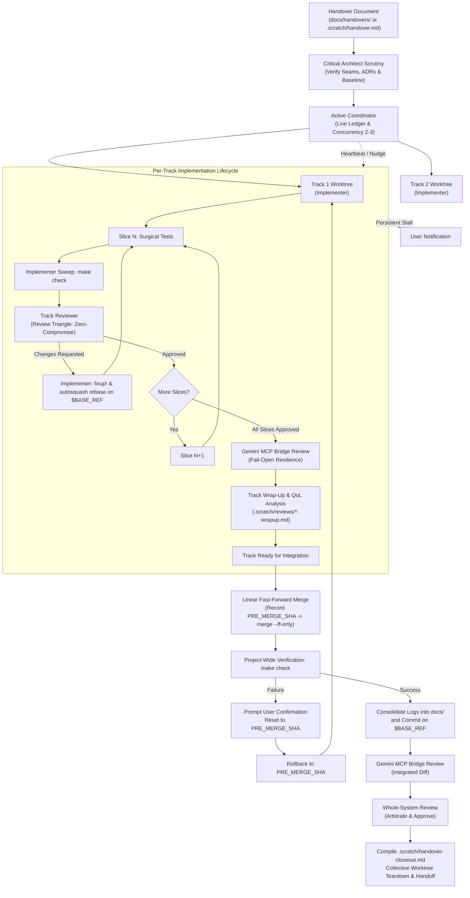

<!-- This skill coordinates multi-track implementations from a handover document, enforcing sliced atomic commits, dedicated implementer-reviewer pairings, cross-model Gemini MCP reviews, and verified integration. Compatible with Codex and Antigravity execution harnesses. -->

# Orchestrate and Implement

Use this skill when receiving a comprehensive handover document, Architecture Decision Record (ADR), or technical specification requiring multi-component implementation across independent or interdependent parallel workstreams.

## Model Roles and Environment Mappings

| Role | Codex Harness | Antigravity IDE | General / Standalone | Primary Responsibilities |
| :--- | :--- | :--- | :--- | :--- |
| **Active Coordinator** | Main session thread | Main session thread | Main session thread | Maintains orchestration, DAG formulation, live status ledger, thread heartbeats, and user communication. |
| **Critical Architect & Integration Reviewer** | Sol 6.1 (`gpt-6.1-sol`) | `inherit` or `pro` (read-only) | Frontier reasoning model (read-only) | Scrutinises handover specifications upfront, validates seams, arbitrates ADR adherence, and conducts whole-system integration reviews. |
| **Track Implementer** | Luna 6 high (`gpt-6-luna`, `high`) | `inherit` or `pro` (read/write) | Frontier reasoning model (read/write) | Implements sequential slices in `.scratch/worktrees/track-<name>`, runs surgical tests, and executes repository sweeps (`make check`). |
| **Dedicated Track Reviewer** | Sol 6.1 (`gpt-6.1-sol`) | `inherit` or `pro` (read-only) | Frontier reasoning model (read-only) | Reviews slice commits in the track against the [Review Triangle](references/review_triangle.md) in read-only mode, issuing binding approval gates. |
| **External Peer Reviewer** | Gemini 3.8 medium via `gemini_review_diff` | `gemini_review_diff` (or independent subagent) | Secondary frontier model (or fail open) | Provides orthogonal reviews via the Gemini MCP bridge (`gemini_review_diff`) at track completion and whole-system integration gates. |

### Environment Fallback Rules

* **Do**: Fall back to the active session model (`inherit`) or large reasoning model (`pro`) in Antigravity or environments where named model profiles (`gpt-6-luna`, `gpt-6.1-sol`) are unavailable.
* **Do**: Fail open if the host environment lacks the Gemini MCP bridge (`gemini_review_diff`), recording the bridge outage notice in the review receipt and proceeding with the Critical Architect as sole reviewer.
* **Don't**: Don't stall or abort implementation solely due to unavailable external model profiles or MCP bridge tooling.

---

## Core Operational Directives

### 1. Deterministic Execution and Tooling

* **Do**: Delegate deterministic tasks (AST modifications via `semedit`, syntax checks, type checks, lint formatting, test sweeps via `make check`, build caching, and git operations) to the host CPU with zero token consumption.
* **Do**: Reserve LLM cognitive capacity strictly for semantic intent, architectural trade-offs, interface decoupling, invariant codification, and substantive code review.
* **Don't**: Don't perform text replacements or ad-hoc source re-writes when deterministic CPU tooling is available.
* **Don't**: Don't waste reasoning tokens re-executing formatting or mechanical lint checks already enforced by `make check`.

### 2. Handover Scrutiny and Two-Tier Baseline Gates

* **Do**: Ingest handover specifications via repository path or inline prompt markdown (auto-saved to `.scratch/handover.md`).
* **Do**: Scrutinise acceptance criteria, failure modes, ADR alignments, and decoupling seams upfront with the Critical Architect before branching.
* **Do**: Enforce the **Initial Session Baseline Gate**: verify that `$BASE_REF` is pristine (`test -z "$(git status --porcelain)"` and `make check` passes) before creating any worktree.
* **Do**: Enforce the **Post-Merge Integration Baseline Gate**: re-verify that `$BASE_REF` is pristine and passing `make check` after every progressive track merge before consolidating logs or notifying sibling tracks.
* **Don't**: Don't branch tracks from dirty, unverified, or failing initial baselines.
* **Don't**: Don't permit circular code dependencies across parallel tracks.

### 3. Worktree Isolation and Ambient Caches

* **Do**: Place all track worktrees strictly in `.scratch/worktrees/track-<track-name>`.
* **Do**: Reuse ambient external build and module caches (`GOCACHE`, `GOMODCACHE`) residing outside the worktree.
* **Do**: Retain all track worktrees throughout progressive integration until final whole-system review approval.
* **Don't**: Don't mutate repository workspace manifests (`go.work`) or root build configurations without explicit user consent.
* **Don't**: Don't configure per-worktree caches or execute destructive cache cleanups (`go clean -modcache`) during teardown.
* **Don't**: Don't prune worktrees piecemeal upon individual track integration merges.

### 4. Slicing, Pipelining, and In-Flight Changes

* **Do**: Partition each track into standalone, compiling functional capability slices bounded by explicit logical criteria.
* **Do**: Iterate rapidly using narrow, surgical test invocations during development.
* **Do**: Run the full repository sweep (`make check`) before committing each slice.
* **Do**: Codify ADR invariants directly in tests using deterministic naming (`TestADR<XXXX>_*` or `t.Run("ADR-<XXXX>/*", ...)`) and docstring citations.
* **Do**: Pipeline forward: advance to subsequent slices immediately without idling while awaiting reviewer verdicts.
* **Do**: Handle `CHANGES REQUESTED` on an earlier slice when subsequent slices are in-flight: pause forward work, preserve uncommitted edits with a temporary WIP commit, stage fixup paths and commit as `fixup! <slice-n-summary>`, rebase downstream slices onto the corrected slice via `git rebase -i --autosquash "$BASE_REF"`, re-verify with `make check`, and resubmit.
* **Don't**: Don't slice by arbitrary line-count caps.
* **Don't**: Don't introduce broken intermediate states that fail compilation or test sweeps.
* **Don't**: Don't abandon or duplicate in-flight downstream slices when addressing review feedback.

### 5. Review Gates and Strictness Bar

* **Do**: Review every slice against the four Review Triangle pillars: Code and Tests, Code Quality, ADR Adherence, and Scope Fidelity.
* **Do**: Enforce a strict, zero-compromise review bar: issue `CHANGES REQUESTED` for any stylistic defect, ambiguous naming, imprecise comment, or lint warning.
* **Do**: Require a dedicated `fixup!` commit (or amended commit) resolving findings before slice approval.
* **Do**: Persist structured review receipts to `.scratch/reviews/`.
* **Do**: Record MCP semantic tool failures in the track-isolated log `.scratch/suboptimal-tools/<track-name>.md`.
* **Don't**: Don't approve slices with cosmetic blemishes, uncodified invariants, or deferred cleanups.
* **Don't**: Don't edit root `docs/SUBOPTIMAL_TOOLS.md` directly from parallel track worktrees.

### 6. Track Wrap-Up, Tool QoL, and Evidence Bundling

* **Do**: Execute the standard wrap-up analysis on every completed track: evaluate semantic-tool QoL (beneficial, neutral, harmful, or unknown), compare agent efficiency with built-in alternatives (`rg`, `apply_patch`), record wall-clock runtimes, and document manual edit fallbacks.
* **Do**: Save the track assessment in `.scratch/reviews/<track-name>-wrapup.md` and log manual source-edit fallbacks in `.scratch/manual-edits/<track-name>.md`.
* **Do**: Bundle all per-track wrap-up assessments, suboptimal tool entries, and manual edit fallbacks into the final delivery closeout report (`.scratch/handover-closeout.md`) so the final worktree wrap-up (`$wrap-up`) ingests pre-assembled session evidence without data loss.
* **Don't**: Don't skip track-level tool QoL and friction analysis when concluding a track.
* **Don't**: Don't defer per-track tool call reconstruction to final whole-system wrap-up.

### 7. Progressive Integration and Safe Rollback

* **Do**: Record `PRE_MERGE_SHA=$(git -C <parent-checkout> rev-parse HEAD)` before merging a track.
* **Do**: Fast-forward merge verified track branches linearly into `$BASE_REF` (`git merge --ff-only` with autosquashed fixups) to preserve bisectability.
* **Do**: Run `make check` on `$BASE_REF` *before* committing any log consolidations.
* **Do**: Enforce safe, user-confirmed rollback if post-merge verification fails: halt immediately, prompt the user for explicit confirmation to reset `$BASE_REF` to `$PRE_MERGE_SHA`, and return the track to its worktree.
* **Do**: Require sibling tracks to rebase onto updated `$BASE_REF` at their next slice boundary, with bounded local resolution (escalate to the Critical Architect on second collision).
* **Don't**: Don't run destructive git resets (`git reset --hard`) without explicit user confirmation.
* **Don't**: Don't rely on `HEAD@{1}` for rollback, which can misidentify the pre-merge commit if intervening commits exist.
* **Don't**: Don't commit log consolidations before `make check` passes on `$BASE_REF`.
* **Don't**: Don't create merge commits on `$BASE_REF`.

### 8. Gemini MCP Bridge Review and Fail-Open Policy

* **Do**: Invoke `gemini_review_diff` (`gemini-3.8-medium`) at Track Completion and Progressive Integration gates.
* **Do**: Arbitrate Gemini findings against repository ADRs with the Critical Architect, recording adopted and dismissed items in review receipts.
* **Do**: Fail open if the Gemini bridge experiences tool errors or network outages: record the outage notice in the receipt and proceed with the Critical Architect evaluation.
* **Don't**: Don't stall or abort the implementation workflow on external bridge outages.
* **Don't**: Don't adopt speculative external review findings that breach repository ADR contracts.

### 9. Follow-Up Routing and Abort Protocol

* **Do**: Route follow-ups non-disruptively through the global reviewer, slicing work before track dispatch.
* **Do**: Advance the existing `track/<track-name>` branch by rebasing onto updated `$BASE_REF` in the retained worktree for follow-up slices.
* **Do**: Retain valid integrated slices on `$BASE_REF` when abandoning an in-flight track (forward ratchet), dispatching cleanup slices for stubs.
* **Do**: Record all scope adjustments, rebase choices, and track aborts in the *Specification Deviations Log*.
* **Don't**: Don't pause in-flight implementer threads for follow-up triage.
* **Don't**: Don't create fragmented child branches (such as `track/<name>-followup`).
* **Don't**: Don't revert valid integrated slices when abandoning an incomplete track.

### 10. Coordinator Oversight and Concurrency

* **Do**: Maintain an authoritative live status table in `.scratch/orchestration-status.md`.
* **Do**: Bound parallel track execution to 2-3 concurrent worktrees.
* **Do**: Nudge quiescent threads after 5 minutes; alert the user if stalls persist after 3 further minutes.
* **Don't**: Don't launch unconstrained parallel tracks that exhaust CPU, memory, or reviewer attention.
* **Don't**: Don't allow stalled threads to idle without automated intervention.

### 11. Handoff to Wrap-Up and Terminal Fallback

* **Do**: Present the delivery closeout report (`.scratch/handover-closeout.md`) and request explicit user confirmation to conclude.
* **Do**: Delegate to `$wrap-up` if installed, passing pre-bundled session evidence to finalize logs, merge `$BASE_REF` into local `main`, and archive the thread.
* **Do**: Execute terminal fallback steps directly if `$wrap-up` is absent (run `make check`, fast-forward merge `$BASE_REF` into `main`, delete track worktrees, and summarize results).
* **Don't**: Don't leave orphan worktrees or unmerged base references upon session conclusion.

---

## Architecture and Lifecycle



---

## Execution Workflow Steps

### Step 1: Ingest Handover Specification and Verify Seams

1. **Ingest Specification**: Ingest the specification from a committed path (e.g. [`docs/handovers/LUNA_HANDOVER_REFACTORING_TAXONOMY.md`](file:///Users/alessandro/sources/semantic-editor/docs/handovers/LUNA_HANDOVER_REFACTORING_TAXONOMY.md)) or write inline prompt markdown to `.scratch/handover.md`.
2. **Architectural Scrutiny**: The Critical Architect verifies functional requirements, acceptance criteria, ADR alignment, and decoupling seams.
3. **Clearance**: Issue formal track boundaries and DAG sequencing to the coordinator thread.

### Step 2: Formulate DAG and Partition Slices

1. **Map Dependencies**: Map package imports and concrete code dependencies using `go list -f '{{.ImportPath}}: {{.Imports}}' ./...`.
2. **Partition Slices**: Partition tracks into ordered, committable functional capability slices, each with defined targets, surgical test commands, and observable invariants.
3. **Queue Tracks**: Queue independent tracks for immediate execution; place dependent tracks in `PENDING` until interface contracts integrate.

### Step 3: Provision Worktrees and Spawn Threads

1. **Initial Baseline Gate**: Confirm `$BASE_REF` is pristine before initialising any worktree:

   ```sh
   test -z "$(git status --porcelain)" && make check
   ```

   Halt immediately if dirty or failing.
2. **Add Worktrees**: Create isolated worktrees in `.scratch/worktrees/track-<name>` branching from `$BASE_REF`:

   ```sh
   git worktree add -b "track/<track-name>" ".scratch/worktrees/track-<track-name>" "$BASE_REF"
   ```

3. **Leverage Ambient Caches**: Transparently reuse external caches (`GOCACHE`, `GOMODCACHE`).
4. **Spawn Threads**: Launch Implementer and Track Reviewer using mapped environment profiles.
5. **Initialise Ledger**: Record initial states in `.scratch/orchestration-status.md`.

### Step 4: Implement Slices with Surgical Iteration and Pipelining

1. **Implement & Test**: Implement slice modifications, codify ADR invariants in tests (`TestADR<XXXX>_*`), and verify using surgical test commands.
2. **Execute Sweep**: Run the complete repository sweep (`make check`).
3. **Commit**: Stage only the assigned slice targets and commit with a descriptive message:

   ```sh
   git add <slice-target-paths> && git commit -m "<track-name>: <slice-summary>"
   ```

4. **Pipeline**: Submit diff to Track Reviewer and advance to subsequent slices immediately without idling.
5. **In-Flight Review Handling**: If the reviewer requests changes for Slice $N$ while Slice $N+1$ is in progress: pause forward work, isolate and commit uncommitted edits belonging to Slice $N+1$ via a targeted WIP commit (`git add <slice-n+1-target-paths> && git commit -m "wip: slice-<n+1> in-flight"`), stage the fixup changes and commit as a targeted fixup (`git add <slice-n-fix-paths> && git commit -m "fixup! <slice-n-summary>"`), rebase the track branch via `git rebase -i --autosquash "$BASE_REF"`, optionally uncommit the WIP commit via `git reset HEAD~1`, re-verify with `make check`, and resubmit.
6. **Log Tool Defects**: Record any MCP tool errors in `.scratch/suboptimal-tools/<track-name>.md`.

### Step 5: Execute Track Review Gate

1. **Inspect Review Triangle**: Track Reviewer evaluates Code and Tests, Code Quality, ADR Adherence, and Scope Fidelity.
2. **Issue Verdict**: Record structured verdict to `.scratch/reviews/<track-name>-slice-<id>.md`:
   * **CHANGES REQUESTED**: Mandate fixups for any stylistic, naming, comment, or structural flaw.
   * **APPROVED**: Slice accepted and locked.

### Step 6: Track Completion, Gemini Review, and Track Wrap-Up Analysis

1. **Pre-Integration Sweep**: Confirm all track slices are `APPROVED` and run `make check` inside the worktree.
2. **Execute Track Wrap-Up Analysis**: Run the standard session wrap-up analysis on the completed track:
   * Assess semantic tool QoL (beneficial, neutral, harmful, or unknown), compare agent efficiency with built-in alternatives (`rg`, `apply_patch`), and record wall-clock runtimes.
   * Document manual source-edit fallbacks in `.scratch/manual-edits/<track-name>.md`.
   * Save the completed track wrap-up receipt to `.scratch/reviews/<track-name>-wrapup.md`.
3. **Gemini Review**: Invoke `gemini_review_diff` (`gemini-3.8-medium`) on the track worktree. Arbitrate findings against ADRs, failing open if the bridge tool is unavailable.
4. **Resolve**: Address genuine findings via corrective slices before integration.

### Step 7: Progressive Linear Integration and Safe Rollback

1. **Capture Pre-Merge Commit**: Record the clean integration commit on `$BASE_REF`:

   ```sh
   PRE_MERGE_SHA=$(git -C <parent-checkout> rev-parse HEAD)
   ```

2. **Fast-Forward Merge**: Merge the track branch into `$BASE_REF` using `git merge --ff-only` (with autosquashed fixups).
3. **Post-Merge Integration Baseline Gate**: Run project-wide tests across the combined `$BASE_REF`:

   ```sh
   make check
   ```

4. **Safe User-Confirmed Rollback on Failure**: If verification fails:
   * Prompt the user for explicit confirmation: `"Integration verification failed on $BASE_REF. May I reset $BASE_REF to $PRE_MERGE_SHA?"`
   * Upon explicit confirmation, reset `$BASE_REF` to `$PRE_MERGE_SHA`:

     ```sh
     git -C <parent-checkout> reset --hard "$PRE_MERGE_SHA"
     ```

   * Return the incoming track to its worktree to diagnose and resolve the regression.
5. **Consolidate Logs**: Once `make check` passes, merge `.scratch/suboptimal-tools/<track-name>.md` into `docs/SUBOPTIMAL_TOOLS.md` and `.scratch/manual-edits/<track-name>.md` into `docs/MANUAL_EDITS.md` on `$BASE_REF`, and commit.
6. **Notify Siblings**: Direct active sibling tracks to rebase onto updated `$BASE_REF` at their next slice boundary.

### Step 8: Whole-System Integration Review

1. **Integrated Gemini Review**: Call `gemini_review_diff` on the integrated checkout.
2. **System Triangle Review**: Critical Architect inspects cumulative diffs, cross-component cohesion, and regression safety.
3. **Record Verdict**: Write integration receipt to `.scratch/reviews/integration-step-<id>.md`.

### Step 9: Follow-Up Routing and Continuity

1. **Centralised Triage**: Global reviewer triages follow-ups against ADRs and slices assignments non-disruptively.
2. **Branch Continuity**: Implementers advance the existing `track/<track-name>` branch by rebasing onto updated `$BASE_REF` in the retained worktree.
3. **Track Abort Protocol**: Retain valid integrated slices on `$BASE_REF` (forward ratchet), dispatch stub cleanup slices, and record rationale in the deviations log.

### Step 10: Collective Worktree Teardown

1. **Decommission Worktrees**: After whole-system review approval, prune all track worktrees collectively:

   ```sh
   git worktree remove ".scratch/worktrees/track-<track-name>"
   git branch -d "track/<track-name>"
   ```

2. **Retain Caches**: Leave shared build and module caches untouched.

### Step 11: Final Presentation, Closeout Bundling, and Wrap-Up Handoff

1. **Bundle Track Analyses into Closeout Artifact**: Compile `.scratch/handover-closeout.md`, consolidating:
   * Cumulative git diff statistics and integrated commit log on `$BASE_REF`.
   * Bundled per-track wrap-up QoL assessments (`.scratch/reviews/*-wrapup.md`), tool runtime comparisons, and net agent-efficiency conclusions.
   * Project-wide verification proofs (`make check`, txtar scripts, and benchmark sweeps).
   * Review receipts links from `.scratch/reviews/`.
   * The complete **Specification Deviations and Architectural Choices Log**.
2. **Confirm with User**: Present summary and clickable file link (`file://.../.scratch/handover-closeout.md`) to the user for explicit sign-off.
3. **Handoff Execution**:
   * **Installed `$wrap-up` Skill**: Call or recommend `$wrap-up` to ingest pre-bundled assessments from `.scratch/handover-closeout.md`, merge `$BASE_REF` into local `main`, archive the chat, and remove scratch artifacts.
   * **Fallback (Skill Absent)**: Execute terminal steps directly (verify `make check` on `$BASE_REF`, merge `$BASE_REF` into `main` via `git merge --ff-only`, delete track worktrees, and report completion).
