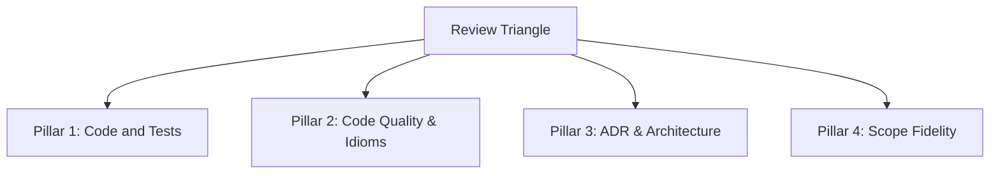

# The Review Triangle Protocol

This reference operationalises the review framework across Track Reviewers, the Integration Reviewer, and the Gemini Model Context Protocol (MCP) bridge across Codex and Antigravity environments.

---

## Model Roles and Environment Mappings

* **Track Implementer**: Luna 6 high (`gpt-6-luna`, `high`) in Codex; `inherit` or `pro` in Antigravity. Implements slices, runs surgical tests, executes repository sweeps (`make check`), and pipelines forward work continuously.
* **Track Reviewer**: Sol 6.1 (`gpt-6.1-sol`) in Codex; `inherit` or `pro` in Antigravity (read-only mode). Reviews commits against the four pillars without repeating `make check`. Serves as the quality gate.
* **External Peer Reviewer**: Gemini 3.8 medium (`gemini-3.8-medium`) via `gemini_review_diff`. Provides orthogonal cross-model verification at Track Completion and Progressive Integration gates; fails open if the tool is unavailable.
* **Critical Architect & Integration Reviewer**: Sol 6.1 (`gpt-6.1-sol`) in Codex; `inherit` or `pro` in Antigravity (read-only mode). Scrutinises specifications upfront, enforces baseline gates, and performs whole-system integration reviews of cumulative diffs on `$BASE_REF`.

---

## Handover Scrutiny (Critical Architect Gate)

Before initialising track worktrees or writing source code:

* **Do**: Scrutinise handover specifications for explicit acceptance criteria, functional requirements, and unambiguous failure modes.
* **Do**: Establish clear decoupling seams (interfaces, package boundaries, data contracts) that prevent merge collisions and circular code dependencies.
* **Do**: Verify alignment with repository Architecture Decision Records (ADRs).
* **Do**: Confirm that each track permits decomposition into compiling, committable functional capability slices.
* **Don't**: Don't grant clearance to ambiguous specifications or circular package dependency graphs.

---

## The Four Evaluation Pillars



### Pillar 1: Code and Tests (Handover and ADR Assertion Fidelity)

The host CPU verifies compilation, formatting, and lint rules via `make check`. Reviewers evaluate substantive test validation:

* **Do**: Verify that test assertions validate explicit functional capabilities and invariants specified in the handover and referenced ADRs.
* **Do**: Assert externally observable behaviour, input-output contracts, and state transformations.
* **Do**: Cover negative test cases, invalid parameters, schema violations, and intentional refusal pathways.
* **Do**: Enforce contextual Go error wrapping (`fmt.Errorf("...: %w", err)`) and inspections with `errors.Is` / `errors.As`.
* **Do**: Preserve nil vs empty collection distinctions.
* **Don't**: Don't accept tautological tests that merely assert `err == nil` or execute code without inspecting output structure.
* **Don't**: Don't rely on shallow mocks or private-internal tests that pass on broken production behaviour.
* **Don't**: Don't silently swallow errors or convert failed external calls into empty results.

### Pillar 2: Code Quality, Idioms, and Semantic Deduplication

Linters detect syntactic clones; reviewers detect structural and semantic duplication:

* **Do**: Enforce idiomatic patterns for the language version (e.g. structured serialisation over manual string concatenation).
* **Do**: Eradicate transitional legacy wrappers, dead code paths, obsolete flags, and temporary shims (Zero Cruft Invariant).
* **Do**: Require top-of-file comments explaining purpose, and comment non-obvious constraints (the why, not the what).
* **Do**: Consolidate parallel state machines, error dispatchers, and duplicate parsing logic into shared domain components.
* **Do**: Enforce a zero-compromise review bar: issue `CHANGES REQUESTED` for any stylistic defect, ambiguous naming, imprecise comment, or lint warning, requiring a dedicated `fixup!` commit before slice approval.
* **Do**: Record any MCP tool failure or manual text workaround on AST code in the track-isolated log `.scratch/suboptimal-tools/<track-name>.md`.
* **Don't**: Don't defer cleanups, comment polish, or naming refinements to subsequent slices.
* **Don't**: Don't permit duplicate domain structs, interfaces, or enumerations representing the same entity.
* **Don't**: Don't allow manual string concatenation when generating structured JSON, YAML, or SQL payloads.

### Pillar 3: ADR and Architecture Adherence (Scope-Partitioned)

Enforce strict compliance with Architecture Decision Records (ADRs) partitioned by scope:

* **Do**: Enforce `code`-scoped ADRs in production source code:
  * Schema and parameter harmonisation (ADR-0007, ADR-0055, ADR-0065).
  * Atomic disk write semantics (temporary file to `fsync` to `os.Rename`) with advancing `mtime` (ADR-0010).
  * Workspace safety: never create unapproved `go.work` modifications (ADR-0005).
  * Fail-closed refusals for ambiguous syntactic patterns (ADR-0011, ADR-0056).
* **Do**: Enforce `test`-scoped ADRs in test suites:
  * Comparable CLI txtar scenario tests across supported backends (ADR-0028).
  * Exhaustive assertions reporting all independent failures (ADR-0033).
  * Fixture and oracle isolation from harness dependencies (ADR-0040).
* **Do**: Codify ADR invariants directly in test code using deterministic naming and docstring citations:
  * Functions: `TestADR<XXXX>_<InvariantName>` (e.g. `TestADR0010_AtomicDiskWrite`).
  * Subtests: `t.Run("ADR-<XXXX>/<InvariantName>", ...)`.
  * Docstrings: cite the ADR number and summarise the invariant to enable deterministic sweeps (`go test -run "ADR0010"`).
* **Don't**: Don't allow speculative mutations or unmodelled syntax to bypass fail-closed refusals.
* **Don't**: Don't rely on prose-only test documentation without deterministic test names.

### Pillar 4: Assignment and Scope Fidelity

* **Do**: Keep code modifications strictly within assigned packages, interfaces, and file boundaries.
* **Do**: Confirm that every requirement in the slice assignment is verifiable in code, documentation, or tests.
* **Don't**: Don't perform speculative refactorings on unrelated subsystems.
* **Don't**: Don't introduce unassigned feature expansions.

---

## Gemini MCP Bridge Review Protocol

### Gate A: Prior to Track Completion

1. Ensure the track branch passes `make check` and all slices have `APPROVED` verdicts.
2. Invoke `gemini_review_diff`:
   * `model`: `"gemini-3.8-medium"`
   * `repository_path`: `".scratch/worktrees/track-<track-name>"`
   * `prompt`: Track goals, acceptance criteria, ADR invariants, and completed diff summary.
3. Arbitrate findings with Sol 6.1 against ADRs: adopt genuine defects, and record any overruled items with explicit rationale in the review receipt.
4. Implement fixes via Luna 6 high, verify with `make check`, and re-review before integration.

### Gate B: Progressive Integration Review

1. Integrate track branch into `$BASE_REF` and execute `make check`.
2. Invoke `gemini_review_diff` on the parent checkout with `model: "gemini-3.8-medium"`.
3. The Integration Reviewer (`sol 6.1`) synthesises Gemini's findings into the whole-system review receipt.

### Bridge Resilience (Fail-Open Policy)

* **Do**: Fail open if the Gemini bridge encounters tool errors or network timeouts: proceed with Sol 6.1 as sole reviewer.
* **Do**: Record the outage notice `[Bridge Unavailable - Failed Open]` and error reason in the review receipt.
* **Don't**: Don't stall or block track integration on external bridge failures.

---

## Specification Deviations Log

When discovering missing edge cases, unmodelled syntax, or specification gaps:

* **Do**: Flag the gap immediately and seek Critical Architect (`sol 6.1`) authorization.
* **Do**: Record authorised deviations, architectural choices, and track abort decisions in the *Specification Deviations and Architectural Choices Log*.
* **Do**: Present the log to the user for explicit confirmation at the final integration gate before delegating to `$wrap-up`.
* **Don't**: Don't alter system contracts or decoupling seams without Critical Architect approval.

---

## Track Wrap-Up and Quality-of-Life Analysis Protocol

When concluding a track prior to integration, execute the standard session wrap-up analysis to preserve granular tool evidence:

### Evaluation Steps

1. **Tool Call Inventory**: Enumerate all `semantic_*` operations invoked during the track from thread logs or via `skills/wrap-up/scripts/extract_semantic_calls.py`.
2. **QoL Rating**: Assess each attempt as beneficial, neutral, harmful, or unknown, identifying intent, outcome, effort avoided, and friction introduced.
3. **Efficiency Comparison**: Identify the local built-in alternative (e.g. `rg` + file read, `apply_patch` + checks), comparing tool-call count, round trips, retries, and context volume.
4. **Runtime Measurement**: Record wall-clock runtimes in milliseconds or seconds for both semantic and built-in workflows (or mark `unavailable: <reason>`).
5. **Manual Edit Fallbacks**: Record any manual source-edit fallbacks or capability gaps in `.scratch/manual-edits/<track-name>.md`.
6. **Track Assessment Receipt**: Write the structured report to `.scratch/reviews/<track-name>-wrapup.md` following the [wrap-up template](file:///Users/alessandro/sources/semantic-editor/skills/wrap-up/SKILL.md#L49-L65).

### Directives

* **Do**: Execute the QoL and runtime analysis at track completion while memory and subagent logs are fresh.
* **Do**: Bundle all track assessments into `.scratch/handover-closeout.md` during final closeout so `$wrap-up` ingests pre-assembled session evidence.
* **Don't**: Don't invent token or time savings; record measured numbers or mark unavailable with a concrete reason.
* **Don't**: Don't defer track-level tool analysis to the end of the entire multi-track implementation.

---

## Pipelining and In-Flight Changes Requested Protocol

When an implementer submits Slice $N$ ($C_N$) and begins work on Slice $N+1$ ($C_{N+1}$), a review verdict of `CHANGES REQUESTED` on Slice $N$ executes as follows:

1. **Preserve Uncommitted Work**: If Slice $N+1$ contains uncommitted edits in the working tree, commit them as a temporary work-in-progress commit to ensure a clean working copy. Stage only the target paths assigned to Slice $N+1$ rather than using broad additions:

   ```sh
   git add <slice-n+1-target-paths> && git commit -m "wip: slice-<n+1> in-flight"
   ```

2. **Commit Slice $N$ Fixup**: Implement the required corrections for Slice $N$, stage the modified paths, and record a targeted fixup commit:

   ```sh
   git add <slice-n-fix-paths> && git commit -m "fixup! <slice-n-summary>"
   ```

3. **Autosquash Rebase across Track Base**: Rebase the entire track branch against the integration parent base `$BASE_REF` (or `<slice-n-sha>~1`) rather than an arbitrary commit count:

   ```sh
   git rebase -i --autosquash "$BASE_REF"
   ```

   This guarantees that Git squashes the fixup directly into Slice $N$ regardless of how many downstream or WIP commits exist, cleanly replaying all subsequent slices on top.

4. **Restore In-Flight Working State**: If creating a temporary WIP commit for Slice $N+1$, optionally restore the working copy edits via:

   ```sh
   git reset HEAD~1
   ```

   Alternatively, retain the commit and continue implementation on top of it.

5. **Re-Verification Sweep**: Execute surgical tests for Slice $N$ and downstream slices, run `make check`, and resubmit the updated Slice $N$.

---

## Reviewer Decision Protocol

Reviewers record structured receipts under `.scratch/reviews/`:

* Slices: `.scratch/reviews/<track-name>-slice-<slice-id>.md`
* Track completion: `.scratch/reviews/<track-name>-completion.md`
* Integration: `.scratch/reviews/integration-step-<integration-step-id>.md`

The reviewer issues `CHANGES REQUESTED` if any finding across Pillars 1 to 4 requires refinement:

```markdown
### Review Verdict: [APPROVED | CHANGES REQUESTED]

#### 1. Code and Tests (Handover & ADR Assertion Fidelity)
- Status: [Satisfied | Deficient]
- Findings: <Traceability to criteria, non-tautological assertions, edge/negative cases>

#### 2. Code Quality, Idioms, and Semantic Deduplication
- Status: [Satisfied | Deficient]
- Findings: <Idiomatic compliance, cruft elimination, absence of logical/semantic duplication>

#### 3. ADR and Architecture (Scope-Partitioned & Invariants Codified)
- Status: [Satisfied | Deficient]
- Findings: <Code scope ADR adherence, Test scope ADR adherence, Codified invariant citations>

#### 4. Assignment and Scope Fidelity
- Status: [Satisfied | Deficient]
- Findings: <Coverage of slice requirements, absence of scope creep>

#### 5. Gemini MCP Bridge Findings & Arbitration
- Status: [Concur | Deficiencies Adopted | Findings Dismissed With Rationale | Bridge Unavailable - Failed Open | N/A]
- Findings: <External review findings from Gemini 3.8 medium, or tool outage notice>
- Overruled Items: <Detailed rationale and ADR citation for any dismissed Gemini findings>

#### 6. Specification Deviations & Conflict Resolutions
- Status: [None | Recorded and Authorised]
- Log Entries: <Deviations from handover spec, rebase conflict choices, or seam adjustments>

#### Action Items and Follow-Up Work
1. <Concrete requirement with code coordinates>
2. <Concrete requirement with code coordinates>
```
