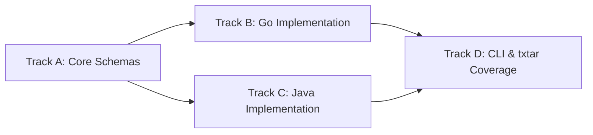

# Worktree and Dependency DAG Protocol

This reference operationalises dependency analysis, execution Directed Acyclic Graphs (DAGs), sandboxed Git worktrees, progressive linear integration, and live state tracking across Codex and Antigravity environments.

---

## 1. Analysing Dependencies and Constructing the DAG



### Dual-Axis Decomposition

* **Logical Axis**: Separate architectural tiers: Models/Types $\to$ Backend Engines $\to$ Registry/Dispatch $\to$ CLI/Handlers $\to$ Documentation.
* **Code Dependency Axis**: Inspect package imports via `go list -f '{{.ImportPath}}: {{.Imports}}' ./...`. Map symbol dependencies and decouple via interfaces.

### Handover Specification Ingestion (Dual Mode)

* **Committed Path**: Ingest an existing document (e.g. [`docs/handovers/LUNA_HANDOVER_REFACTORING_TAXONOMY.md`](file:///Users/alessandro/sources/semantic-editor/docs/handovers/LUNA_HANDOVER_REFACTORING_TAXONOMY.md)).
* **Inline Prompt Markdown**: Automatically write prompt specifications to `.scratch/handover.md` prior to DAG analysis.

### Directives for DAG and Slicing

* **Do**: Partition slices strictly by logical acceptance criteria and functional capabilities.
* **Do**: Ensure every slice delivers a compiling, verified, and observable capability advancing the track.
* **Do**: Queue independent tracks for immediate execution; set dependent tracks to `PENDING` until contracts integrate.
* **Don't**: Don't slice by arbitrary line counts.
* **Don't**: Don't permit circular package dependencies across tracks.

---

## 2. Worktree Provisioning and Two-Tier Baseline Gates

All worktrees reside strictly in `.scratch/worktrees/track-<track-name>`.

### Initial Session Baseline Gate vs Post-Merge Integration Baseline Gate

1. **Initial Session Baseline Gate (Evaluated Once at Startup)**:
   * Discover base reference:

     ```sh
     BASE_REF=$(git rev-parse --abbrev-ref HEAD)
     ```

   * Verify pristine baseline before branching:

     ```sh
     test -z "$(git status --porcelain)" && make check
     ```

   * Halt immediately if uncommitted changes or test/lint failures exist. Worktrees are never created from dirty or failing baselines.
2. **Post-Merge Integration Baseline Gate (Evaluated After Each Track Merge)**:
   * Re-verify `make check` on `$BASE_REF` immediately following each progressive track merge before consolidating logs or notifying sibling tracks.

### Provisioning Worktrees

* **Do**: Branch worktrees strictly from verified `$BASE_REF`:

   ```sh
   git worktree add -b "track/<track-name>" ".scratch/worktrees/track-<track-name>" "$BASE_REF"
   ```

* **Do**: Reuse ambient external build and module caches (`GOCACHE`, `GOMODCACHE`).
* **Do**: Export external cache pointers for direct tool invocations outside `make`:

   ```sh
   SHARED_CACHE_ROOT=${GO_CACHE_ROOT:-$(bash tools/go-cache-root.sh .)}
   export GOCACHE="${GOCACHE:-$SHARED_CACHE_ROOT/build}"
   export GOMODCACHE="${GOMODCACHE:-$SHARED_CACHE_ROOT/mod}"
   ```

* **Do**: Isolate volatile runtime directories inside `.scratch/worktrees/track-<track-name>/.scratch/go`.
* **Don't**: Don't branch tracks from dirty, failing, or uncommitted working trees.
* **Don't**: Don't configure per-worktree caches or duplicate dependency downloads.
* **Don't**: Don't mutate repository manifests (`go.work`).

---

## 3. Append-Only Commit Pipelining and In-Flight Review Handling

* **Do**: Run surgical test commands during development:

   ```sh
   go test -v -run <TestName> ./<package-path>
   ```

* **Do**: Run the full repository sweep (`make check`) before committing each slice.
* **Do**: Commit slices with descriptive messages detailing the improvement:

   ```sh
   git add <slice-target-paths> && git commit -m "<track-name>: <slice-summary>"
   ```

* **Do**: Pipeline forward: submit commit SHA to Track Reviewer and advance immediately to Slice $N+1$ without idling.
* **Do**: Handle `CHANGES REQUESTED` on Slice $N$ while Slice $N+1$ is in progress:
   1. Pause forward work on Slice $N+1$.
   2. If Slice $N+1$ contains uncommitted edits, commit them as a temporary work-in-progress commit (`git add <slice-n+1-target-paths> && git commit -m "wip: slice-<n+1> in-flight"`).
   3. Stage the fixup paths and commit fixes for Slice $N$ as a targeted fixup commit:

      ```sh
      git add <slice-n-fix-paths> && git commit -m "fixup! <slice-n-summary>"
      ```

   4. Rebase across the track branch against `$BASE_REF` (or `<slice-n-sha>~1`):

      ```sh
      git rebase -i --autosquash "$BASE_REF"
      ```

   5. If creating a temporary WIP commit, optionally restore the working copy edits via `git reset HEAD~1`.
   6. Re-verify both slices via surgical tests and `make check`, then resubmit Slice $N$.
* **Do**: Record MCP tool failures or manual text edits in `.scratch/suboptimal-tools/<track-name>.md`.
* **Don't**: Don't idle while awaiting review verdicts.
* **Don't**: Don't leave fixup commits un-autosquashed prior to track integration.
* **Don't**: Don't edit root `docs/SUBOPTIMAL_TOOLS.md` directly from parallel track worktrees.

---

## 4. Progressive Linear Integration and Safe Rollback

When a track finishes all slices and passes Gemini review:

1. **Verify Clean Worktree**: Confirm the track working tree is clean:

   ```sh
   test -z "$(git -C <track-worktree> status --porcelain)"
   ```

2. **Record Pre-Merge SHA**: Capture the pre-merge commit of `$BASE_REF` before modifying it:

   ```sh
   PRE_MERGE_SHA=$(git -C <parent-checkout> rev-parse HEAD)
   ```

3. **Linear Fast-Forward Merge**: Merge into `$BASE_REF` (with autosquashed fixups):

   ```sh
   git -C <parent-checkout> merge --ff-only "track/<track-name>"
   ```

4. **Post-Merge Integration Baseline Verification**: Run project-wide tests across `$BASE_REF` *before* committing any log consolidations:

   ```sh
   make check
   ```

5. **Safe User-Confirmed Rollback on Failure**: If `make check` detects any regression across the combined workspace:
   * Prompt the user for explicit confirmation:
     `"Integration check failed on $BASE_REF. May I reset $BASE_REF to pre-merge commit $PRE_MERGE_SHA?"`
   * Only upon explicit user confirmation, reset `$BASE_REF` to `$PRE_MERGE_SHA`:

     ```sh
     git -C <parent-checkout> reset --hard "$PRE_MERGE_SHA"
     ```

   * Return the incoming track to its isolated worktree to diagnose the failure, implement corrective slices, and re-clear the verification gate.
6. **Consolidate Logs**: Once `make check` passes cleanly, merge `.scratch/suboptimal-tools/<track-name>.md` into `docs/SUBOPTIMAL_TOOLS.md` and `.scratch/manual-edits/<track-name>.md` into `docs/MANUAL_EDITS.md` on `$BASE_REF`, and commit.
7. **Sibling Track Rebase**: Active sibling tracks rebase onto updated `$BASE_REF` at their next slice boundary:

   ```sh
   git -C ".scratch/worktrees/track-<sibling>" rebase "$BASE_REF"
   ```

   * Implementers resolve local conflicts and verify with `make check`.
   * If a structural seam collision persists after one attempt, escalate to the Critical Architect.
   * Record conflict resolution choices in the slice commit notes.

---

## 5. Follow-Up Continuity and Forward Ratchet Abort

### Follow-Up Branch Continuity in Retained Worktrees

* **Do**: Rebase the existing `track/<track-name>` branch directly onto updated `$BASE_REF` in the retained worktree:

   ```sh
   git -C ".scratch/worktrees/track-<track-name>" fetch . "$BASE_REF"
   git -C ".scratch/worktrees/track-<track-name>" rebase "$BASE_REF"
   ```

* **Do**: Execute follow-up slices with standard surgical tests, `make check`, and Track Review before fast-forward merging.
* **Don't**: Don't provision fragmented child branches (such as `track/<name>-followup`).

### Track Abort and Forward Ratchet Protocol

* **Do**: Retain valid integrated slices on `$BASE_REF` (forward ratchet) when abandoning an in-flight track.
* **Do**: Dispatch a targeted cleanup slice to prune, deprecate, or isolate dangling stubs.
* **Do**: Log the abort rationale, affected symbols, and retained commits in the *Specification Deviations Log*.
* **Don't**: Don't revert valid integrated slices when abandoning an incomplete track.

---

## 6. Collective Worktree Teardown and Wrap-Up Handoff

* **Do**: Retain all track worktrees throughout progressive integration for regression triage and diff verification.
* **Do**: Decommission all track worktrees collectively only after whole-system review approval:

   ```sh
   git worktree remove ".scratch/worktrees/track-<track-name>"
   git branch -d "track/<track-name>"
   ```

* **Do**: Leave shared module and build caches untouched.
* **Do**: Verify zero orphan worktrees remain:

   ```sh
   git worktree list --porcelain
   ```

* **Do**: Compile the delivery closeout report at `.scratch/handover-closeout.md`, consolidating all per-track wrap-up receipts (`.scratch/reviews/*-wrapup.md`), tool runtime comparisons, and net efficiency findings for explicit user sign-off.
* **Do**: Hand off to `$wrap-up` if installed, passing pre-bundled session evidence to finalize logs, merge `$BASE_REF` into `main`, and archive the chat.
* **Do**: Execute terminal fallback steps if `$wrap-up` is absent (verify `make check`, fast-forward merge `$BASE_REF` into `main`, remove track worktrees, and summarize results).
* **Don't**: Don't prune worktrees piecemeal during progressive integration.
* **Don't**: Don't execute destructive cache cleanups (`go clean -modcache`).

---

## 7. Coordinator Heartbeats and Stall Recovery

* **Do**: Inspect thread health periodically via `git log -1 --stat`, subagent message queues, and `git status --porcelain`.
* **Do**: Nudge quiescent threads with a continuation prompt after 5 minutes of total inactivity or 2 repeated error loops.
* **Do**: Alert the user with structured diagnostics (track, role, slice, error, and remediation choices) if a stall persists for 3 minutes after prompting.
* **Don't**: Don't allow quiescent or looping threads to idle indefinitely without intervention.

---

## 8. Live Orchestration State Ledger

Maintain an authoritative ledger in `.scratch/orchestration-status.md`, updated on every slice transition, rebase, and integration milestone:

```markdown
| Track ID | Worktree & Branch | Active Slice | Slice State | Track State | Integrated Slices | Blockers / Action Items |
| :--- | :--- | :--- | :--- | :--- | :--- | :--- |
| `track-schemas` | `.scratch/worktrees/track-schemas` (`track/schemas`) | `slice-2-validation` | `IN_PROGRESS` | `ACTIVE` | `slice-1-models` (`a1b2c3d`) | None |
| `track-go-engine` | `.scratch/worktrees/track-go-engine` (`track/go-engine`) | `slice-1-ast` | `APPROVED` | `READY_FOR_INTEGRATION` | None | Gemini MCP Bridge Review |
| `track-cli` | `.scratch/worktrees/track-cli` (`track/cli`) | `slice-1-wiring` | `PENDING` | `PROVISIONED` | None | Blocked on `track-schemas` integration |
```

### State Enums

* **Track State**: `PROVISIONED` $\to$ `ACTIVE` $\to$ `AWAITING_REVIEW` $\to$ `REBASING` $\to$ `READY_FOR_INTEGRATION` $\to$ `INTEGRATED` (or `ABORTED`).
* **Slice State**: `PENDING` $\to$ `IN_PROGRESS` $\to$ `COMMITTED` $\to$ `CHANGES_REQUESTED` $\to$ `APPROVED` $\to$ `INTEGRATED`.
