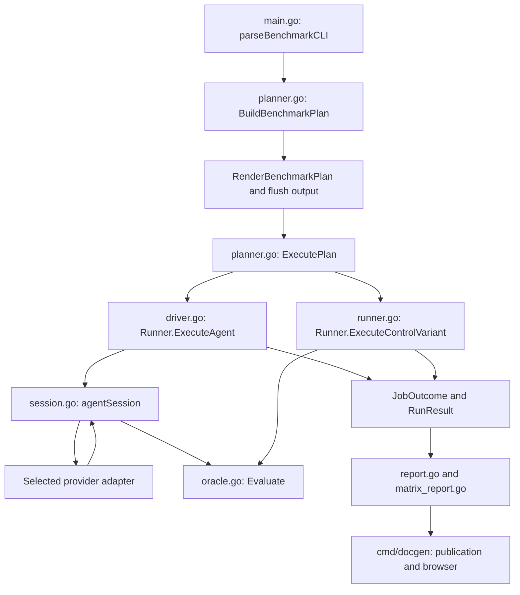

<!-- Maps benchmark ownership and measurement contracts to implementation and verification. -->

# Benchmark harness architecture

Start here when changing the benchmark harness. This guide maps the current implementation to its responsibilities, contracts, and regression tests. Update it when ownership or entry points move. [ADR-0050](../../docs/adr/0050-benchmark-planning-sessions-and-arm-policy.md) records the accepted design and invariants; this file records where to implement them.

## Execution flow

All benchmark runs follow the same planning and scheduling path. Listing, fixture extraction, and standalone oracle evaluation are command-line utilities outside that execution path.



`main.go:executeBenchmarkPlan` connects these components. Read that function first to trace a complete invocation. For an individual agent job, continue at `driver.go:Runner.ExecuteAgent`. The `task-00-hi-overhead` fixture has no source files and uses `disallowed_files: ["*"]` to require no workspace changes. The single-file `task-12-rename-scale-*` fixtures measure 1, 2, 4, 8, and 16 coordinated method renames under one task contract. The `task-12-rename-scale-05-multifile` fixture asks for five renames in one turn, with call sites in separate files and batching permitted. Compare paired arms within each edit count; the no-op probe is an overhead diagnostic, not the intercept of an edit-count fit. The `task-13-rename-followup-scale` fixture uses one continuing session: the first prompt makes one edit, then four follow-ups reach cumulative totals of 2, 4, 8, and 16. Each checkpoint has an exact-state oracle.

### Task complexity profiles and evaluation axes

Rather than using an opaque scalar difficulty score, each benchmark fixture has an explicit 7-axis complexity profile scored on a 5-dot scale (`●○○○○` to `●●●●●`) codified in [ADR-0044](../../docs/adr/0044-benchmark-experiment-dimensions-and-result-semantics.md). Each axis targets specific strengths and failure modes of LLM coding agents:

| Dimension | Why It Matters / Agent Dynamics | Vanilla Agent Profile | Semedit MCP Profile |
| --- | --- | --- | --- |
| **1. Locality & Fan-Out** ($D_{\text{loc}}$) | **Multi-file degradation cliff**: Success drops below 20% once edits span $>3$ files due to omitted peripheral call sites. | **Strong at `●○○○○`** (1-turn local patch); **Collapses at `●●●●●`** (misses call sites in downstream packages). | **Dominates at `●●●●●`**: Compiler traces symbol usages across packages and updates all files deterministically in $O(1)$ tool output tokens. |
| **2. Context Burden** ($D_{\text{ctx}}$) | **Working memory saturation & 'Lost-in-the-Middle'**: Loading thousands of lines causes models to lose track of early instructions and file structures. | **Strong at `●○○○○`** (<50 lines fits in prompt); **Poor at `●●●●●`** (wastes thousands of tokens grepping and reading unrelated code). | **Dominates at `●●●●●`**: Operates via compiler-indexed symbols; zero prompt tokens spent reading unmodified files into memory. |
| **3. Symbol Ambiguity** ($D_{\text{amb}}$) | **Token-level pattern matching vs. Type Graph**: When identical names exist (`r.ID`, `Close()`, `Get()`), regex cannot distinguish receiver types. | **Strong at `●○○○○`** (unique names like `ParseXMLToAST`); **Fails at `●●●●●`** (false-positive search/replace breaks unrelated structs). | **Dominates at `●●●●●`**: The language server type checker resolves exact struct field bindings and receiver types with 100% precision. |
| **4. Change Composition** ($D_{\text{comp}}$) | **State tracking & error compounding**: RefactorBench shows agents fail multi-hop refactoring (22% vs 87% human) because intermediate steps break state and compound errors. | **Moderate at `●●○○○`**; struggles with multi-step sequential dependencies. | **Strong at `●●●●●` with `semantic_batch`**: Executes compound mutations atomically in an in-memory session, avoiding intermediate broken states. |
| **5. Invariant Strictness** ($D_{\text{inv}}$) | **Probabilistic generation vs. AST invariants**: LLM text generation is prone to whitespace drift, dropped comments, and damaged compiler directives (`//go:embed`, `//go:build`). | **Fragile at `●●●●●`** (patch reject errors, linter failures from formatting churn). | **Dominates at `●●●●●`**: AST-level transformations isolate target nodes without collateral damage to comments, whitespace, or build tags. |
| **6. Edit Scale** ($D_{\text{scl}}$) | **Output token budgets & generation exhaustion**: Generating diffs for 20+ call sites linearly bloats output tokens and increases truncation risk. | **Collapses at `●●●●●`** (exceeds token limits, truncates diffs, becomes 'lazy' with `// ...existing code...`). | **Dominates at `●●●●●`**: Zero-token output transformation; a ~25-token tool call triggers $N$ refactorings in the host engine. |
| **7. Staging & Verification** ($D_{\text{stg}}$) | **Paranoia tax & diagnostic loops**: When tools lack feedback, agents run defensive verification turns (`git diff`, `go test`), doubling latency and token spend. | **Fast at `●○○○○`** (single-shot diff + test in one command); fragile under complex compilation breaks. | **Strong at `●●●●●`**: Integrated compiler diagnostic deltas terminate invalid trajectories and provide immediate verification signals. |

## Where to change what

Paths in this table are relative to this directory unless they start with `../../`.

| Change | Start here | Responsibility and nearby checks |
| :--- | :--- | :--- |
| CLI flags, defaults, utility dispatch, output destinations, or resume behavior | [main.go](main.go): `parseBenchmarkCLI`, `runPlannedCLI`, `executeBenchmarkPlan`; [resume.go](resume.go) | Translate user input into `PlanOptions`, print the plan before execution, checkpoint terminal job results, validate a saved run manifest, and rebuild reports. Process-level contracts are in [cli_integration_test.go](cli_integration_test.go) and checkpoint contracts are in [resume_test.go](resume_test.go). |
| External repository cache, pinned checkout hydration, private test/fix patches, or fixture diagnostics | [external_repo.go](external_repo.go), [oracle.go](oracle.go) | Prepare local pinned checkouts before timing; keep acceptance patches private. Human fix replay diagnoses fixture validity and is excluded from agent comparisons. See [external_repo_test.go](external_repo_test.go). |
| Make variables, forwarded flags, and local Go state | [Makefile](Makefile) | Both `bench` and `bench-all` use the same CLI path. Forward `SEMEDIT_ARM_RESTRICT`, defaulting to `write`, and `RESUME=true` with a caller-stable `RUN_ID`. The root Makefile includes this file, and standalone harness targets derive their Go caches from the repository's `.scratch/go` directory. Check the Make tests in `cli_integration_test.go`. |
| Fixture selection, context compatibility, prompt expansion, pairing, job identities, exclusions, or plan display | [planner.go](planner.go): `BuildBenchmarkPlan`, `RenderBenchmarkPlan` | Load fixtures, normalize selections, and create all jobs and resolved prompts once. See [planner_test.go](planner_test.go). |
| Concurrency, cancellation, per-job timeout, completion output, or failed-job accounting | [planner.go](planner.go): `ExecutePlan` | Scheduling currently shares this file with planning. It consumes existing jobs, fills terminal result metadata, emits completion order, and returns plan order. See [scheduler_test.go](scheduler_test.go). |
| Local OpenCode endpoint confinement and shared transport lifecycle | [opencode_relay.go](opencode_relay.go), [opencode_sandbox.go](opencode_sandbox.go), [main.go](main.go): `executeBenchmarkPlan` | The run owns one fixed-destination loopback relay shared by its jobs. Provider configuration and server/client profiles use the same selected URL. Relay tests prove forwarding and shutdown; Seatbelt tests prove selected-port access and filesystem confinement. |
| Restriction values and semantic-arm steering | [session_policy.go](session_policy.go): `ParseSemeditArmRestriction`, `ResolveAgentExecution`, `semeditRestrictionSteering` | Resolve initial and follow-up prompts centrally. Base prompt assembly and fixture mutation guidance remain in [driver.go](driver.go). See [session_policy_test.go](session_policy_test.go) and CLI policy-isolation tests. |
| MCP server instruction mode matrix | [runner.go](runner.go): `ParseMCPServerInstructionModes`; [planner.go](planner.go): `normalizePlanOptions`, `makePlannedJobs` | Expand each selected server instruction mode into independent paired agent jobs with mode-specific identities. Deterministic control jobs remain single. See `planner_test.go` and `cli_integration_test.go`. |
| Agent lifecycle and measurement boundaries | [driver.go](driver.go): `Runner.ExecuteAgent`, `mergeTurn`, `requestSemanticToolReflection` | Orchestrate setup, task turns, oracle checks, task metric finalization, and optional diagnostic questioning. See [session_test.go](session_test.go). |
| Workspace preparation and runtime directory/file creation | [workspace.go](workspace.go): `fixtureGoEnvironment`, `runSemeditVerifyWarmup`, `prepareFixtureGoDependencies`, `prepareRuntimeLayout`; [driver.go](driver.go): `prepareAgentWorkspace` | Shared code applies fixture preparation and atomic runtime file publication for every harness. The generic session invokes provider configuration preparation before the workspace snapshot. Providers select protocol paths and contents; shared code creates directories and publishes files within an `os.Root`. See the offline dependency test, warmup tests, and the Agy no-op regression. |
| Workspace ownership, original snapshot, continuation state, transcript recording, or follow-up sequencing | [session.go](session.go): `agentSession`, `prepareFixture`, `runTurn`, `runFollowups`, `runStagedFollowups`, `evaluateStage`, `close` | One session owns mutable state and one selected adapter. Cleanup retains evidence outside the task workspace. See `session_test.go`. |
| Provider process arguments, environment, event parsing, tool outcomes, or provider diagnostics | [codex_app_server.go](codex_app_server.go), [agy_stream.go](agy_stream.go), [opencode_session.go](opencode_session.go), [codex_driver.go](codex_driver.go), [agy_driver.go](agy_driver.go), [opencode_driver.go](opencode_driver.go), [opencode_usage.go](opencode_usage.go) | Each coding job owns a persistent backend. Codex uses app-server; Agy streams prompts through one process and normalizes cumulative observations; OpenCode attaches thin clients to one retained server instance. Shared adapter selection and continuation guards live in `session.go`. Legacy drivers retain stream parsing contracts. See [codex_app_server_test.go](codex_app_server_test.go), [agy_stream_test.go](agy_stream_test.go), [opencode_session_test.go](opencode_session_test.go), [session_continuity_test.go](session_continuity_test.go), and [opencode_usage_test.go](opencode_usage_test.go). |
| Target syntax or a pinned model catalog | [target.go](target.go), [openrouter.go](openrouter.go) | Parse harness/model/effort and expand the explicitly selected catalog. See [target_test.go](target_test.go), [openrouter_test.go](openrouter_test.go), and [the OpenRouter guide](../../docs/benchmark-openrouter.md). |
| Result fields, tool telemetry types, runner options, or deterministic control execution | [runner.go](runner.go): `RunResult`, `ToolCall`, `Runner`, `ExecuteControlVariant` | Shared runtime data and control execution. A serialized field change also needs review of `report.go` and the docgen read model. |
| Fixture metadata, extraction, mutation guards, hidden tests, or acceptance evaluation | [oracle.go](oracle.go): `TaskMetadata`, `ParseTask`, `ExtractVariantTo`, `Evaluate` | [txtar.go](txtar.go) wraps archive parsing; [large_overlay.go](large_overlay.go) supplies supported large-context overlays. Inputs live in [testdata/bench](../../testdata/bench), with some script fixtures also usable as benchmarks. See `bench_test.go` and planner context tests. |
| Extraction/evaluation utility behavior | [extract.go](extract.go), [evaluate_cmd.go](evaluate_cmd.go) | Utility entry points used by `main.go:runFixtureUtility`; they reuse fixture and oracle logic. |
| Harness JSON, duration units, comparison slots, or Markdown reports | [report.go](report.go): `BenchmarkReport.MarshalJSON`, `BuildComparisons`, `SaveReport` | Build policy-specific comparisons and serialize the versioned result format. See [report_test.go](report_test.go). |
| Per-fixture result directories, filenames, or source provenance | [matrix_report.go](matrix_report.go): `saveMatrixReports` | Persist grouped reports without merging different policies or distinct planned fixtures. The filename is historical; there is no separate matrix executor. |
| Published eligibility, best-case selection, aggregate metrics, or browser columns | [cmd/docgen](../../cmd/docgen/benchmarks.go) | Follow the publication map below. The aggregate overview is rendered from [benchmark_compare.go](../../cmd/docgen/benchmark_compare.go), per-benchmark detail pages use the same pooled groups, and [main.go](../../cmd/docgen/main.go) writes them. Changes here affect claims made from results, not execution. See [benchmarks_test.go](../../cmd/docgen/benchmarks_test.go). |

## Smoke and full suite targets

The root Makefile and this directory's Makefile expose the same suite targets.
Each repeat runs baseline, implicit semedit, and explicit semedit once per task,
target, context, and MCP instruction mode. Defaults select one small-context cell
and one instruction mode.

| Suite | Smoke target | Full target | Tasks |
| :--- | :--- | :--- | :--- |
| Local Saluki discovery | `bench-smoke-saluki` | `bench-full-saluki` | `task-01-rename-local` |
| Original hard tasks | `bench-smoke-hard` | `bench-full-hard` | Tasks 09, 11, and 12 request identity migration |
| Multi-SWE-bench Go | `bench-smoke-swe` | `bench-full-swe` | The five grpc-go and go-zero fixtures listed below |

Hard and SWE smoke runs use `codex/gpt-6-luna/medium` with one repeat.
Their full runs use ten repeats with `codex/gpt-6-luna/medium`,
`codex/gpt-6-luna/high`, `agy/gemini-3.7-flash-low`, and
`agy/gemini-3.7-flash-medium`. Saluki runs instead retain the local model:
`opencode/amdbeast/Kujira/Underdog-Saluki-27B-1.0-MTP-GGUF:latest`,
with one repeat for smoke and ten for full.
These defaults schedule 9 and 360 hard jobs, 15 and 600 SWE jobs, and 3 and 30
Saluki jobs respectively. They exclude deterministic control jobs.

Hard and Saluki use `small:explicit` to schedule all three arms. SWE uses
`small:default` so the external-repository planner schedules all three arms and
preserves the optional skill condition. Selecting `small` for first-party tasks
can expand additional discovery prompts and omit the explicit arm.

```sh
make bench-smoke-hard
make bench-smoke-swe
make bench-smoke-swe SEMEDIT_SKILL=true
make bench-smoke-swe SEMEDIT_SKILL=true TASKS=grpc__grpc-go-3361
make bench-smoke-saluki
make bench-full-hard REPEATS=20 TIMEOUT=12m
make bench-full-swe RUN_ID=swe-comparison RESUME=true
make bench-smoke-saluki SALUKI_TARGET=opencode/my-local-model
```

The Saluki target uses OpenCode's existing local provider endpoint,
`http://192.168.1.122:1234/v1`; override it with
`SEMEDIT_OPENCODE_QWEN_BASE_URL`. `SALUKI_TARGET` and `SALUKI_TASKS` select
its model and discovery fixture. The target tests editing with semantic tools;
an oracle pass alone does not prove discovery. Inspect retained tool-use
coverage and transcripts for actual semantic calls. Each run owns one loopback
relay shared by all its local OpenCode jobs; it forwards only to the configured
desktop endpoint and stops at run completion. The configured model server must
be reachable and advertise the selected model identifier. OpenCode receives an
isolated provider configuration containing that model; the harness does not
automatically discover models or change the user's OpenCode configuration.

| Parameter | Suite default | Other choices |
| :--- | :--- | :--- |
| `REPEATS` | Smoke 1; full 10 | Any positive integer |
| `TARGET` | Suite-specific models above | Comma-separated supported harness/model targets |
| `VARIANTS` | Hard/Saluki `small:explicit`; SWE `small:default` | Declared contexts and prompts, including `large:explicit` for hard tasks |
| `MCP_SERVER_INSTRUCTIONS` | `prescriptive` | `none`, `descriptive`, or a comma-separated subset of all three |
| `SEMEDIT_ARM_RESTRICT` | `write` | `read` or `readwrite` |
| `SEMEDIT_SKILL` | `false` | `true` for the SWE semedit arms; first-party explicit cells keep it disabled |
| `SEMEDIT_PREWARM_VERIFY` | `true` | `false` to include cold semantic startup |
| `CONCURRENCY` | Hard/SWE 2; Saluki 1 | Any positive integer; local models share desktop capacity |
| `TIMEOUT` | `5m` per job, including corrective follow-ups | Any positive Go duration |
| `TASKS` | Suite task list | Comma-separated fixture IDs; `HARD_TASKS`, `SWE_TASKS`, and `SALUKI_TASKS` also override suite selection |
| `RUN_ID`, `RESUME`, `OUT_DIR` | Unique suite-prefixed run ID, `false`, repository results directory | Stable run ID and `RESUME=true` to continue an identical plan |
| `PROVENANCE`, `BENCH_DIR` | Empty provenance; repository fixtures | Execution-context `key=value` entries and alternate fixture directory |

Fixture-authored corrective hints remain part of each measured session. One
repeat means one independent session per arm, including any corrective turns;
it does not mean one model turn. The CLI has no random-seed or hint-count flag.

For `bench-smoke-swe`, `SEMEDIT_SKILL=true` delivers the skill to both semedit
arms while leaving the baseline unchanged. The smoke target still uses its
existing one-repeat, `codex/gpt-6-luna/medium` configuration; the single-fixture
example only narrows `TASKS`. The run metadata records the skill condition, and
resume requires an identical plan, so an existing run cannot be resumed with a
different skill setting. Hard and Saluki use first-party explicit cells, where
the planner does not deliver this optional skill.

## Contracts and state ownership

`PlanOptions` contains invocation settings. `BenchmarkPlan` contains normalized options, loaded jobs, and explicit fixture exclusions. Each `Job` identifies one task, target, arm, context, prompt, and repeat; agent jobs also carry their resolved `AgentExecution`. Execution must consume these jobs without rediscovering fixtures or expanding another matrix.

`JobExecutor` is the scheduler's provider-neutral execution boundary. `JobOutcome` retains the job, result, and execution error. Every scheduled job gets one terminal outcome, including setup failure and queued cancellation. Live output follows completion order; returned results follow plan order. The configured timeout starts after fixture preparation and spans task turns and follow-ups without restarting per turn. Each acceptance evaluation has a separate five-minute budget and still honors parent cancellation. Oracle cancellation is an execution error, not a scored assertion failure. Provider and cleanup failures are both retained. When `--out-dir` is enabled, each non-cancelled terminal outcome is atomically saved under `jobs/<job-id>.json` with its resolved job metadata and a one-run report. The run manifest fingerprints the ordered resolved plan and fixture contents. `--resume` requires the same run ID and an identical manifest, loads valid job checkpoints, and schedules only jobs without checkpoints; recorded failures count as completed so resume does not silently repeat provider work. Signal-cancelled jobs are not checkpointed and run again on resume.

To continue an interrupted run, repeat its original command with `--resume` and
the same `--run-id`, target, fixtures, prompt variants, timeout, concurrency,
policy, instruction modes, and provenance. The harness rejects a changed plan
before starting providers. Each `jobs/<job-id>.json` report is independently
readable; the existing per-fixture and aggregate reports are rebuilt after the
remaining jobs finish.

`agentSession` owns the workspace, snapshot, selected `providerAdapter`, resume identifier, transcript, start time, measured result, and retention decision. `Runner.ExecuteAgent` provides lifecycle orchestration; session methods run follow-ups, evaluate results, and clean up. A provider adapter handles one turn and continuation mechanics. It does not decide whether the oracle requires a corrective attempt.

Every coding harness keeps the original live coding session and MCP service through initial work, corrective hints, staged prompts, and diagnostic reflection. The shared session layer rejects missing or changed identities, preserves the original ID in its state, and records the error in the transcript. Once a provider fails, later turns cannot dispatch or start a replacement. Workspace, target, arm, configuration, and sandbox settings remain bound to that session.

Before the timed agent work, every Go fixture prepares production and test dependencies with `go list -mod=readonly -deps -test ./...` in its local Go environment. Preparation is bounded to five minutes, leaves module manifests unchanged, and fails explicitly if dependencies cannot be resolved. This applies to every arm and provider so sandboxed OpenCode jobs can use semantic tools and run checks without dependency-network access. `driver_dependency_test.go` proves a prepared module builds with its proxy disabled and unchanged manifests.

Local OpenCode model configuration includes the desktop server's loaded context capacity and an output reserve, allowing OpenCode's context compaction to operate. A finish reason of `length` reports output-token exhaustion while retaining the reported usage; it cannot count as a successful completed turn.

Codex uses one owned `codex app-server` process and one `thread/start` per task. Initial work, corrective hints, staged turns, and diagnostic questions use `turn/start` with that original thread ID on the same connection. Repeated `codex exec resume` processes preserve conversation history but restart MCP servers, so they are not used for task continuation. A disconnected process or changed thread identity is an explicit provider failure; continuation never silently starts a replacement. The fixture, model, effort, MCP configuration, and sandbox remain fixed. Coding agents have workspace write access and no network access. The harness preapproves operations from its configured local semedit server; other interactive approval requests terminate the unattended run after receiving a rejection response.

OpenCode owns one sandboxed `opencode serve` process bound to a selected localhost port. Each `run --attach` client submits to that server with the same absolute `--dir` and original `--session` ID. The server retains the directory instance, coding session, and MCP state; the client performs no local coding operations. OpenCode 1.18.30 can exit an attached client before its turn finishes. If its stream lacks terminal usage, the harness waits for the retained session to become idle and reads persisted parts from this turn, excluding prior assistant messages and duplicate usage parts. Missing counters and provider errors remain failures. The sandbox adds only the selected localhost listener port to its existing permissions. Agy owns one process with `--input-format stream-json --output-format stream-json`; each prompt is an NDJSON user message in the original conversation. Its transport checks the init/result identity, computes usage differences from cumulative totals, and reads only newly appended transcript observations.

`RunResult` holds normalized task measurements. `InteractionStep` records each turn, including its cumulative edit count, oracle outcome, elapsed time, and token usage for staged fixtures. `sessionTurn` records classified transcript evidence, including diagnostic turns, provider errors, and raw events. The transcript path is retained in provenance and lives under the runner's `transcripts` directory outside the disposable workspace. Semedit agent jobs also persist MCP server timing records under the fixture's `.scratch` directory during execution. At close, the harness retains task-only records beside the transcript and records `mcp_metrics_file` in result provenance when any records exist.

Codex benchmark threads start with `ephemeral: true`, and the adapter requires that the server confirms it. They retain their live identity throughout the task but do not become stored Codex conversations or sidebar workspace groups. The harness JSON transcript remains the durable record for human inspection in Codex's file panel and agent analysis; its path is `provenance.session_transcript` in the run report. Transcripts include prompts, responses, raw protocol events, tool observations, usage, and failures. These files survive fixture cleanup, but the ephemeral conversation cannot be reopened as a native chat after the run. Each job keeps its isolated fixture directory; no shared top-level Codex project is needed. `codex_app_server_test.go` covers continuation and rejection of a server that returns a persistent thread.

The session closes and reaps its provider before retaining MCP timing records or removing the fixture. Codex raw evidence contains app-server JSON-RPC messages; normalized item observations remain separate. A matching `turn/completed` with completed status confirms capture. Per-turn token counts are differences between cumulative thread usage snapshots, so repeated usage updates and diagnostic turns cannot inflate task totals.

Results record `provider_transport` as `codex_app_server_v2`, `agy_stream_json_v1`, or `opencode_attached_server_v1`. Every coding transport participates in resume fingerprints, preventing a partially saved run from mixing earlier CLI-resume measurements with persistent-session measurements. Archived results keep their original evidence.

## Measurement and policy boundaries

Fixture extraction, directory preparation, provider configuration, and semedit verify prewarm finish before the shared workspace snapshot and agent wall time. The verify prewarm is enabled by default for semedit jobs on every harness with a Go oracle target; `--semedit-prewarm-verify=false` disables it. Each treated job starts with empty fixture-local Go build and module caches, runs `semedit-next verify --check-only` in that workspace, and records its duration separately. Fixtures without a Go target skip prewarm. The agent then uses the populated disk caches. Its MCP server starts fresh and lazily starts gopls on the first diagnostic scan or rename, then reuses that session across tool calls. Rename uses that same process; all AST refactorings synchronize retained buffers, including edits inside a batch. The CLI prewarm does not retain a live server for the agent. Every agent task clock starts immediately after its first provider process launches successfully and runs continuously through all task turns and oracle checks. A launch failure records zero agent wall time. Provider configuration and the semedit prewarm are outside that interval for both arms. Diagnostic reflection remains outside task wall time.

The measured lifecycle is initial task answer, oracle evaluation, and declared corrective follow-ups with oracle evaluation after each. Follow-ups stop on success or terminal failure. A staged fixture instead runs every declared checkpoint in one workspace and provider session, evaluating its stage oracle after each turn. A failed checkpoint remains a failed overall result even when later stages pass. The printed plan includes every resolved staged prompt. Staged turns are excluded from corrective-attempt publication statistics. Hidden oracle output never becomes agent steering.

Failed or exhausted task attempts do not trigger diagnostic reflection. The result retains the last oracle and task measurements and records why reflection was skipped.

An optional `oracle.diagnostic_expected_tools` list adds informational tool-use coverage to a result. Expected and observed names are normalized across provider prefixes, and observations include selections from every measured task turn even when the selected call failed. Diagnostic reflection calls are excluded. A batch call counts only as `semantic_batch`; it does not imply that any individual tool was observed. `observation_state` and `complete` describe capture quality, while `expected_satisfied` reports positively observed expected tools. The harness emits `missing` only after complete capture; unknown or partial capture retains positive observations without making absence claims. Tool-use coverage never changes oracle pass/fail. Codex capture is complete only after the matching app-server `turn/completed` notification reports completed status; OpenCode and Agy remain unknown until their terminal telemetry contracts are validated.

Semantic tool identity is normalized before MCP verification, expected-tool coverage, and batch-reflection decisions. Recognized names include `semantic_*`, `semedit/semantic_*`, `mcp__semedit__semantic_*`, and OpenCode's `semedit_semantic_*`; a provider may also identify the server separately as `semedit`. OpenCode's prefixed semantic terminal events therefore count as MCP use even when its event omits a server field.

Task elapsed time is finalized before optional diagnostic questioning. A non-use, batching, or integration-value reflection runs through the same adapter with a fresh result and the `diagnostic_reflection` classification. Its explanation may be retained; its tokens, tools, turns, elapsed time, and oracle effects must not enter task totals, serialized benchmark metrics, or publication aggregates. Never merge a reflection result through `mergeTurn`. Every successful semedit session with a continuation identity receives an integration-value question after any behavior-specific reflection, regardless of observed tool use. Save its prompt, response, and capture error as `semantic_integration_reflection`. The prompt requests a candid one-sentence recommendation from the coding agent, grounded in this run, including whether it would ask its owner to add semedit. It prohibits edits, tools, and retries. Reports label the response as agent opinion; browser metric rows exclude the entire object.

Agy transcript reads are cumulative. Its session adapter advances a cursor and returns only new observations, including after a failed resume. A regressed transcript must not reintroduce old calls into task totals. Missing transcripts, invalid streaming records, and transcript-write failures remain explicit errors. Missing evidence is not a successful zero-tool measurement. Keep raw evidence and normalized observations distinct when changing a parser.

The primary evaluation matrix standardizes on three canonical arms (ADR-0050):

1. `baseline-diff`: Vanilla LLM editing with native file manipulation / patch tools (no semedit tools).
2. `semedit-agentic`: Autonomous agentic AST discovery, navigation, and editing using semedit MCP tools.
3. `semedit-explicit`: An agent receives an exact successful semedit recipe, including complete arguments, batch grouping, and operation order.

New benchmark plans default to `--mcp-server-instructions=prescriptive`; pass `none` explicitly to omit MCP initialization guidance, or select `descriptive` to advertise semantic tools without directing their use. The legacy instruction-mode array remains available for ablation runs. Historical results without an instruction-mode field continue to report as `none`. Skill delivery is evaluated as an orthogonal boolean ablation condition (`--semedit-skill=true|false`). External-repository fixtures require a pre-existing local clone under `.scratch/benchmarks/cache/repos/<repository>/<base-commit>`. The harness checks out the pinned revision, removes remotes, and copies the fully materialized checkout into the fixture before provider launch, outside measured agent wall-clock time. Missing or invalid cache data fails setup; there is no clone or fetch fallback.

The selected `read`, `write`, or `readwrite` policy is a comparison condition on both agent arms, but steering applies only to semedit. `Job.Policy` describes semedit applicability; `AgentExecution.Policy` carries the selected agent condition. Terminal `RunResult.SemeditArmRestrict` records the condition, and `SemeditArmRestrictionApplied` records applicability. Direct control has no restriction condition. All policies permit shell builds and tests.

Pinned external-repository fixtures use the same agent lifecycle for all three
arms. A private `.benchmark/explicit.md` supplies the exact recipe only to the
explicit arm; baseline and agentic receive the original issue. Planning fails
when the recipe is missing or blank. Authoring requires executing the recipe
through semedit from the pinned base and passing the ordinary private oracle.
Human fix patches may inform recipe authoring and diagnose fixture validity;
they cannot execute the explicit arm. Legacy
`execution_mode=ground_truth_fix_patch_replay` records remain raw evidence and
are excluded from comparisons and publication. The optional skill condition
applies equally to both semedit arms. Hydration and prewarm precede agent timing.

All five Multi-SWE Go fixtures contain a self-contained explicit prompt with
exactly one `semantic_batch`, complete JSON arguments, and ordered child edits.
The prompt requires no preliminary lookup or private artifact reads.

| Fixture | Batch operations | Validation evidence |
| :--- | ---: | :--- |
| `grpc__grpc-go-2735` | 32 | [Prompt and receipt](../../data/benchmarks/fixture-validation/grpc__grpc-go-2735/) |
| `grpc__grpc-go-2951` | 59 | [Prompt and receipt](../../data/benchmarks/fixture-validation/grpc__grpc-go-2951/) |
| `grpc__grpc-go-3361` | 7 | [Prompt and receipt](../../data/benchmarks/fixture-validation/grpc__grpc-go-3361/) |
| `zeromicro__go-zero-2463` | 29 | [Prompt and receipt](../../data/benchmarks/fixture-validation/zeromicro__go-zero-2463/) |
| `zeromicro__go-zero-964` | 17 | [Prompt and receipt](../../data/benchmarks/fixture-validation/zeromicro__go-zero-964/) |

Each recipe passed a fresh pinned-source replay and the ordinary private oracle.
Receipts preserve binary, fixture, recipe, and response hashes. Recipe validation
uses prepared disk dependencies and a local file proxy for isolated oracle caches;
it does not constitute a measured coding-agent run or prove a globally minimal
operation sequence. grpc 3361 scopes its batch to `balancer/base` to avoid unrelated
tools-only nested modules.

Two acceptance fixtures were repaired without removing assertions: grpc 3361
uses a fixed TLS verification clock inside the certificates' validity interval;
go-zero 964 passes the interceptor function value and pins an arm64-compatible
test-only monkeypatch dependency. Its test command declares `-gcflags=all=-l`
so patches cannot be bypassed by compiler inlining. Only that exact compiler
option is allowed by the oracle argument validator. Original and corrected
private patches remain in the validation evidence; historical smoke results
retain their original fixture identity.

All five external fixtures declare three progressively stronger
`interactive_followups`, authored from their human fix patches. Vanilla and
implicit receive the same task-specific hint content in the same order, with
the selected semedit steering added only to implicit. The initial issue stays
verbatim. Hints describe behavior, APIs, and integration points; they contain
neither raw patch text nor acceptance-test output. External explicit receives
its complete initial recipe and no corrective hint ladder. Hints advance only
after an oracle task failure, stop on success, and never turn setup errors into
retries. `InteractionSteps` retains each received hint and its outcome; time,
tokens, and tools remain part of the measured session. Hint-bearing runs have
changed fixture fingerprints and cannot resume the earlier unhinted smoke plan.

Patch application bounds Git discovery to the target directory, rejects skipped
patches even when Git exits successfully, and reverse-checks the applied patch.
Acceptance-test installation errors return through the scheduler's `ERROR` path
with retained run evidence; failed acceptance assertions remain oracle `FAIL`
results. Neither a nonzero patch exit nor a silent skip is a task verdict.

Policy changes must remain consistent across planning, prompts, result metadata, comparison keys, filenames, and publication. Historical results without policy metadata remain `unspecified`; the new-run default `write` must not be applied to them. Planned results retain exact fixture task identities, while legacy results retain their established normalization.

## Explicit semedit prompt experiment

An explicit prompt names the complete semantic tool arguments and execution order, batching compatible mutations in an ordered `semantic_batch`. Select first-party fixtures with `--variants small:explicit` (or `large:explicit`); external fixtures schedule all three arms by default and require the exact recipe. The implicit and explicit arms share the baseline run and rotate execution order across repeats. Independent reads may run in parallel. A missing recipe never falls back to the issue or a fix patch.

The experiment investigates whether semedit's extra time and tool cycles come from model-side operation selection and planning or from MCP execution. Explicit instructions add input tokens, so compare turns, tool cycles, invocations, failures, token components, and wall time together rather than assuming lower total tokens. See [RQ-0065](../../docs/research/RQ-0065-explicit-semedit-prompt-arm.md).

## OpenCode AMD Beast smoke run

The shared fixture Go environment sets `GOFLAGS=-buildvcs=false` for every
harness and oracle. Builds and tests validate code without embedding Git revision
metadata. This avoids invoking the macOS Git launcher and its developer-tool
lookup solely for revision stamping inside the fixture sandbox. It does not
disable compilation or test assertions, nor make direct Git commands available.

Use `opencode/qwen36-iq4-xs` without an effort suffix. The provider defaults to
`http://192.168.1.122:1234/v1`; `SEMEDIT_OPENCODE_QWEN_BASE_URL` overrides the endpoint.
The adapter selects the configured `amdbeast` provider internally and passes
`qwen36-iq4-xs` as the API model ID. Reports retain the short target identifier.
The runner creates isolated OpenCode state and configuration for each fixture, and
resumes that same session for corrective task turns and diagnostic questions.
Each fixture is initialized as its own Git project, and OpenCode plus its child
processes run under a fail-closed macOS Seatbelt profile. The profile permits the
fixture workspace and the exact root directory vnode required by the macOS 26
loader, while denying outside-file reads. Seatbelt supports loopback or wildcard
remote hosts, but rejects exact numeric remote hosts. A run therefore owns one
fixed-destination TCP relay on an OS-assigned loopback port. All its concurrent
local OpenCode jobs share that relay; separate runs receive separate ports.
Run cleanup closes the listener and active connections. The sandbox permits only
the relay port and the session's loopback port, including for attached clients.
The configured desktop endpoint must use HTTP with a numeric IP and explicit
port; unsupported endpoints fail before jobs start. See
[ADR-0067](../../docs/adr/0067-opencode-run-owned-model-relay.md).

Local model sessions automatically compact at 75% of the discovered context
capacity, rounded down to whole tokens. For Saluki's 65,536-token context this
means 49,152 tokens. The generated configuration sets `limit.input` to the
context capacity and `compaction.reserved` to the remaining quarter, because
OpenCode 1.18.30 ignores that reserve without an explicit input limit. If the
output limit exceeds a quarter of context, compaction happens earlier to leave
enough output capacity. The policy applies equally to all local benchmark arms;
catalog-backed OpenRouter models retain their existing compaction settings.
This does not change the per-response output limit. See the
[versioned overflow implementation](https://github.com/anomalyco/opencode/blob/v1.18.30/packages/opencode/src/session/overflow.ts).

OpenCode 1.18.30 emits disjoint input, cache-read, cache-write, output, and reasoning
counters in each `step_finish`. Total input includes all three input buckets;
cached input contains cache reads; uncached input includes cache writes. Sum
distinct part IDs within each process, preserving multiple steps within one
assistant message. Require a final `stop` finish with complete counters and no
unmatched starts; missing counters produce a failed measurement. Delegated agent
tasks are disabled in both arms because OpenCode omits child-session usage from
the root JSON stream. Cache-write counts are preserved, but their distinct price
is not represented by the existing uncached-input field.

After `make check`, build the harness and run the simplest editing task first,
then the three complex migrations/refactorings, with one worker and paired arms:

```sh
make bench-build build-next
.scratch/bin/benchmark-harness \
  --target opencode/qwen36-iq4-xs \
  --task task-01-rename-local --variants small --concurrency 1 \
  --timeout 12m --run-id opencode-amdbeast-simple
.scratch/bin/benchmark-harness \
  --target opencode/qwen36-iq4-xs \
  --tasks task-09-composite-refactor,task-11-mixed-sink-api-migration,task-12-request-identity-migration \
  --variants small:default --concurrency 1 --timeout 12m \
  --run-id opencode-amdbeast-hard
```

Task 01 declares its existing instruction as the default prompt, so either
`small` or `small:default` schedules its pair. The hard
selection uses the default prompt and excludes task 11's additional discovery
prompt. Diagnostic questions remain outside all solving totals; corrective
prompts that continue solving remain inside them. Live connectivity evidence and
the experiment results are recorded in [RQ-0061](../../docs/research/RQ-0061-opencode-amdbeast-smoke.md).

## Publication map

The publisher is a separate Go command, so its JSON read model is separate from the harness runtime types. Trace [benchmarks.go](../../cmd/docgen/benchmarks.go): `renderBenchmarkDocumentation` when a result is recorded correctly but displayed or grouped incorrectly.

| File in `cmd/docgen` | Responsibility |
| :--- | :--- |
| [benchmark_model.go](../../cmd/docgen/benchmark_model.go) | Read-side result, comparison, and publication structures. |
| [benchmark_load.go](../../cmd/docgen/benchmark_load.go) | Shared report intake for pages and browser rows; normalize supported duration formats, reject invalid files consistently, and collect all input failures. |
| [benchmark_publish.go](../../cmd/docgen/benchmark_publish.go) | Publication eligibility, ordering, and source provenance. |
| [benchmark_compare.go](../../cmd/docgen/benchmark_compare.go) | Pair selection, ranking, cost calculations, aggregate condition identities, the compact aggregate overview, and per-benchmark pooled detail pages. |
| [benchmark_best.go](../../cmd/docgen/benchmark_best.go) | Best-case pages, first-attempt rates, corrective-turn histograms, and policy-separated headlines. |
| [benchmark_render.go](../../cmd/docgen/benchmark_render.go) | Published comparison tables, prompts, and diagnostic explanations. |
| [benchmark_aggregate.go](../../cmd/docgen/benchmark_aggregate.go) | Browser row flattening, paired deltas, filters, and grouping. Excludes diagnostic reflection objects from metric rows. |

For a new experiment dimension, trace it from `PlanOptions` and `Job` through result serialization and every publication grouping key. For a new metric, establish its measurement boundary and missing-value semantics before updating both result models and rendering paths.

Documentation generation continues through independent input and output failures. Valid benchmark reports still produce pages and browser data; rejected reports appear in neither. After attempting all independent sections, the command reports collected errors and exits nonzero. Repository discovery and output-directory preparation remain prerequisites. `cmd/docgen/error_collection_test.go` protects partial generation, multiple diagnostics, empty datasets, and independent output failures.

## Verification and related decisions

Follow the repository workflow: run `make check` before targeted verification and again before completion. Focused commands, after that prerequisite, are:

```sh
go test ./tools/benchmark-harness
go test ./cmd/docgen
```

The standalone MCP startup benchmark runs a fresh Go module and empty module/build cache for each iteration. Workspace and directory creation and binary build occur outside the timer. After verification timing stops, it retrieves the same subprocess's `tools/list` schema and validates the verification response. With `gopls` on `PATH`, run `go test ./internal/mcp -run '^$' -bench BenchmarkMCPColdStartupVerify -benchtime=10x` to record subprocess spawn, initialize-response, and verify-response phases.

Use fake provider processes for routine regressions. `cli_integration_test.go` proves that the complete plan precedes execution and that all three policies isolate baseline behavior. `scheduler_test.go` proves completion accounting and ordering. `session_test.go` exercises process continuation, cumulative transcript failures, evidence recording, and reflection exclusion. Parser-only tests cannot establish those lifecycle properties. `report_test.go` and docgen tests cover serialization and policy-separated publication.

Consult the [ADR index](../../docs/adr/README.md) before opening a decision. The relevant contracts are ADR-0038 (conditions and provenance), ADR-0039 (validity and telemetry), ADR-0040 (fixture/oracle isolation), ADR-0041 (process environment), ADR-0043 (publication), ADR-0044 (experiment dimensions and 7-axis complexity), and ADR-0050 (planning, sessions, and arm policy). Record a new accepted architectural decision when changing these boundaries, and update its index in the same change.
