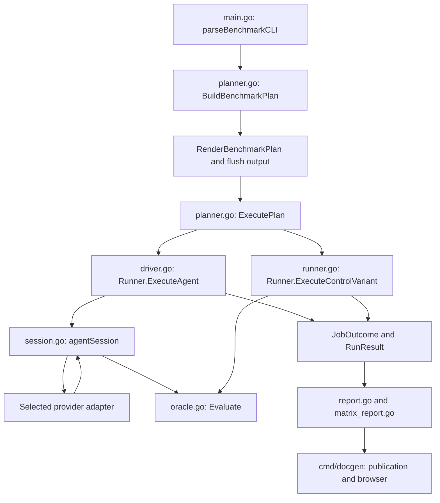

<!-- Maps benchmark ownership and measurement contracts to implementation and verification. -->

# Benchmark harness architecture

Start here when changing the benchmark harness. This guide maps the current implementation to its responsibilities, contracts, and regression tests. Update it when ownership or entry points move. [ADR-0050](../../docs/adr/0050-benchmark-planning-sessions-and-arm-policy.md) records the accepted design and invariants; this file records where to implement them.

## Execution flow

All benchmark runs follow the same planning and scheduling path. Listing, fixture extraction, and standalone oracle evaluation are command-line utilities outside that execution path.



`main.go:executeBenchmarkPlan` connects these components. Read that function first to trace a complete invocation. For an individual agent job, continue at `driver.go:Runner.ExecuteAgent`. The `task-00-hi-overhead` fixture has no source files and uses `disallowed_files: ["*"]` to require no workspace changes. The single-file `task-12-rename-scale-*` fixtures measure 1, 2, 4, 8, and 16 coordinated method renames under one task contract. The `task-12-rename-scale-05-multifile` fixture asks for five renames in one turn, with call sites in separate files and batching permitted. Compare paired arms within each edit count; the no-op probe is an overhead diagnostic, not the intercept of an edit-count fit. The `task-13-rename-followup-scale` fixture uses one continuing session: the first prompt makes one edit, then four follow-ups reach cumulative totals of 2, 4, 8, and 16. Each checkpoint has an exact-state oracle.

## Where to change what

Paths in this table are relative to this directory unless they start with `../../`.

| Change | Start here | Responsibility and nearby checks |
| :--- | :--- | :--- |
| CLI flags, defaults, utility dispatch, output destinations, or resume behavior | [main.go](main.go): `parseBenchmarkCLI`, `runPlannedCLI`, `executeBenchmarkPlan`; [resume.go](resume.go) | Translate user input into `PlanOptions`, print the plan before execution, checkpoint terminal job results, validate a saved run manifest, and rebuild reports. Process-level contracts are in [cli_integration_test.go](cli_integration_test.go) and checkpoint contracts are in [resume_test.go](resume_test.go). |
| External repository cache, pinned checkout hydration, private test/fix patches, or patch-replay execution | [external_repo.go](external_repo.go), [oracle.go](oracle.go) | Cache repositories and prepare per-job checkouts before timing; keep dataset acceptance patches out of agent workspaces and replay the fix patch as a separately labeled upper-bound arm. See [external_repo_test.go](external_repo_test.go). |
| Make variables, forwarded flags, and local Go state | [Makefile](Makefile) | Both `bench` and `bench-all` use the same CLI path. Forward `SEMEDIT_ARM_RESTRICT`, defaulting to `write`, and `RESUME=true` with a caller-stable `RUN_ID`. The root Makefile includes this file, and standalone harness targets derive their Go caches from the repository's `.scratch/go` directory. Check the Make tests in `cli_integration_test.go`. |
| Fixture selection, context compatibility, prompt expansion, pairing, job identities, exclusions, or plan display | [planner.go](planner.go): `BuildBenchmarkPlan`, `RenderBenchmarkPlan` | Load fixtures, normalize selections, and create all jobs and resolved prompts once. See [planner_test.go](planner_test.go). |
| Concurrency, cancellation, per-job timeout, completion output, or failed-job accounting | [planner.go](planner.go): `ExecutePlan` | Scheduling currently shares this file with planning. It consumes existing jobs, fills terminal result metadata, emits completion order, and returns plan order. See [scheduler_test.go](scheduler_test.go). |
| Restriction values and semantic-arm steering | [session_policy.go](session_policy.go): `ParseSemeditArmRestriction`, `ResolveAgentExecution`, `semeditRestrictionSteering` | Resolve initial and follow-up prompts centrally. Base prompt assembly and fixture mutation guidance remain in [driver.go](driver.go). See [session_policy_test.go](session_policy_test.go) and CLI policy-isolation tests. |
| MCP server instruction mode matrix | [runner.go](runner.go): `ParseMCPServerInstructionModes`; [planner.go](planner.go): `normalizePlanOptions`, `makePlannedJobs` | Expand each selected server instruction mode into independent paired agent jobs with mode-specific identities. Deterministic control jobs remain single. See `planner_test.go` and `cli_integration_test.go`. |
| Agent lifecycle and measurement boundaries | [driver.go](driver.go): `Runner.ExecuteAgent`, `mergeTurn`, `requestSemanticToolReflection` | Orchestrate setup, task turns, oracle checks, task metric finalization, and optional diagnostic questioning. See [session_test.go](session_test.go). |
| Workspace ownership, original snapshot, continuation state, transcript recording, or follow-up sequencing | [session.go](session.go): `agentSession`, `runTurn`, `runFollowups`, `runStagedFollowups`, `evaluateStage`, `close` | One session owns mutable state and one selected adapter. Cleanup retains evidence outside the task workspace. See `session_test.go`. |
| Provider process arguments, environment, event parsing, tool outcomes, or provider diagnostics | [codex_driver.go](codex_driver.go), [agy_driver.go](agy_driver.go), [opencode_driver.go](opencode_driver.go), [opencode_usage.go](opencode_usage.go) | Keep protocol details in the matching driver. OpenCode usage owns step deduplication, token normalization, and terminal completeness. Adapter selection and Agy's cumulative-observation cursor live in `session.go`. See [bench_test.go](bench_test.go), [session_test.go](session_test.go), and [opencode_usage_test.go](opencode_usage_test.go). |
| Target syntax or a pinned model catalog | [target.go](target.go), [openrouter.go](openrouter.go) | Parse harness/model/effort and expand the explicitly selected catalog. See [target_test.go](target_test.go), [openrouter_test.go](openrouter_test.go), and [the OpenRouter guide](../../docs/benchmark-openrouter.md). |
| Result fields, tool telemetry types, runner options, or deterministic control execution | [runner.go](runner.go): `RunResult`, `ToolCall`, `Runner`, `ExecuteControlVariant` | Shared runtime data and control execution. A serialized field change also needs review of `report.go` and the docgen read model. |
| Fixture metadata, extraction, mutation guards, hidden tests, or acceptance evaluation | [oracle.go](oracle.go): `TaskMetadata`, `ParseTask`, `ExtractVariantTo`, `Evaluate` | [txtar.go](txtar.go) wraps archive parsing; [large_overlay.go](large_overlay.go) supplies supported large-context overlays. Inputs live in [testdata/bench](../../testdata/bench), with some script fixtures also usable as benchmarks. See `bench_test.go` and planner context tests. |
| Extraction/evaluation utility behavior | [extract.go](extract.go), [evaluate_cmd.go](evaluate_cmd.go) | Utility entry points used by `main.go:runFixtureUtility`; they reuse fixture and oracle logic. |
| Harness JSON, duration units, comparison slots, or Markdown reports | [report.go](report.go): `BenchmarkReport.MarshalJSON`, `BuildComparisons`, `SaveReport` | Build policy-specific comparisons and serialize the versioned result format. See [report_test.go](report_test.go). |
| Per-fixture result directories, filenames, or source provenance | [matrix_report.go](matrix_report.go): `saveMatrixReports` | Persist grouped reports without merging different policies or distinct planned fixtures. The filename is historical; there is no separate matrix executor. |
| Published eligibility, best-case selection, aggregate metrics, or browser columns | [cmd/docgen](../../cmd/docgen/benchmarks.go) | Follow the publication map below. Changes here affect claims made from results, not execution. See [benchmarks_test.go](../../cmd/docgen/benchmarks_test.go). |

## Contracts and state ownership

`PlanOptions` contains invocation settings. `BenchmarkPlan` contains normalized options, loaded jobs, and explicit fixture exclusions. Each `Job` identifies one task, target, arm, context, prompt, and repeat; agent jobs also carry their resolved `AgentExecution`. Execution must consume these jobs without rediscovering fixtures or expanding another matrix.

`JobExecutor` is the scheduler's provider-neutral execution boundary. `JobOutcome` retains the job, result, and execution error. Every scheduled job gets one terminal outcome, including setup failure and queued cancellation. Live output follows completion order; returned results follow plan order. A timeout covers the whole job, including follow-ups, rather than restarting for each turn. When `--out-dir` is enabled, each non-cancelled terminal outcome is atomically saved under `jobs/<job-id>.json` with its resolved job metadata and a one-run report. The run manifest fingerprints the ordered resolved plan and fixture contents. `--resume` requires the same run ID and an identical manifest, loads valid job checkpoints, and schedules only jobs without checkpoints; recorded failures count as completed so resume does not silently repeat provider work. Signal-cancelled jobs are not checkpointed and run again on resume.

To continue an interrupted run, repeat its original command with `--resume` and
the same `--run-id`, target, fixtures, prompt variants, timeout, concurrency,
policy, instruction modes, and provenance. The harness rejects a changed plan
before starting providers. Each `jobs/<job-id>.json` report is independently
readable; the existing per-fixture and aggregate reports are rebuilt after the
remaining jobs finish.

`agentSession` owns the workspace, snapshot, selected `providerAdapter`, resume identifier, transcript, start time, measured result, and retention decision. `Runner.ExecuteAgent` provides lifecycle orchestration; session methods run follow-ups, evaluate results, and clean up. A provider adapter handles one turn and continuation mechanics. It does not decide whether the oracle requires a corrective attempt.

`RunResult` holds normalized task measurements. `InteractionStep` records each turn, including its cumulative edit count, oracle outcome, elapsed time, and token usage for staged fixtures. `sessionTurn` records classified transcript evidence, including diagnostic turns, provider errors, and raw events. The transcript path is retained in provenance and lives under the runner's `transcripts` directory outside the disposable workspace. Semedit agent jobs also persist MCP server timing records under the fixture's `.scratch` directory during execution. At close, the harness retains task-only records beside the transcript and records `mcp_metrics_file` in result provenance when any records exist.

## Measurement and policy boundaries

Fixture extraction, directory preparation, and semedit verify prewarm finish before agent wall time starts. The verify prewarm is enabled by default for Codex semedit jobs with a Go oracle target; `--semedit-prewarm-verify=false` disables it. Each treated job starts with empty fixture-local Go build and module caches, runs `semedit-next verify --check-only` in that workspace, and records its duration separately. Fixtures without a Go target skip prewarm. The agent then uses the populated disk caches. Its MCP server starts fresh and lazily starts gopls on the first diagnostic scan or rename, then reuses that session across tool calls. Rename uses that same process; all AST refactorings synchronize retained buffers, including edits inside a batch. The CLI prewarm does not retain a live server for the agent. Every agent task clock starts immediately after its first provider process launches successfully and runs continuously through all task turns and oracle checks. A launch failure records zero agent wall time. Provider configuration and the semedit prewarm are outside that interval for both arms. Diagnostic reflection remains outside task wall time.

The measured lifecycle is initial task answer, oracle evaluation, and declared corrective follow-ups with oracle evaluation after each. Follow-ups stop on success or terminal failure. A staged fixture instead runs every declared checkpoint in one workspace and provider session, evaluating its stage oracle after each turn. A failed checkpoint remains a failed overall result even when later stages pass. The printed plan includes every resolved staged prompt. Staged turns are excluded from corrective-attempt publication statistics. Hidden oracle output never becomes agent steering.

Failed or exhausted task attempts do not trigger diagnostic reflection. The result retains the last oracle and task measurements and records why reflection was skipped.

An optional `oracle.diagnostic_expected_tools` list adds informational tool-use coverage to a result. Expected and observed names are normalized across provider prefixes, and observations include selections from every measured task turn even when the selected call failed. Diagnostic reflection calls are excluded. A batch call counts only as `semantic_batch`; it does not imply that any individual tool was observed. `observation_state` and `complete` describe capture quality, while `expected_satisfied` reports positively observed expected tools. The harness emits `missing` only after complete capture; unknown or partial capture retains positive observations without making absence claims. Tool-use coverage never changes oracle pass/fail. Codex capture is complete only after a clean stream containing `turn.completed`; OpenCode and Agy remain unknown until their terminal telemetry contracts are validated.

Semantic tool identity is normalized before MCP verification, expected-tool coverage, and batch-reflection decisions. Recognized names include `semantic_*`, `semedit/semantic_*`, `mcp__semedit__semantic_*`, and OpenCode's `semedit_semantic_*`; a provider may also identify the server separately as `semedit`. OpenCode's prefixed semantic terminal events therefore count as MCP use even when its event omits a server field.

Task elapsed time is finalized before optional diagnostic questioning. A non-use, batching, or integration-value reflection runs through the same adapter with a fresh result and the `diagnostic_reflection` classification. Its explanation may be retained; its tokens, tools, turns, elapsed time, and oracle effects must not enter task totals, serialized benchmark metrics, or publication aggregates. Never merge a reflection result through `mergeTurn`. Every successful semedit session with a continuation identity receives an integration-value question after any behavior-specific reflection, regardless of observed tool use. Save its prompt, response, and capture error as `semantic_integration_reflection`. The prompt requests a candid one-sentence recommendation from the coding agent, grounded in this run, including whether it would ask its owner to add semedit. It prohibits edits, tools, and retries. Reports label the response as agent opinion; browser metric rows exclude the entire object.

Agy transcript reads are cumulative. Its session adapter advances a cursor and returns only new observations, including after a failed resume. A regressed transcript must not reintroduce old calls into task totals. Missing transcripts, invalid streaming records, and transcript-write failures remain explicit errors. Missing evidence is not a successful zero-tool measurement. Keep raw evidence and normalized observations distinct when changing a parser.

The selected `read`, `write`, or `readwrite` policy is a comparison condition on both agent arms, but steering applies only to semedit. `Job.Policy` describes semedit applicability; `AgentExecution.Policy` carries the selected agent condition. Terminal `RunResult.SemeditArmRestrict` records the condition, and `SemeditArmRestrictionApplied` records applicability. Direct control has no restriction condition. All policies permit shell builds and tests. `--mcp-server-instructions` accepts a comma-separated list of `none`, `descriptive`, and `prescriptive`; each mode creates a separate paired agent cell, and control jobs run once.

Pinned external-repository fixtures use baseline, semedit-agentic, and
semedit-explicit arms. The explicit arm currently applies the source dataset's
human fix patch and records `execution_mode=ground_truth_fix_patch_replay`; it
is a correctness and speed upper bound, not evidence of agent tool use. The
optional `--semedit-skill=true` condition adds the project skill only to the
semedit-agentic workspace and changes job identities. Repository cache warmup,
checkout, and copy-on-write hydration occur before agent timing. Dataset test
patches are installed only into the private oracle copy.

Policy changes must remain consistent across planning, prompts, result metadata, comparison keys, filenames, and publication. Historical results without policy metadata remain `unspecified`; the new-run default `write` must not be applied to them. Planned results retain exact fixture task identities, while legacy results retain their established normalization.

## Explicit semedit prompt experiment

Every agent fixture declares an `explicit` prompt that names the semantic tool sequence and task-specific arguments. Select it with `--variants small:explicit` (or `large:explicit`). That selection schedules three results per repeat and instruction mode: baseline, semedit with the default implicit task prompt, and semedit with the explicit tool plan. The two semedit comparisons share the same baseline run. The arm execution order rotates across repeats. Existing report columns and paired deltas remain unchanged; ordinary `small` selections do not include the explicit experiment. Explicit prompts permit parallel independent read-only lookups and require mutations to run serially or inside one ordered `semantic_batch`.

The experiment investigates whether semedit's extra time and tool cycles come from model-side operation selection and planning or from MCP execution. Explicit instructions add input tokens, so compare turns, tool cycles, invocations, failures, token components, and wall time together rather than assuming lower total tokens. See [RQ-0065](../../docs/research/RQ-0065-explicit-semedit-prompt-arm.md).

## OpenCode AMD Beast smoke run

Use `opencode/qwen36-iq4-xs` without an effort suffix. The provider defaults to
`http://192.168.1.122:1234/v1`; `SEMEDIT_OPENCODE_QWEN_BASE_URL` overrides the endpoint.
The adapter selects the configured `amdbeast` provider internally and passes
`qwen36-iq4-xs` as the API model ID. Reports retain the short target identifier.
The runner creates isolated OpenCode state and configuration for each fixture, and
resumes that same session for corrective task turns and diagnostic questions.
Each fixture is initialized as its own Git project, and OpenCode plus its child
processes run under a fail-closed macOS Seatbelt profile. The profile permits the
fixture workspace while denying reads elsewhere and all network egress. Remote
provider calls therefore remain unavailable until the OS boundary can allow the
configured endpoint without widening access to other hosts.

OpenCode 1.18.30 emits disjoint input, cache-read, cache-write, output, and reasoning
counters in each `step_finish`. Total input includes all three input buckets;
cached input contains cache reads; uncached input includes cache writes. Sum
distinct part IDs within each process, preserving multiple steps within one
assistant message. Require a final `stop` finish with complete counters and no
unmatched starts; missing counters produce a failed measurement. Delegated agent
tasks are disabled in both arms because OpenCode omits child-session usage from
the root JSON stream. Cache-write counts are preserved, but their distinct price
is not represented by the existing uncached-input field.

After `make check`, build the harness and run the simplest editing task first,
then the three complex migrations/refactorings, with one worker and paired arms:

```sh
make bench-build build-next
.scratch/bin/benchmark-harness \
  --target opencode/qwen36-iq4-xs \
  --task task-01-rename-local --variants small --concurrency 1 \
  --timeout 12m --run-id opencode-amdbeast-simple
.scratch/bin/benchmark-harness \
  --target opencode/qwen36-iq4-xs \
  --tasks task-09-composite-refactor,task-11-mixed-sink-api-migration,task-12-request-identity-migration \
  --variants small:default --concurrency 1 --timeout 12m \
  --run-id opencode-amdbeast-hard
```

Task 01 declares its existing instruction as the default prompt, so either
`small` or `small:default` schedules its pair. The hard
selection uses the default prompt and excludes task 11's additional discovery
prompt. Diagnostic questions remain outside all solving totals; corrective
prompts that continue solving remain inside them. Live connectivity evidence and
the experiment results are recorded in [RQ-0061](../../docs/research/RQ-0061-opencode-amdbeast-smoke.md).

## Publication map

The publisher is a separate Go command, so its JSON read model is separate from the harness runtime types. Trace [benchmarks.go](../../cmd/docgen/benchmarks.go): `renderBenchmarkDocumentation` when a result is recorded correctly but displayed or grouped incorrectly.

| File in `cmd/docgen` | Responsibility |
| :--- | :--- |
| [benchmark_model.go](../../cmd/docgen/benchmark_model.go) | Read-side result, comparison, and publication structures. |
| [benchmark_load.go](../../cmd/docgen/benchmark_load.go) | Load saved runs and normalize supported duration formats. |
| [benchmark_publish.go](../../cmd/docgen/benchmark_publish.go) | Publication eligibility, ordering, and source provenance. |
| [benchmark_compare.go](../../cmd/docgen/benchmark_compare.go) | Pair selection, ranking, cost calculations, and aggregate condition identities. |
| [benchmark_best.go](../../cmd/docgen/benchmark_best.go) | Best-case pages, first-attempt rates, corrective-turn histograms, and policy-separated headlines. |
| [benchmark_render.go](../../cmd/docgen/benchmark_render.go) | Published comparison tables, prompts, and diagnostic explanations. |
| [benchmark_aggregate.go](../../cmd/docgen/benchmark_aggregate.go) | Browser row flattening, paired deltas, filters, and grouping. Excludes diagnostic reflection objects from metric rows. |

For a new experiment dimension, trace it from `PlanOptions` and `Job` through result serialization and every publication grouping key. For a new metric, establish its measurement boundary and missing-value semantics before updating both result models and rendering paths.

## Verification and related decisions

Follow the repository workflow: run `make check` before targeted verification and again before completion. Focused commands, after that prerequisite, are:

```sh
go test ./tools/benchmark-harness
go test ./cmd/docgen
```

The standalone MCP startup benchmark runs a fresh Go module and empty module/build cache for each iteration. Workspace and directory creation and binary build occur outside the timer. After verification timing stops, it retrieves the same subprocess's `tools/list` schema and validates the verification response. With `gopls` on `PATH`, run `go test ./internal/mcp -run '^$' -bench BenchmarkMCPColdStartupVerify -benchtime=10x` to record subprocess spawn, initialize-response, and verify-response phases.

Use fake provider processes for routine regressions. `cli_integration_test.go` proves that the complete plan precedes execution and that all three policies isolate baseline behavior. `scheduler_test.go` proves completion accounting and ordering. `session_test.go` exercises process continuation, cumulative transcript failures, evidence recording, and reflection exclusion. Parser-only tests cannot establish those lifecycle properties. `report_test.go` and docgen tests cover serialization and policy-separated publication.

Consult the [ADR index](../../docs/adr/README.md) before opening a decision. The relevant contracts are ADR-0038 (conditions and provenance), ADR-0039 (validity and telemetry), ADR-0040 (fixture/oracle isolation), ADR-0041 (process environment), ADR-0043 (publication), and ADR-0050 (planning, sessions, and arm policy). ADR-0044 remains a proposal. Record a new accepted architectural decision when changing these boundaries, and update its index in the same change.
