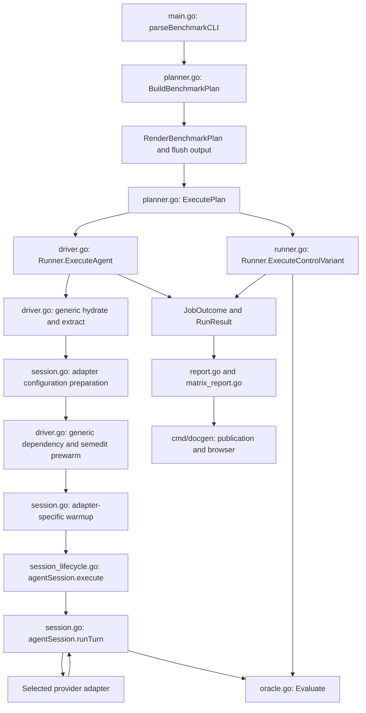

<!-- Maps benchmark ownership and measurement contracts to implementation and verification. -->

# Benchmark harness architecture

Start here when changing the benchmark harness. This guide maps the current implementation to its responsibilities, contracts, and regression tests. Update it when ownership or entry points move. [ADR-0050](../../docs/adr/0050-benchmark-planning-sessions-and-arm-policy.md) records the accepted design and invariants; this file records where to implement them.

## Execution flow

All benchmark runs follow the same planning and scheduling path. Listing, fixture extraction, standalone oracle evaluation, and analysis extraction are command-line utilities outside that execution path.

Use `go run ./tools/benchmark-harness analyze --input <report.json>` to export newline-delimited analysis events from an explicit report. Pass `--input <run-directory>` to read only its direct `jobs/*.json` checkpoints; the command never walks the archived benchmark-results tree. Repeat `--input` to combine selected runs, use `--include-sidecars` to add provider-turn transcripts (including raw adapter events), adapter-stage evidence, and MCP phase metrics, and pass `--out <file.jsonl>` to write atomically. Each run’s conditions, oracle outcomes, diffs, latency/token/cost measurements, diagnostic coverage, and provenance appear once; compact run references connect those records to tool calls and failures, step results, reflections, provider errors, and optional sidecars. The raw event stream is opt-in because it can be large; it lets analysis connect a tool response to the next agent turn and assess whether the response supported a useful tactic change.

To include interactive Codex chats, pass `--codex-home ~/.codex`. This explicitly scans only `sessions/` and `archived_sessions/` below that home for `.jsonl` and `.jsonl.zst` transcripts; it does not inspect databases, settings, logs, or other Codex state. User messages, assistant final/commentary messages, tool calls and results, and per-turn token usage are streamed as `codex_chat` records. Developer instructions, private assistant phases, and reasoning records are omitted. Compressed transcripts require `zstd` on `PATH`; override its executable with `--zstd-bin`. The exporter processes transcripts one at a time and writes `--out` through an atomic temporary file, so the full chat archive is not loaded into memory. These transcripts can contain sensitive conversation and tool output; keep the analysis output local and select its destination deliberately.

For context-sized exports, add `--limit N`. Each page ends with a `page_info` record containing `pagination.returned`, `pagination.has_more`, and an opaque `pagination.next_cursor`. Resume with the same inputs and `--cursor <next_cursor>`; the cursor skips completed benchmark events and transcript files, then resumes at the recorded JSONL ordinal. For example, save each page separately and read the final cursor with `jq -r 'select(.type == "page_info") | .pagination.next_cursor // empty' page.jsonl`. Pagination reads only the current transcript file on continuation, but cursors assume the selected input files and ordering stay unchanged; restart from page one if they change. Without `--limit`, output remains unpaged.

Use `--since 2026-10-19T12:00:00Z` to exclude benchmark reports and transcript records before an RFC3339 instant. Benchmark records use the report/checkpoint timestamp; Codex records use each transcript record timestamp. The cutoff is inclusive, and data without a timestamp is omitted when filtering. Keep the same cutoff while following a pagination cursor.

Run `go run ./tools/benchmark-harness observe --input analysis.jsonl` after exporting evidence to derive deterministic observations and exact-condition cohort summaries. Pass selected pages with repeated `--input` flags; use `--out observations.json` to save the compact report atomically. It groups run outcomes, failed-call counts, wall-clock p50/p95/p99, tokens and recorded cost by task, arm, model, effort, skill, batching, variant, execution mode, server instructions, and arm restriction. When transcript sidecars contain paired provider start/completion timestamps, `analyze --include-sidecars` adds per-call `tool_duration_ms` plus run-level `tool_wait_ms` (sum of call durations, including overlap), `semantic_tool_wait_ms`, `other_tool_wait_ms`, `tool_occupied_ms` (union of tool-call intervals), and `non_tool_wall_clock_ms` (run wall time minus occupied tool intervals). `observe` reports timing coverage and p50/p95 tool-wait, semantic-tool-wait, other-tool-wait, occupied-time, and non-tool residuals by cohort, plus per-tool timed-call counts, total/mean wait, and p50/p95 call duration. Per-tool rows identify semantic tools and retain each tool name, so matched semedit and control cohorts can show whether wall-time differences coincide with particular semantic operations. The non-tool residual includes model generation and provider, harness, or startup overhead outside tool calls; it is not a pure model-inference measurement. Timing summaries only include runs with complete call timing, and coverage is reported so missing transcript timestamps remain visible. `tool_stats` gives per-tool call, transport-failure, functional-failure, and unknown-outcome counts; interactive Codex records are grouped as `codex-chat` because they may not retain benchmark model metadata. The report also identifies narrow failure-text signals, exact repeated tool calls, the next observed call after a failure, and keyword matches in benchmark reflections. Codex call/result references are linked by chat and call ID when the export provides them. Check `coverage.has_more_pages` before interpreting silence as absence; rerun `analyze` without paging for a complete local export when practical.

The observation report is a mechanical index into evidence, not a verdict. A different next tool does not prove the agent understood the failure; a keyword match does not establish a real capability gap; and a missing event may reflect incomplete capture. Compare only matched benchmark conditions, then inspect the linked prompt, tool arguments and response, later turns, final diff, oracle, and testimonial. Use that evidence to propose a focused change, keep the benchmark method fixed, rerun the same cells, and accept or reject the change on correctness and measured outcomes. [ADR-0077](../../docs/adr/0077-deterministic-benchmark-evidence-analysis.md) defines this analysis boundary and the broader improvement loop.

### Benchmark improvement loop

Use the exporter as the evidence package for a controlled improvement cycle:

1. Select explicit result files or run directories and export them with `--include-sidecars` when diagnosing tool choice, parameter errors, retries, or response guidance. Keep matched task, model, reasoning effort, skill, and batching conditions together; do not compare unmatched cells as if the harness changed alone.
2. For each unsuccessful or inefficient run, trace the prompt, tool arguments, transport and functional status, server/tool response, subsequent agent turn, final diff, oracle stage, and post-run reflection. Assess:
   - tool selection and parameter fit, separating harness/provider transport failures from server-side functional rejections;
   - repeated calls with the same or changed arguments, their outcomes, and whether a failure led to a different tactic;
   - whether a response supplied an actionable correction and whether the next agent turn used it;
   - suspected capability gaps against the declared semedit/backend capability and the relevant native LSP or language-tool support;
   - correctness, failed-call counts, call/turn counts, latency, token use, and cost; and
   - the agent’s unmeasured testimonial and diagnostic reflections, including whether a reflection was skipped and why.

   Treat capability gaps and planner misunderstandings as hypotheses until the trace distinguishes them. Incomplete tool observation means absence of a call is unknown, not proof that the agent skipped it.
3. Propose the smallest change that addresses the strongest repeated evidence. Keep task prompts and benchmark method fixed when evaluating a tooling change. Record architectural decisions in an ADR and open or update a research question for measurements or unresolved alternatives, updating the corresponding index in the same change.
4. Re-run the same benchmark cells and compare functional success, oracle levels, failed tool and failed semantic-call counts, call/turn counts, wall time, token use, and harness-recorded cost. Accept a change only when the intended outcome improves without an unacceptable correctness or cost regression; otherwise retain the baseline and investigate the next cause.
5. Repeat from the exported evidence while improvements remain measurable. Keep raw outputs, analysis exports, implementation diffs, and the specific hypothesis linked so later runs can reproduce the comparison.

The exporter preserves evidence and links records; it does not automatically decide that a tool call was wrong or that a response caused a retry. Those judgments need trace review and should identify the exact evidence and confidence behind each diagnosis.



`main.go:executeBenchmarkPlan` connects these components. Read that function first to trace a complete invocation. For an individual agent job, continue at `driver.go:Runner.ExecuteAgent`. The `task-00-hi-overhead` fixture has no source files and uses `disallowed_files: ["*"]` to require no workspace changes. The single-file `task-12-rename-scale-*` fixtures measure 1, 2, 4, 8, and 16 coordinated method renames under one task contract. The `task-12-rename-scale-05-multifile` fixture asks for five renames in one turn, with call sites in separate files and batching permitted. Compare paired arms within each edit count; the no-op probe is an overhead diagnostic, not the intercept of an edit-count fit. The `task-13-rename-followup-scale` fixture uses one continuing session: the first prompt makes one edit, then four follow-ups reach cumulative totals of 2, 4, 8, and 16. Each checkpoint has an exact-state oracle.

External Multi-SWE-Bench tasks use their prescribed patch protocol in
`oracle.go:Evaluate`: the oracle checks the agent's mutation policy, creates a
private checkout at the fixture's pinned commit, applies the private
`test.patch`, then applies the candidate patch captured from the agent
workspace. Build and test evaluation run on that combined state. Test patches
never enter the agent-visible checkout, and external task fixtures forbid
candidate test edits. Ground-truth patch replay uses the same sequence while
allowing test-file edits included in the reference fix. First-party txtar
fixtures continue to use the private workspace-copy path and install hidden
tests after candidate execution.

### Task complexity profiles and evaluation axes

Rather than using an opaque scalar difficulty score, each benchmark fixture has an explicit 7-axis complexity profile scored on a 5-dot scale (`●○○○○` to `●●●●●`) codified in [ADR-0044](../../docs/adr/0044-benchmark-experiment-dimensions-and-result-semantics.md). Each axis targets specific strengths and failure modes of LLM coding agents:

| Dimension | Why It Matters / Agent Dynamics | Vanilla Agent Profile | Semedit MCP Profile |
| --- | --- | --- | --- |
| **1. Locality & Fan-Out** ($D_{\text{loc}}$) | **Multi-file degradation cliff**: Success drops below 20% once edits span $>3$ files due to omitted peripheral call sites. | **Strong at `●○○○○`** (1-turn local patch); **Collapses at `●●●●●`** (misses call sites in downstream packages). | **Dominates at `●●●●●`**: Compiler traces symbol usages across packages and updates all files deterministically in $O(1)$ tool output tokens. |
| **2. Context Burden** ($D_{\text{ctx}}$) | **Working memory saturation & 'Lost-in-the-Middle'**: Loading thousands of lines causes models to lose track of early instructions and file structures. | **Strong at `●○○○○`** (<50 lines fits in prompt); **Poor at `●●●●●`** (wastes thousands of tokens grepping and reading unrelated code). | **Dominates at `●●●●●`**: Operates via compiler-indexed symbols; zero prompt tokens spent reading unmodified files into memory. |
| **3. Symbol Ambiguity** ($D_{\text{amb}}$) | **Token-level pattern matching vs. Type Graph**: When identical names exist (`r.ID`, `Close()`, `Get()`), regex cannot distinguish receiver types. | **Strong at `●○○○○`** (unique names like `ParseXMLToAST`); **Fails at `●●●●●`** (false-positive search/replace breaks unrelated structs). | **Dominates at `●●●●●`**: The language server type checker resolves exact struct field bindings and receiver types with 100% precision. |
| **4. Change Composition** ($D_{\text{comp}}$) | **State tracking & error compounding**: RefactorBench shows agents fail multi-hop refactoring (22% vs 87% human) because intermediate steps break state and compound errors. | **Moderate at `●●○○○`**; struggles with multi-step sequential dependencies. | **Strong at `●●●●●` with `semantic_batch`**: Executes compound mutations atomically in an in-memory session, avoiding intermediate broken states. |
| **5. Invariant Strictness** ($D_{\text{inv}}$) | **Probabilistic generation vs. AST invariants**: LLM text generation is prone to whitespace drift, dropped comments, and damaged compiler directives (`//go:embed`, `//go:build`). | **Fragile at `●●●●●`** (patch reject errors, linter failures from formatting churn). | **Dominates at `●●●●●`**: AST-level transformations isolate target nodes without collateral damage to comments, whitespace, or build tags. |
| **6. Edit Scale** ($D_{\text{scl}}$) | **Output token budgets & generation exhaustion**: Generating diffs for 20+ call sites linearly bloats output tokens and increases truncation risk. | **Collapses at `●●●●●`** (exceeds token limits, truncates diffs, becomes 'lazy' with `// ...existing code...`). | **Dominates at `●●●●●`**: Zero-token output transformation; a ~25-token tool call triggers $N$ refactorings in the host engine. |
| **7. Staging & Verification** ($D_{\text{stg}}$) | **Paranoia tax & diagnostic loops**: When tools lack feedback, agents run defensive verification turns (`git diff`, `go test`), doubling latency and token spend. | **Fast at `●○○○○`** (single-shot diff + test in one command); fragile under complex compilation breaks. | **Strong at `●●●●●`**: Integrated compiler diagnostic deltas terminate invalid trajectories and provide immediate verification signals. |

## Where to change what

Tool latency measurements are separate from agent task comparisons. The production
MCP server and real-gopls warm-operation benchmarks live in
[`internal/mcp/warm_cost_bench_test.go`](../../internal/mcp/warm_cost_bench_test.go).
Expanded cohorts and their component collector live in
[`internal/mcp/warm_actual_bench_test.go`](../../internal/mcp/warm_actual_bench_test.go).
They distinguish unchanged-revision reads from actual edits and
completed edit/read or staging workflows. Latency series use distinct component
names so reporting a read cannot overwrite its preceding edit measurement.
Wire-size reporting includes text and structured result data; it does not infer
client model context. These tool benchmarks remain separate from the agent task
comparisons implemented by this harness.
Actual filesystem rename and first-MCP-reaction cases live in
[`internal/mcp/file_rename_bench_test.go`](../../internal/mcp/file_rename_bench_test.go).
Populated diagnostic-page reads live in
[`internal/mcp/diagnostic_page_bench_test.go`](../../internal/mcp/diagnostic_page_bench_test.go):
one- and twenty-package fixtures capture at least 50 real diagnostics, then time
50-item MCP pages while requiring exactly one gopls process. Analysis is outside
the timer, and the page-read p99 target is 10 ms.
The target inventory, measurement boundaries, session-continuity requirement, and
remaining cases live in [RQ-0070](../../docs/research/RQ-0070-warm-mcp-operation-costs.md).

### Cold/hot tool cost table

Run `make bench-mcp-tools` for Go MCP tool costs. The baseline read/lifecycle
matrix has exactly twenty active Go source files across twenty packages.
Its helper declarations occupy existing files; snapshot journals under
`.scratch` are outside the source corpus.
This is a small synthetic corpus, not a large-project performance test.

The target reports cold and hot p99, observation counts, and lifecycle/budget
status directly. Cold samples use a new MCP server and close it before the next
sample. The first semantic call includes any required lazy gopls startup;
initialization is outside the timer. Go/compiler/disk caches remain intact, and
this does not include launching a separate semedit executable. Hot samples use
one retained gopls, with actual mutations and final synchronization checked.
Commit, abort, populated metrics, and diagnostic paging require prior calls, so
their isolated cold per-tool time is unavailable; fresh-session workflow costs
are reported separately. A failed continuity probe cannot publish a hot p99.

Defaults are 100 cold observations and 1,000 hot observations per tool. These
runs can be long when a tool exceeds its latency budget. Focused runs support:

```sh
make bench-mcp-tools TOOL_FILTER=semantic_lookup COLD_SAMPLES=100 HOT_SAMPLES=100
make bench-mcp-tools TOOL_FILTER=refactor_rename ENFORCE_BUDGETS=true
```

`TOOL_FILTER` selects a matching tool name. `ENFORCE_BUDGETS=true` additionally
fails unmet hot p99 budgets; native-result and session-continuity failures always
fail. A short contract run is available with `TOOL_SMOKE=true COLD_SAMPLES=2
HOT_SAMPLES=2`; it labels its output as smoke and does not publish a p99 claim.
The Make target fixes Go's outer benchmark invocation at one iteration; the
explicit cold/hot counts drive the real measurements, independently of Go's
calibration. The benchmark-only RPC watchdog bounds each request at thirty
seconds, while the target permits a long overall measurement run.

Implementation and the scenario registry live in
[`internal/mcp/cold_hot_tool_cost_test.go`](../../internal/mcp/cold_hot_tool_cost_test.go).
The target reuses the existing MCP transport and native-result checks. It does
not run the functional agent benchmark harness.

Agent comparison reports include `estimated_cost_usd` when complete token
counters are available for a priced cloud target. The estimator applies the
dated model rate card to uncached input, cached input, and generated output.
GPT-6 Astra, GPT-6 Sol, GPT-6.1 Sol, GPT-6 Luna, and GPT-5.6 Sol, Terra, Luna,
and Cyber are explicitly priced. The `gpt-5.6` alias uses the GPT-5.6 Sol rate
card. Reasoning effort does not change these models' token rates, so per-run
differences come from observed token consumption. Gemini 3.7/3.8 Flash and
Gemini 4 Argon effort variants likewise share their model rates. Gemini
thinking tokens are priced as output; Codex output already includes reasoning
tokens.

These are comparable list-rate token estimates, not invoice amounts. The
benchmark pages and browser display the cost recorded by the harness for each
run, together with its pricing ID and rate-card date; docgen never recalculates
historical cost using today's rates. Older reports without recorded estimates
show cost as unavailable. Gemini
regional routing is not recorded by the harness, so estimates use global rates;
the current interactive runs do not use Batch or Flex requests, which have
separate discounted rates. Estimates omit cache-write and cache-storage fees,
subscription entitlements, negotiated discounts, taxes, and non-token service
charges. OpenAI estimates use Standard short-context rates because the harness
does not retain per-request context lengths needed to apply long-context
multipliers. The rate-card identity and
dated basis accompany `estimated_cost_usd` in JSON. Local OpenCode models have no cloud-cost
estimate; their hardware CAPEX is user-specific and is not mixed into cloud
OPEX. The exact formula and pricing sources are recorded in [ADR-0050](../../docs/adr/0050-benchmark-planning-sessions-and-arm-policy.md).

The source-edit registry covers insertion, replacement, removal, movement,
extraction, inlining, signature and type transformations, comments, contracts,
file scaffolding, and undo. `CORPUS=20` keeps exactly twenty source files before
each source-edit sample; creation operations may increase that count. Consumer
packages make room for scenario probe files. The original read/lifecycle matrix
retains its twenty-package corpus.

```sh
make bench-mcp-tools CORPUS=repository
make bench-mcp-tools CORPUS=repository TOOL_FILTER=refactor_move_construct
```

For method-level attribution, run the focused in-process benchmark through
Make to retain the same Go cache environment. It includes dirty unused-import
removal in a fanout root and a leaf, root variants using unused `unsafe` and
`errors` imports, an exported rename and body-only edit on
the twenty-package fixture, plus an unused-import probe in an archived copy of
the repository's `internal/telemetry` package. Each sample logs end-to-end
latency, verification-before and verification-after counts and time, gopls
request count, and the full phase snapshot. Correctness checks and metrics
retrieval happen outside the operation timer; the benchmark requires one
retained gopls process per fixture module.
Import scenarios also require resolved diagnostics for the dirty input and
exact restoration of the original source after cleanup.
The repository fixture disables its external lint hook and preserves existing
findings by comparing full verification results after each edit outside the
timer. It does not require the archived codebase to have zero warnings. These
verification calls also warm gopls; the next dirty input is injected afterward.

```sh
make bench-mcp-gopls GOPLS_CALL_SAMPLES=10
```

To retain an ordered Go execution trace of the same in-process work:

```sh
make bench-mcp-gopls GOPLS_CALL_SAMPLES=10 GOPLS_TRACE=.scratch/mcp-go-orchestration.trace
go tool trace .scratch/mcp-go-orchestration.trace
```

Add `GOPLS_CPU_PROFILE=.scratch/mcp-go.cpu` to collect this process's CPU
profile and retain the test binary in `.scratch/mcp-gopls-profile.test`.
Inspect it with `go tool pprof -top .scratch/mcp-go.cpu`. This profile includes
fixture setup and verification; use trace regions to isolate operation waits.

Tracing is enabled only when a trace file is requested. Named regions cover
the existing timing phases plus Go environment resolution, session lock waits,
scope/package discovery, document synchronization, source snapshots, revision
validation, symbol discovery/resolution, and rename publication. Request
children separate `gopls.send.<method>` from `gopls.wait.<method>`.
Native `disk.*` regions separate creation, writing, fsync, close, final
validation, and rename without recording paths or content. The viewer
shows goroutine scheduling and blocking stacks within these regions. Traces
cover setup, calibration, and final verification as well as measured calls;
filter the operation goroutine and nested regions when attributing latency.
Child-process CPU is not captured. Traced timings are diagnostic evidence;
use untraced runs for performance acceptance.

It exercises root/leaf import removal, exported rename, and body edits on
twenty packages, plus an import edit in an archived repository fixture, and emits
`GOPLS_COST_SAMPLE` JSON records for each measured call. Fetching the latest
`semantic_metrics` record and writing benchmark logs happen outside the timer.
The records include all existing phases plus per-method `gopls.request.*`,
`gopls.send.*`, `gopls.wait.*`, and `gopls.notify.*` counts and cumulative
elapsed milliseconds. Method timings
include client transport and waiting; they overlap enclosing phases and are
not CPU samples. Small attribution runs do not establish a qualified p99.
The implementation and public MCP integration check live in
[`gopls_call_metrics_test.go`](../../internal/mcp/gopls_call_metrics_test.go).

Repository mode exports committed `HEAD` once using `git archive`, records the
revision, and creates isolated fixtures from that immutable export. Uncommitted
files and `.git` are excluded. On macOS each fixture requests copy-on-write
cloning with `/bin/cp -cR`; native cp falls back to copying when the filesystem
cannot clone. Command failures are errors. Other platforms copy files.
Export, cloning, probe creation, baseline reset, and correctness checks are
outside the operation timer. Each cold observation uses a fresh clone and MCP
session; hot observations retain one clone and MCP session, with one gopls
process per Go module. Starts are attributed to their module root: a second
start for an existing root is a restart, while an additional root is a new
session. Both withhold a hot percentile; missing/truncated session logs fail.

The repository corpus adds disclosed probe declarations to the existing
`internal/telemetry` package, preserving the real module and package graph.
These are controlled refactoring targets. The small-corpus read/lifecycle matrix
does not run in repository mode. Undo reports cold workflow time including its
snapshot and mutation prerequisites; hot time measures only undo. Build
dependency additions and manifest/network operations are out of scope.
Fixture-local verification configuration disables the detected external
golangci-lint hook. Go analysis uses the inherited Make compiler and module
caches. Verification requires completed Go coverage and no error diagnostics;
informational findings about unused private probes are retained and allowed.
The registry supplies explicit Go selection when the advertised schema permits
it. Ordinary removal and the additional `[safe]` deletion case remain distinct;
native refusals are failed rows with no latency claim.

Source-edit scenarios and schema coverage live in
[`cold_hot_file_edit_cases_test.go`](../../internal/mcp/cold_hot_file_edit_cases_test.go);
timing, baseline restoration, and mutation assertions live in
[`cold_hot_file_edit_runner_test.go`](../../internal/mcp/cold_hot_file_edit_runner_test.go).
Git export and fixture cloning live in
[`repository_cost_fixture_test.go`](../../internal/mcp/repository_cost_fixture_test.go).
The exported corpus excludes archived benchmark data and `.agents` configuration.
The latter contains a skill symlink unrelated to compilation; source symlinks
remain intact so checked file moves retain their normal refusal behavior.
The source-edit matrix includes cross-package `refactor_move_file` publication.
Per-module session accounting and its semantic tests live in
[`file_edit_session_cost_test.go`](../../internal/mcp/file_edit_session_cost_test.go).

Paths in this table are relative to this directory unless they start with `../../`.

| Change | Start here | Responsibility and nearby checks |
| :--- | :--- | :--- |
| CLI flags, defaults, utility dispatch, output destinations, or resume behavior | [main.go](main.go): `parseBenchmarkCLI`, `runPlannedCLI`, `executeBenchmarkPlan`; [resume.go](resume.go) | Translate user input into `PlanOptions`, print the plan before execution, checkpoint terminal job results, validate a saved run manifest, and rebuild reports. Process-level contracts are in [cli_integration_test.go](cli_integration_test.go) and checkpoint contracts are in [resume_test.go](resume_test.go). |
| External repository cache, pinned checkout hydration, private test/fix patches, or fixture diagnostics | [external_repo.go](external_repo.go), [oracle.go](oracle.go) | Prepare local pinned checkouts before timing; keep acceptance patches private. Human fix replay diagnoses fixture validity and is excluded from agent comparisons. See [external_repo_test.go](external_repo_test.go). |
| Make variables, forwarded flags, and local Go state | [Makefile](Makefile) | Both `bench` and `bench-all` use the same CLI path. Forward `SEMEDIT_ARM_RESTRICT`, defaulting to `write`, and `RESUME=true` with a caller-stable `RUN_ID`. Both Make entry points include `tools/go-environment.mk`: development module/build caches default to the primary checkout's `.scratch/go`; tools and temporary state remain worktree-local. Explicit `GOMODCACHE`, `GOCACHE`, or `GO_CACHE_ROOT` overrides retain control. Fixture cache isolation is unchanged. Check the Make tests in `cli_integration_test.go`. |
| Fixture selection, context compatibility, prompt expansion, pairing, job identities, exclusions, or plan display | [planner.go](planner.go): `BuildBenchmarkPlan`, `RenderBenchmarkPlan` | Load fixtures, normalize selections, and create all jobs and resolved prompts once. See [planner_test.go](planner_test.go). |
| Concurrency, cancellation, per-job timeout, completion output, or failed-job accounting | [planner.go](planner.go): `ExecutePlan` | Scheduling currently shares this file with planning. It consumes existing jobs, fills terminal result metadata, emits completion order, and returns plan order. See [scheduler_test.go](scheduler_test.go). |
| Local OpenCode endpoint confinement and shared transport lifecycle | [opencode_relay.go](opencode_relay.go), [opencode_sandbox.go](opencode_sandbox.go), [main.go](main.go): `executeBenchmarkPlan` | The run owns one fixed-destination loopback relay shared by its jobs. Provider configuration and server/client profiles use the same selected URL. Relay tests prove forwarding and shutdown; Seatbelt tests prove selected-port access and filesystem confinement. |
| Restriction values and semantic-arm steering | [session_policy.go](session_policy.go): `ParseSemeditArmRestriction`, `ResolveAgentExecution`, `semeditRestrictionSteering` | Resolve initial and follow-up prompts centrally. Base prompt assembly and fixture mutation guidance remain in [driver.go](driver.go). See [session_policy_test.go](session_policy_test.go) and CLI policy-isolation tests. |
| MCP server instruction mode matrix | [runner.go](runner.go): `ParseMCPServerInstructionModes`; [planner.go](planner.go): `normalizePlanOptions`, `makePlannedJobs` | Expand each selected server instruction mode into independent paired agent jobs with mode-specific identities. Deterministic control jobs remain single. See `planner_test.go` and `cli_integration_test.go`. |
| Agent lifecycle and measurement boundaries | [session_lifecycle.go](session_lifecycle.go): `agentSession.execute`, `runInitialTask`, `runFollowups`, `runStagedFollowups`, `runDiagnostics`, `mergeTurn` | One provider-independent lifecycle owns task turns, oracle checks, aggregation, the task clock freeze, and diagnostic questioning. [driver.go](driver.go): `Runner.ExecuteAgent` prepares the job and invokes this lifecycle. See [session_test.go](session_test.go). |
| Workspace preparation and runtime directory/file creation | [workspace.go](workspace.go): `fixtureGoEnvironment`, `runSemeditVerifyWarmup`, `prepareFixtureGoDependencies`, `prepareRuntimeLayout`; [driver.go](driver.go): `prepareAgentWorkspace` | Shared code owns external checkout hydration, fixture extraction, semedit skill installation, Go dependency preparation, generic semedit prewarm, workspace snapshots, and atomic runtime file publication. The shared session invokes adapter configuration preparation after fixture extraction and adapter-specific warmup after generic pre-run setup. Providers select protocol paths and contents; shared code creates directories and publishes files within an `os.Root`. See the offline dependency test, warmup tests, and the Agy no-op regression. |
| Workspace ownership, original snapshot, continuation state, or transcript recording | [session.go](session.go): `agentSession`, `prepareAdapter`, `runTurn`, `evaluateStage`, `close`; [adapter_lifecycle.go](adapter_lifecycle.go) | One session wraps every selected adapter with continuation guards, classified per-turn measurements, and task MCP evidence capture. Stage outcomes and complete normalized turn observations are persisted generically; diagnostic observations stay in the transcript and out of work totals. Cleanup retains evidence outside the task workspace. Follow-up sequencing belongs to `session_lifecycle.go`. See `session_contract_test.go` and `session_test.go`. |
| Provider initial and follow-up invocation construction | [adapter_lifecycle.go](adapter_lifecycle.go): `adapterInvocation`, `newInitialPromptCommand`, `newFollowUpCommand`, `validateAdapterInvocation`; [session.go](session.go): `agentSession.dispatchAdapterInvocation`; provider-specific mappings remain in [codex_app_server.go](codex_app_server.go), [agy_stream.go](agy_stream.go), [opencode_session.go](opencode_session.go), and [copilot_session.go](copilot_session.go) | The shared lifecycle constructs one typed invocation for the initial prompt and a distinct follow-up form for later task or diagnostic prompts. It validates that the first command has no session ID and every follow-up preserves the original ID before passing the invocation to the adapter. Each adapter maps it into its native CLI arguments or protocol request. See `session_contract_test.go` and [ADR-0050](../../docs/adr/0050-benchmark-planning-sessions-and-arm-policy.md). |
| Provider process arguments, environment, event parsing, tool outcomes, or provider diagnostics | [codex_app_server.go](codex_app_server.go), [agy_stream.go](agy_stream.go), [opencode_session.go](opencode_session.go), [codex_driver.go](codex_driver.go), [agy_driver.go](agy_driver.go), [opencode_driver.go](opencode_driver.go), [opencode_usage.go](opencode_usage.go) | Each coding job owns a persistent backend. Codex uses app-server; Agy streams prompts through one process and normalizes cumulative observations; OpenCode attaches thin clients to one retained server instance. Shared adapter selection and continuation guards live in `session.go`. Legacy drivers retain stream parsing contracts. Process tests inject a pass-through profile factory so event accounting runs on every OS; production still rejects OpenCode execution without macOS Seatbelt. See [codex_app_server_test.go](codex_app_server_test.go), [agy_stream_test.go](agy_stream_test.go), [opencode_session_test.go](opencode_session_test.go), [session_continuity_test.go](session_continuity_test.go), and [opencode_usage_test.go](opencode_usage_test.go). |
| Target syntax or a pinned model catalog | [target.go](target.go), [openrouter.go](openrouter.go) | Parse harness/model/effort and expand the explicitly selected catalog. See [target_test.go](target_test.go), [openrouter_test.go](openrouter_test.go), and [the OpenRouter guide](../../docs/benchmark-openrouter.md). |
| Copilot process, runtime, and evidence | [copilot_session.go](copilot_session.go), [copilot_runtime.go](copilot_runtime.go) | Keep one ACP session and MCP process tree per job, configure isolated cloud or local inference and containment, and validate tool and usage evidence. Adjacent process/runtime tests cover continuation and failure paths. |
| Result fields, tool telemetry types, runner options, or deterministic control execution | [runner.go](runner.go): `RunResult`, `ToolCall`, `Runner`, `ExecuteControlVariant` | Shared runtime data and control execution. A serialized field change also needs review of `report.go` and the docgen read model. |
| Fixture metadata, extraction, mutation guards, hidden tests, or acceptance evaluation | [oracle.go](oracle.go): `TaskMetadata`, `ParseTask`, `ExtractVariantTo`, `Evaluate` | [txtar.go](txtar.go) wraps archive parsing; [large_overlay.go](large_overlay.go) supplies supported large-context overlays. Inputs live in [testdata/bench](../../testdata/bench), with some script fixtures also usable as benchmarks. See `bench_test.go` and planner context tests. |
| Extraction/evaluation utility behavior | [extract.go](extract.go), [evaluate_cmd.go](evaluate_cmd.go) | Utility entry points used by `main.go:runFixtureUtility`; they reuse fixture and oracle logic. |
| Harness JSON, duration units, comparison slots, or Markdown reports | [report.go](report.go): `BenchmarkReport.MarshalJSON`, `BuildComparisons`, `SaveReport` | Build policy-specific comparisons and serialize the versioned result format. See [report_test.go](report_test.go). |
| Per-fixture result directories, filenames, or source provenance | [matrix_report.go](matrix_report.go): `saveMatrixReports` | Persist grouped reports without merging different policies or distinct planned fixtures. The filename is historical; there is no separate matrix executor. |
| Published eligibility, best-case selection, aggregate metrics, or browser columns | [cmd/docgen](../../cmd/docgen/benchmarks.go) | Follow the publication map below. The aggregate overview is rendered from [benchmark_compare.go](../../cmd/docgen/benchmark_compare.go), per-benchmark detail pages use the same pooled groups, and [main.go](../../cmd/docgen/main.go) writes them. Changes here affect claims made from results, not execution. See [benchmarks_test.go](../../cmd/docgen/benchmarks_test.go). |

## Smoke and full suite targets

The root Makefile and this directory's Makefile expose the same suite targets.
Each repeat runs baseline, implicit semedit, and explicit semedit once per task,
target, context, and MCP instruction mode. Defaults select one small-context cell
and one instruction mode.

| Suite | Smoke target | Full target | Tasks |
| :--- | :--- | :--- | :--- |
| Local Saluki discovery | `bench-smoke-saluki` | `bench-full-saluki` | `task-01-rename-local` |
| Original hard tasks | `bench-smoke-hard` | `bench-full-hard` | Tasks 09, 11, and 12 request identity migration |
| Multi-SWE-bench Go | `bench-smoke-swe` | `bench-full-swe` | The five grpc-go and go-zero fixtures listed below |

Hard and SWE smoke runs use `codex/gpt-6-luna/medium` with one repeat.
Their full runs use ten repeats with `codex/gpt-6-luna/medium`,
`codex/gpt-6-luna/high`, `agy/gemini-3.7-flash-low`, and
`agy/gemini-3.7-flash-medium`. Saluki runs instead retain the local model:
`opencode/amdbeast/Kujira/Underdog-Saluki-27B-1.0-MTP-GGUF:latest`,
with one repeat for smoke and ten for full.
These defaults schedule 9 and 360 hard jobs, 15 and 600 SWE jobs, and 3 and 30
Saluki jobs respectively. They exclude deterministic control jobs.

Hard and Saluki use `small:explicit` to schedule all three arms. SWE uses
`small:default` so the external-repository planner schedules all three arms and
preserves the optional skill condition. Selecting `small` for first-party tasks
can expand additional discovery prompts and omit the explicit arm.

```sh
make bench-smoke-hard
make bench-smoke-swe
make bench-smoke-swe SEMEDIT_SKILL=true
make bench-smoke-swe SEMEDIT_SKILL=true TASKS=grpc__grpc-go-3361
make bench-smoke-saluki
make bench-full-hard REPEATS=20 TIMEOUT=12m
make bench-full-swe RUN_ID=swe-comparison RESUME=true
make bench-smoke-saluki SALUKI_TARGET=opencode/my-local-model
```

The Saluki target uses OpenCode's existing local provider endpoint,
`http://192.168.1.122:1234/v1`; override it with
`SEMEDIT_OPENCODE_QWEN_BASE_URL`. `SALUKI_TARGET` and `SALUKI_TASKS` select
its model and discovery fixture. The target tests editing with semantic tools;
an oracle pass alone does not prove discovery. Inspect retained tool-use
coverage and transcripts for actual semantic calls. Each run owns one loopback
relay shared by all its local OpenCode jobs; it forwards only to the configured
desktop endpoint and stops at run completion. The configured model server must
be reachable and advertise the selected model identifier. OpenCode receives an
isolated provider configuration containing that model; the harness does not
automatically discover models or change the user's OpenCode configuration.

| Parameter | Suite default | Other choices |
| :--- | :--- | :--- |
| `REPEATS` | Smoke 1; full 10 | Any positive integer |
| `TARGET` | Suite-specific models above | Comma-separated supported harness/model targets |
| `VARIANTS` | Hard/Saluki `small:explicit`; SWE `small:default` | Declared contexts and prompts, including `large:explicit` for hard tasks |
| `MCP_SERVER_INSTRUCTIONS` | `prescriptive` | `none`, `descriptive`, or a comma-separated subset of all three |
| `SEMEDIT_ARM_RESTRICT` | `write` | `read` or `readwrite` |
| `SEMEDIT_SKILL` | `false` | `true` to install the semedit skill in both semedit arms; baseline remains unchanged |
| `SEMEDIT_BATCHING` | `false` | `true` to expose `semantic_batch` to semedit arms; baseline remains unchanged |
| `SEMEDIT_PREWARM_VERIFY` | `true` | `false` to include cold semantic startup |
| `CONCURRENCY` | Hard/SWE 2; Saluki 1 | Any positive integer; local models share desktop capacity |
| `TIMEOUT` | `5m` per job, including corrective follow-ups | Any positive Go duration |
| `TASKS` | Suite task list | Comma-separated fixture IDs; `HARD_TASKS`, `SWE_TASKS`, and `SALUKI_TASKS` also override suite selection |
| `RUN_ID`, `RESUME`, `OUT_DIR` | Unique suite-prefixed run ID, `false`, repository results directory | Stable run ID and `RESUME=true` to continue an identical plan |
| `PROVENANCE`, `BENCH_DIR` | Empty provenance; repository fixtures | Execution-context `key=value` entries and alternate fixture directory |

Fixture-authored corrective hints remain part of each measured session. One
repeat means one independent session per arm, including any corrective turns;
it does not mean one model turn. The CLI has no random-seed or hint-count flag.

`SEMEDIT_SKILL=true` delivers the skill to both semedit arms for first-party
and external-repository fixtures while leaving the baseline unchanged. The
skill file is installed before the initial workspace snapshot, and the setting
is included in job and pair identities. The smoke target still uses its
existing one-repeat, `codex/gpt-6-luna/medium` configuration; the single-fixture
example only narrows `TASKS`. The run metadata records the skill condition, and
resume requires an identical plan, so an existing run cannot be resumed with a
different skill setting.

`SEMEDIT_BATCHING=true` enables the MCP server's `--enable-batching` startup
flag in semedit arms. It is an independent boolean ablation from skill delivery,
is off by default, and is recorded in result metadata and job/pair identities.
Run once with batching disabled and again with it enabled to compare the same
tasks; existing run IDs cannot resume across the two settings. Baseline arms
never receive the option.

## Contracts and state ownership

`PlanOptions` contains invocation settings. `BenchmarkPlan` contains normalized options, loaded jobs, and explicit fixture exclusions. Each `Job` identifies one task, target, arm, context, prompt, and repeat; agent jobs also carry their resolved `AgentExecution`. Execution must consume these jobs without rediscovering fixtures or expanding another matrix.

`JobExecutor` is the scheduler's provider-neutral execution boundary. `JobOutcome` retains the job, result, and execution error. Every scheduled job gets one terminal outcome, including setup failure and queued cancellation. Live output follows completion order; returned results follow plan order. The configured timeout starts after fixture preparation and spans task turns and follow-ups without restarting per turn. Each acceptance evaluation has a separate five-minute budget and still honors parent cancellation. Oracle cancellation is an execution error, not a scored assertion failure. Provider and cleanup failures are both retained. When `--out-dir` is enabled, each non-cancelled terminal outcome is atomically saved under `jobs/<job-id>.json` with its resolved job metadata and a one-run report. The run manifest fingerprints the ordered resolved plan and fixture contents. `--resume` requires the same run ID and an identical manifest, loads valid job checkpoints, and schedules only jobs without checkpoints; recorded failures count as completed so resume does not silently repeat provider work. Signal-cancelled jobs are not checkpointed and run again on resume.

To continue an interrupted run, repeat its original command with `--resume` and
the same `--run-id`, target, fixtures, prompt variants, timeout, concurrency,
policy, instruction modes, and provenance. The harness rejects a changed plan
before starting providers. Each `jobs/<job-id>.json` report is independently
readable; the existing per-fixture and aggregate reports are rebuilt after the
remaining jobs finish.

`agentSession` owns the workspace, snapshot, selected `providerAdapter`, resume identifier, transcript, start time, measured result, and retention decision. `Runner.ExecuteAgent` provides lifecycle orchestration; session methods run follow-ups, evaluate results, and clean up. A provider adapter handles one turn and continuation mechanics. It does not decide whether the oracle requires a corrective attempt.

Every coding harness keeps the original live coding session and MCP service through initial work, corrective hints, staged prompts, and diagnostic reflection. The shared session layer rejects missing or changed identities, preserves the original ID in its state, and records the error in the transcript. After a task failure, only diagnostic-reflection turns may make a best-effort continuation on the original session ID; task turns cannot continue or start a replacement. Workspace, target, arm, configuration, and sandbox settings remain bound to that session.

Before the timed agent work, every Go fixture prepares production and test dependencies with `go list -mod=readonly -deps -test ./...` in its local Go environment. Preparation is bounded to five minutes, leaves module manifests unchanged, and fails explicitly if dependencies cannot be resolved. This applies to every arm and provider so sandboxed OpenCode jobs can use semantic tools and run checks without dependency-network access. `driver_dependency_test.go` proves a prepared module builds with its proxy disabled and unchanged manifests.

Local OpenCode model configuration includes the desktop server's loaded context capacity and an output reserve, allowing OpenCode's context compaction to operate. A finish reason of `length` reports output-token exhaustion while retaining the reported usage; it cannot count as a successful completed turn.

Codex uses one owned `codex app-server` process and one `thread/start` per task. Initial work, corrective hints, staged turns, and diagnostic questions use `turn/start` with that original thread ID on the same connection. Repeated `codex exec resume` processes preserve conversation history but restart MCP servers, so they are not used for task continuation. A disconnected process or changed thread identity is an explicit provider failure; continuation never silently starts a replacement. The fixture, model, effort, MCP configuration, and sandbox remain fixed. Coding agents have workspace write access and no network access. The harness preapproves operations from its configured local semedit server; other interactive approval requests terminate the unattended run after receiving a rejection response.

OpenCode owns one sandboxed `opencode serve` process bound to a selected localhost port. Each `run --attach` client submits to that server with the same absolute `--dir` and original `--session` ID. The server retains the directory instance, coding session, and MCP state; the client performs no local coding operations. OpenCode 1.18.30 can exit an attached client before its turn finishes. If its stream lacks terminal usage, the harness waits for the retained session to become idle and reads persisted parts from this turn, excluding prior assistant messages and duplicate usage parts. Missing counters and provider errors remain failures. The sandbox adds only the selected localhost listener port to its existing permissions. Agy owns one process with `--input-format stream-json --output-format stream-json`; each prompt is an NDJSON user message in the original conversation. Its transport checks the init/result identity, computes usage differences from cumulative totals, and reads only newly appended transcript observations.

`RunResult` holds normalized task measurements. `InteractionStep` records each turn, including its cumulative edit count, oracle outcome, elapsed time, and token usage for staged fixtures. `sessionTurn` records the complete normalized `adapterTurnObservation` for every classified turn, including diagnostics, provider errors, raw events, usage, tool evidence, latency, and availability provenance. Shared elapsed time and failure classification sit beside the observation, with duration fields in `_ns` units. The generic session applies the same output contract to work and diagnostic turns; diagnostic observations remain in the transcript but never feed benchmark aggregates. The transcript path is retained in provenance and lives under the runner's `transcripts` directory outside the disposable workspace. Semedit agent jobs also persist MCP server timing records under the fixture's `.scratch` directory during execution. Before the first diagnostic, the harness freezes completed task records, including an empty snapshot when no task record exists. At close it retains that snapshot beside the transcript and records `mcp_metrics_file` in result provenance when any records exist. Runs without diagnostics capture their records at close. Late diagnostic records are excluded without relying on timestamps.

Codex benchmark threads start with `ephemeral: true`, and the adapter requires that the server confirms it. They retain their live identity throughout the task but do not become stored Codex conversations or sidebar workspace groups. The harness JSON transcript remains the durable record for human inspection in Codex's file panel and agent analysis; its path is `provenance.session_transcript` in the run report. Transcripts include prompts, responses, raw protocol events, tool observations, usage, and failures. These files survive fixture cleanup, but the ephemeral conversation cannot be reopened as a native chat after the run. Each job keeps its isolated fixture directory; no shared top-level Codex project is needed. `codex_app_server_test.go` covers continuation and rejection of a server that returns a persistent thread.

The session closes and reaps its provider before retaining MCP timing records or removing the fixture. Codex raw evidence contains app-server JSON-RPC messages; normalized item observations remain separate. A matching `turn/completed` with completed status confirms capture. Per-turn token counts are differences between cumulative thread usage snapshots, so repeated usage updates and diagnostic turns cannot inflate task totals.

Results record `provider_transport` as `codex_app_server_v2`, `agy_stream_json_v1`, `opencode_attached_server_v1`, or `copilot_acp_v1`. Every coding transport participates in resume fingerprints, preventing a partially saved run from mixing earlier CLI-resume measurements with persistent-session measurements. Archived results keep their original evidence.

## Measurement and policy boundaries

Fixture extraction, directory preparation, provider configuration, shared-module preparation, and semedit verify prewarm finish before the shared workspace snapshot and agent wall time. The verify prewarm is enabled by default for semedit jobs on every harness; `--semedit-prewarm-verify=false` disables it. It selects a fixture-local Go AST assertion file when present, otherwise a visible build-selected Go file from `go list -find -json ./...`. Go SWE tasks need no AST assertion to prewarm. Target discovery uses a disposable build cache, validates path containment, and skips fixtures without a Go target. Each treated job starts with an empty fixture-local Go build cache, runs `semedit-next verify --check-only` in that workspace, and records its duration separately. The default mode also starts with an empty module cache; an explicit persistent module cache is populated during setup and accessed directly. The agent then reuses its job's prepared caches. Its MCP server starts fresh and lazily starts gopls on the first diagnostic scan or rename, then reuses that session across tool calls. Rename uses that same process; all AST refactorings synchronize retained buffers, including edits inside a batch. The CLI prewarm does not retain a live server for the agent. Every agent task clock starts immediately after its first provider process launches successfully and runs continuously through all task turns and oracle checks. A launch failure records zero agent wall time. Provider configuration and the semedit prewarm are outside that interval for both arms. Diagnostic reflection remains outside task wall time.

The measured lifecycle is initial task answer, oracle evaluation, and declared corrective follow-ups with oracle evaluation after each. Follow-ups stop on success or terminal failure. A staged fixture instead runs every declared checkpoint in one workspace and provider session, evaluating its stage oracle after each turn. A failed checkpoint remains a failed overall result even when later stages pass. The printed plan includes every resolved staged prompt. Staged turns are excluded from corrective-attempt publication statistics. Hidden oracle output never becomes agent steering.

Every semedit-enabled run asks for tooling-improvement feedback after the task attempt, including failed oracle outcomes, when the provider exposes a resumable session ID and the parent job remains active. The feedback asks for candid, serious, experience-based improvements and accepts an explicit "not enough exposure" answer. A timed-out run first receives a separate timeout diagnosis, then the same improvement question using the partial run as evidence. These diagnostic turns resume the original provider session, prohibit tools, edits, and retries, and remain outside measured task time and aggregates. Runs without a resumable identity or cancelled parent record why feedback was skipped.

An optional `oracle.diagnostic_expected_tools` list adds informational tool-use coverage to a result. Expected and observed names are normalized across provider prefixes, and observations include selections from every measured task turn even when the selected call failed. Diagnostic reflection calls are excluded. A batch call counts only as `semantic_batch`; it does not imply that any individual tool was observed. `observation_state` and `complete` describe capture quality, while `expected_satisfied` reports positively observed expected tools. The harness emits `missing` only after complete capture; unknown or partial capture retains positive observations without making absence claims. Tool-use coverage never changes oracle pass/fail. Codex capture is complete only after the matching app-server `turn/completed` notification reports completed status; OpenCode and Agy remain unknown until their terminal telemetry contracts are validated.

Semantic tool identity is normalized before MCP verification, expected-tool coverage, and batch-reflection decisions. Recognized names include `semantic_*` and `refactor_*` operations with `semedit/`, `mcp__semedit__`, or OpenCode's `semedit_` provider prefixes; a provider may also identify the server separately as `semedit`. Prefixed terminal events therefore count as MCP use even when their event omits a server field.

Task elapsed time is finalized before diagnostic questioning. A non-use, batching, integration, timeout, or tooling-improvement reflection runs through the same adapter with a fresh result and the `diagnostic_reflection` classification. Its explanation may be retained; its tokens, tools, turns, elapsed time, and oracle effects must not enter task totals, serialized benchmark metrics, or publication aggregates. Never merge a reflection result through `mergeTurn`. Every semedit run with a continuation identity receives tooling-improvement feedback after any behavior-specific reflection, regardless of task success or observed tool use. A timed-out semedit session receives a timeout diagnosis followed by tooling feedback. Save the timeout diagnosis as `diagnostic_timeout_reflection` and the improvement response as `semantic_integration_reflection` for report compatibility. Reflection prompts prohibit edits, tools, and retries. Reports label feedback as agent opinion; browser metric rows exclude the entire object.

The turn wrapper owns session identity. Callers pass a prompt, a typed task or
diagnostic kind, and a result destination; they cannot supply a second target.
Before dispatch, `runTurn` sets the result's target, arm, and prompt from the
session, binds the original workspace/target/arm, and rejects later changes.
Continuation turns cannot reuse the work aggregate. Once diagnostics start,
task work is forbidden. Invalid kinds fail explicitly. These checks apply even
to an adapter that implements none of them itself; `session_contract_test.go`
proves that contract across all arms with an otherwise unguarded adapter.

New adapters implement transport, native continuation identity, per-turn usage
normalization, process timing, and shutdown. They must not construct follow-up
results or decide whether a turn contributes to work totals. Protocol-specific
identity/configuration checks remain useful inside adapters, but the shared
wrapper enforces the benchmark contract before any provider call. Exercise the
adapter through that wrapper as well as testing its protocol parser.

A failed diagnostic subprocess records its exit in the diagnostic transcript and
does not invalidate accepted work. Genuine cleanup and work-evidence failures
remain execution errors. Diagnostic turns preserve the original arm, including
the explicit semedit arm. See [ADR-0076](../../docs/adr/0076-work-and-diagnostic-measurement-boundaries.md).

Agy transcript reads are cumulative. Its session adapter advances a cursor and returns only new observations, including after a failed resume. A regressed transcript must not reintroduce old calls into task totals. Missing transcripts, invalid streaming records, and transcript-write failures remain explicit errors. Missing evidence is not a successful zero-tool measurement. Keep raw evidence and normalized observations distinct when changing a parser.

The primary evaluation matrix standardizes on three canonical arms (ADR-0050):

1. `baseline-diff`: Vanilla LLM editing with native file manipulation / patch tools (no semedit tools).
2. `semedit-agentic`: Autonomous agentic AST discovery, navigation, and editing using semedit MCP tools.
3. `semedit-explicit`: An agent receives an exact successful semedit recipe, including complete arguments, batch grouping, and operation order.

New benchmark plans default to `--mcp-server-instructions=prescriptive`; pass `none` explicitly to omit MCP initialization guidance, or select `descriptive` to advertise semantic tools without directing their use. The legacy instruction-mode array remains available for ablation runs. Historical results without an instruction-mode field continue to report as `none`. Skill delivery is evaluated as an orthogonal boolean ablation condition (`--semedit-skill=true|false`). External-repository fixtures require a pre-existing local clone under `.scratch/benchmarks/cache/repos/<repository>/<base-commit>`. The oracle materializes the pinned tree from that local object database with a temporary Git index, then initializes an isolated repository for applying test and candidate patches. It does not clone or enumerate unrelated refs, and it never fetches. Missing or invalid cache data fails setup.

The selected `read`, `write`, or `readwrite` policy is a comparison condition on both agent arms, but steering applies only to semedit. `Job.Policy` describes semedit applicability; `AgentExecution.Policy` carries the selected agent condition. Terminal `RunResult.SemeditArmRestrict` records the condition, and `SemeditArmRestrictionApplied` records applicability. Direct control has no restriction condition. All policies permit shell builds and tests.

Pinned external-repository fixtures use the same agent lifecycle for all three
arms. A private `.benchmark/explicit.md` supplies the exact recipe only to the
explicit arm; baseline and agentic receive the original issue. Planning fails
when the recipe is missing or blank. Authoring requires executing the recipe
through semedit from the pinned base and passing the ordinary private oracle.
Human fix patches may inform recipe authoring and diagnose fixture validity;
they cannot execute the explicit arm. Legacy
`execution_mode=ground_truth_fix_patch_replay` records remain raw evidence and
are excluded from comparisons and publication. The optional skill condition
applies equally to both semedit arms. Hydration and prewarm precede agent timing.

All five Multi-SWE Go fixtures contain a self-contained explicit prompt with
exactly one `semantic_batch`, complete JSON arguments, and ordered child edits.
The prompt requires no preliminary lookup or private artifact reads.

| Fixture | Batch operations | Validation evidence |
| :--- | ---: | :--- |
| `grpc__grpc-go-2735` | 32 | [Prompt and receipt](../../data/benchmarks/fixture-validation/grpc__grpc-go-2735/) |
| `grpc__grpc-go-2951` | 59 | [Prompt and receipt](../../data/benchmarks/fixture-validation/grpc__grpc-go-2951/) |
| `grpc__grpc-go-3361` | 7 | [Prompt and receipt](../../data/benchmarks/fixture-validation/grpc__grpc-go-3361/) |
| `zeromicro__go-zero-2463` | 29 | [Prompt and receipt](../../data/benchmarks/fixture-validation/zeromicro__go-zero-2463/) |
| `zeromicro__go-zero-964` | 17 | [Prompt and receipt](../../data/benchmarks/fixture-validation/zeromicro__go-zero-964/) |

Each recipe passed a fresh pinned-source replay and the ordinary private oracle.
Receipts preserve binary, fixture, recipe, and response hashes. Recipe validation
uses prepared disk dependencies and a local file proxy for isolated oracle caches;
it does not constitute a measured coding-agent run or prove a globally minimal
operation sequence. grpc 3361 scopes its batch to `balancer/base` to avoid unrelated
tools-only nested modules.

Two acceptance fixtures were repaired without removing assertions: grpc 3361
uses a fixed TLS verification clock inside the certificates' validity interval;
go-zero 964 passes the interceptor function value and pins an arm64-compatible
test-only monkeypatch dependency. Its test command declares `-gcflags=all=-l`
so patches cannot be bypassed by compiler inlining. Only that exact compiler
option is allowed by the oracle argument validator. Original and corrected
private patches remain in the validation evidence; historical smoke results
retain their original fixture identity.

All five external fixtures declare three progressively stronger
`interactive_followups`, authored from their human fix patches. Vanilla and
implicit receive the same task-specific hint content in the same order, with
the selected semedit steering added only to implicit. The initial issue stays
verbatim. Hints describe behavior, APIs, and integration points; they contain
neither raw patch text nor acceptance-test output. External explicit receives
its complete initial recipe and no corrective hint ladder. Hints advance only
after an oracle task failure, stop on success, and never turn setup errors into
retries. `InteractionSteps` retains each received hint and its outcome; time,
tokens, and tools remain part of the measured session. Hint-bearing runs have
changed fixture fingerprints and cannot resume the earlier unhinted smoke plan.

Patch application bounds Git discovery to the target directory, rejects skipped
patches even when Git exits successfully, and reverse-checks the applied patch.
Acceptance-test installation errors return through the scheduler's `ERROR` path
with retained run evidence; failed acceptance assertions remain oracle `FAIL`
results. Neither a nonzero patch exit nor a silent skip is a task verdict.

Policy changes must remain consistent across planning, prompts, result metadata, comparison keys, filenames, and publication. Historical results without policy metadata remain `unspecified`; the new-run default `write` must not be applied to them. Planned results retain exact fixture task identities, while legacy results retain their established normalization.

## Explicit semedit prompt experiment

An explicit prompt names the complete semantic tool arguments and execution order, batching compatible mutations in an ordered `semantic_batch`. Select first-party fixtures with `--variants small:explicit` (or `large:explicit`); external fixtures schedule all three arms by default and require the exact recipe. The implicit and explicit arms share the baseline run and rotate execution order across repeats. Independent reads may run in parallel. A missing recipe never falls back to the issue or a fix patch.

The experiment investigates whether semedit's extra time and tool cycles come from model-side operation selection and planning or from MCP execution. Explicit instructions add input tokens, so compare turns, tool cycles, invocations, failures, token components, and wall time together rather than assuming lower total tokens. See [RQ-0065](../../docs/research/RQ-0065-explicit-semedit-prompt-arm.md).

## Copilot cloud and local-model runs

`copilot/<model>` uses GitHub Copilot's hosted routing with a pinned cloud model:

```sh
COPILOT_GITHUB_TOKEN="$(gh auth token)"
export COPILOT_GITHUB_TOKEN
make bench TARGET=copilot/gpt-5.4 TASK=task-01-rename-local VARIANTS=small
```

Cloud authentication accepts `COPILOT_GITHUB_TOKEN`, `GH_TOKEN`, or
`GITHUB_TOKEN`, in that order. Supply a supported Copilot or GitHub CLI OAuth
token, or a fine-grained PAT with Copilot Requests permission. The adapter
passes only the selected token and marks it secret for shell/MCP children and
output redaction. It keeps account/config/cache state fixture-local rather than
reading saved Copilot login state. Missing credentials fail explicitly. Cloud
runs remove inherited offline and custom-provider settings, require no local
relay or model properties, and use the hosted model's catalog limits. `auto`
is rejected because benchmark runs require a pinned model identity.

Use the installed Copilot CLI with the same local Saluki server:

```sh
make bench-smoke-saluki SALUKI_TARGET='copilot/local/Kujira/Underdog-Saluki-27B-1.0-MTP-GGUF:latest'
```

`copilot/local/<model>` selects local inference and preserves the entire wire
model ID, including slashes. Effort suffixes are not interpreted in either mode.
`SEMEDIT_COPILOT_BASE_URL` overrides the local endpoint;
otherwise it uses `SEMEDIT_OPENCODE_QWEN_BASE_URL` or
`http://192.168.1.122:1234/v1`. Copilot uses Chat Completions with offline mode
and fixture-local account/config/cache state. No GitHub login is required.
The existing OpenCode Saluki suite default remains unchanged.

Each task owns one persistent ACP process and session. Corrective prompts,
staged turns, and reflections retain that process and its MCP children. Semedit
arms register the benchmark semedit binary and receive native Copilot repository
instructions; baseline has no semedit registration or generated restriction file.
The installed runtime bundle is granted read access in the existing macOS
Seatbelt boundary. Local model traffic uses the shared fixed-upstream relay,
and llama.cpp properties supply the model alias and context/output limits.
Cloud mode permits outbound HTTPS and DNS for hosted authentication and model
requests; this network permission also applies to child tools. Filesystem
containment remains the same in both modes.

Cloud runs require a model catalog advertising the requested canonical ID.
An unavailable catalog fails with credential/entitlement guidance before inference.
The adapter selects the wire model with ACP `session/set_config_option` before
the first prompt and requires cloud confirmation of the actual current model.
A rejected or unapplied selection fails startup, and reported per-call model IDs
must still match. Responses use ordered standard ACP text chunks, avoiding the
size limit on redundant raw assistant-message events.

`copilot_session.go` owns ACP framing, identity, usage, and tool evidence;
`copilot_runtime.go` owns configuration, process arguments, and containment.
Their adjacent tests cover continuation and explicit failure paths.
`opencode_relay.go` now implements the shared local-model relay used by both
clients; its tests cover mixed-harness model/endpoint validation. Shared runner
configuration uses `WithLocalModelRelayURL` and `WithLocalModelLimits`.

Copilot raw per-call input/output usage must match cumulative ACP prompt usage
deltas. Missing required counters, omitted event payloads, truncation, or
incomplete tool observations fail the run. Missing optional cache/reasoning
buckets are marked unavailable in provenance. Original ACP messages remain in
the retained session transcript. `copilot_acp_v1` identifies this transport in
provenance and resume fingerprints. See [ADR-0075](../../docs/adr/0075-copilot-local-model-benchmark-transport.md).

## OpenCode AMD Beast smoke run

The shared fixture Go environment sets `GOFLAGS=-buildvcs=false` for every
harness and oracle. Builds and tests validate code without embedding Git revision
metadata. This avoids invoking the macOS Git launcher and its developer-tool
lookup solely for revision stamping inside the fixture sandbox. It does not
disable compilation or test assertions, nor make direct Git commands available.

Use `opencode/qwen36-iq4-xs` without an effort suffix. The provider defaults to
`http://192.168.1.122:1234/v1`; `SEMEDIT_OPENCODE_QWEN_BASE_URL` overrides the endpoint.
The adapter selects the configured `amdbeast` provider internally and passes
`qwen36-iq4-xs` as the API model ID. Reports retain the short target identifier.
The runner creates isolated OpenCode state and configuration for each fixture, and
resumes that same session for corrective task turns and diagnostic questions.
Each fixture is initialized as its own Git project, and OpenCode plus its child
processes run under a fail-closed macOS Seatbelt profile. The profile permits the
fixture workspace and the exact root directory vnode required by the macOS 26
loader, while denying outside-file reads. Seatbelt supports loopback or wildcard
remote hosts, but rejects exact numeric remote hosts. A run therefore owns one
fixed-destination TCP relay on an OS-assigned loopback port. All its concurrent
local OpenCode jobs share that relay; separate runs receive separate ports.
Run cleanup closes the listener and active connections. The sandbox permits only
the relay port and the session's loopback port, including for attached clients.
The configured desktop endpoint must use HTTP with a numeric IP and explicit
port; unsupported endpoints fail before jobs start. See
[ADR-0067](../../docs/adr/0067-opencode-run-owned-model-relay.md).

Local model sessions automatically compact at 75% of the discovered context
capacity, rounded down to whole tokens. For Saluki's 65,536-token context this
means 49,152 tokens. The generated configuration sets `limit.input` to the
context capacity and `compaction.reserved` to the remaining quarter, because
OpenCode 1.18.30 ignores that reserve without an explicit input limit. If the
output limit exceeds a quarter of context, compaction happens earlier to leave
enough output capacity. The policy applies equally to all local benchmark arms;
catalog-backed OpenRouter models retain their existing compaction settings.
This does not change the per-response output limit. See the
[versioned overflow implementation](https://github.com/anomalyco/opencode/blob/v1.18.30/packages/opencode/src/session/overflow.ts).

OpenCode 1.18.30 emits disjoint input, cache-read, cache-write, output, and reasoning
counters in each `step_finish`. Total input includes all three input buckets;
cached input contains cache reads; uncached input includes cache writes. Sum
distinct part IDs within each process, preserving multiple steps within one
assistant message. Require a final `stop` finish with complete counters and no
unmatched starts; missing counters produce a failed measurement. Delegated agent
tasks are disabled in both arms because OpenCode omits child-session usage from
the root JSON stream. Cache-write counts are preserved, but their distinct price
is not represented by the existing uncached-input field.

After `make check`, build the harness and run the simplest editing task first,
then the three complex migrations/refactorings, with one worker and paired arms:

```sh
make bench-build build-next
.scratch/bin/benchmark-harness \
  --target opencode/qwen36-iq4-xs \
  --task task-01-rename-local --variants small --concurrency 1 \
  --timeout 12m --run-id opencode-amdbeast-simple
.scratch/bin/benchmark-harness \
  --target opencode/qwen36-iq4-xs \
  --tasks task-09-composite-refactor,task-11-mixed-sink-api-migration,task-12-request-identity-migration \
  --variants small:default --concurrency 1 --timeout 12m \
  --run-id opencode-amdbeast-hard
```

Task 01 declares its existing instruction as the default prompt, so either
`small` or `small:default` schedules its pair. The hard
selection uses the default prompt and excludes task 11's additional discovery
prompt. Diagnostic questions remain outside all solving totals; corrective
prompts that continue solving remain inside them. Live connectivity evidence and
the experiment results are recorded in [RQ-0061](../../docs/research/RQ-0061-opencode-amdbeast-smoke.md).

## Publication map

The publisher is a separate Go command, so its JSON read model is separate from the harness runtime types. Trace [benchmarks.go](../../cmd/docgen/benchmarks.go): `renderBenchmarkDocumentation` when a result is recorded correctly but displayed or grouped incorrectly.

| File in `cmd/docgen` | Responsibility |
| :--- | :--- |
| [benchmark_model.go](../../cmd/docgen/benchmark_model.go) | Read-side result, comparison, and publication structures. |
| [benchmark_load.go](../../cmd/docgen/benchmark_load.go) | Shared report intake for pages and browser rows; normalize supported duration formats, reject invalid files consistently, and collect all input failures. |
| [benchmark_publish.go](../../cmd/docgen/benchmark_publish.go) | Publication eligibility, ordering, and source provenance. |
| [benchmark_compare.go](../../cmd/docgen/benchmark_compare.go) | Pair selection, ranking, cost calculations, aggregate condition identities, the compact aggregate overview, and per-benchmark pooled detail pages. |
| [benchmark_best.go](../../cmd/docgen/benchmark_best.go) | Best-case pages, first-attempt rates, corrective-turn histograms, and policy-separated headlines. |
| [benchmark_render.go](../../cmd/docgen/benchmark_render.go) | Published comparison tables, prompts, and diagnostic explanations. |
| [benchmark_aggregate.go](../../cmd/docgen/benchmark_aggregate.go) | Browser row flattening, paired deltas, filters, and grouping. Excludes diagnostic reflection objects from metric rows. |

For a new experiment dimension, trace it from `PlanOptions` and `Job` through result serialization and every publication grouping key. For a new metric, establish its measurement boundary and missing-value semantics before updating both result models and rendering paths.

Documentation generation continues through independent input and output failures. Valid benchmark reports still produce pages and browser data; rejected reports appear in neither. After attempting all independent sections, the command reports collected errors and exits nonzero. Repository discovery and output-directory preparation remain prerequisites. `cmd/docgen/error_collection_test.go` protects partial generation, multiple diagnostics, empty datasets, and independent output failures.

Report discovery reads only `data/benchmarks/results`, with JSON reports at the results root, `run/`, or `run/task/` level. It prunes deeper captured workspaces, archived and fixture-validation trees, hidden directories, jobs, evidence, workspace directories, and dependency trees before descent. Resume `manifest.json` and auxiliary `smoke-summary.json` files are not reports. Checkpoints contain nested reports for resuming jobs; publishing them alongside rebuilt reports would duplicate results. Remaining JSON candidates retain strict validation and collected error reporting. `cmd/docgen/benchmark_discovery_test.go` verifies pruning with unreadable archives and malformed artifact JSON; `error_collection_test.go` verifies independent report failures.

The user-approved `data/benchmarks/go.mod` boundary prevents native Go package discovery, tests, fixers, and module tidying from entering benchmark artifacts. Formatting explicitly prunes that path as well; `.ignore` excludes it from default ripgrep/fd source searches without changing which benchmark files Git tracks. Shared source discovery, buffered tree observation, verification staging, snapshots, and benchmark workspace copies skip `data/benchmarks` before descending. Ordinary source directories named `benchmarks` elsewhere remain eligible. Repository-corpus benchmarks select Git archive paths before exporting and omit `data/benchmarks`, including when the measured commit predates this boundary. Cleanup still visits owned temporary workspaces when necessary to remove them.

## Go environment isolation

Normal semedit CLI and MCP use inherit the user's Go environment. The benchmark runner explicitly creates each fixture's `.scratch/go` state and starts its MCP server with `--go-base-dir` selecting that state. Fixture builds, coding processes, verification, and oracle commands share those managed paths rather than writing to the host's Go caches. This policy belongs to benchmark preparation, not ordinary tool installation; see [ADR-0070](../../docs/adr/0070-opt-in-go-runtime-isolation.md).

## RAM-backed benchmark workspaces

[ADR-0074](../../docs/adr/0074-ram-backed-benchmark-workspaces-and-persistent-module-cache.md)
separates disposable fixtures from persistent benchmark storage. `Runner` keeps
pinned repository caches and transcripts under SSD scratch. The optional
`--ram-fixture-root` selects an existing native tmpfs; validation failure stops
the run. `--module-cache` selects an SSD cache populated during setup and accessed directly,
without copying it into fixtures. Each job retains independent build, temporary,
gopls, binary, and agent runtime directories beneath its RAM workspace. Reports,
checkpoints, manifests, and transcripts stay on SSD and survive fixture cleanup.
Normal project build configuration is unchanged. Benchmark Make targets default
to the platform's RAM mount and retain `GOMODCACHE` on SSD. The harness verifies
actual tmpfs and fails explicitly if the mount is unavailable or incompatible;
it never silently falls back to SSD. Use `BENCH_RAM_ROOT=` to explicitly select
SSD fixtures, or set a custom `BENCH_RAM_ROOT` and `BENCH_MODCACHE`. Direct CLI
invocations require explicit flags.

| Responsibility | Implementation |
| :--- | :--- |
| Native filesystem checks and persistent output validation | `tmpfs_linux.go`, `tmpfs_darwin.go`, `ram_storage_paths.go`; unsupported platforms fail explicitly in `tmpfs_other.go`. |
| Exclusive job directories and split cleanup/evidence roots | `run_workspace.go`, `runner.go`, `driver.go`, and `session.go`. |
| Independent module selection, setup downloads, and offline validation | `internal/gocache`, `workspace.go`, and `oracle.go`; provider adapters forward the selection to MCP. |
| macOS tmpfs executable signature-cache workaround | `toolexec.go`, selected by the fixture environment only for native Darwin tmpfs. |
| Capacity/memory estimates and privileged mount lifecycle | `scripts/benchmark-ram-size.sh`, `benchmark-ram-memory.sh`, `benchmark-ram-common.sh`, and the platform wrappers. |

The harness does not mount volumes or run sudo. Use the native platform wrapper:

```sh
# macOS: estimate first, then create a reusable case-sensitive native tmpfs.
./tools/benchmark-harness/scripts/benchmark-ram-macos.sh estimate --concurrency 2
./tools/benchmark-harness/scripts/benchmark-ram-macos.sh mount --size auto --concurrency 2
make bench-smoke-swe \
  BENCH_RAM_ROOT=/Volumes/semedit-bench-ram \
  BENCH_MODCACHE="$PWD/.scratch/go/mod"
./tools/benchmark-harness/scripts/benchmark-ram-macos.sh status
# Stop all benchmark processes before explicit teardown.
./tools/benchmark-harness/scripts/benchmark-ram-macos.sh unmount
```

On Linux substitute `benchmark-ram-linux.sh`; select a location outside the
repository with `--mountpoint`. Both wrappers accept `--dry-run`, `--size`,
`--concurrency`, `--safety-factor`, and `--repo-root`. The latter selects the
checkout containing existing samples, independently of the mount location.
Make exposes `bench-ram-estimate`, `bench-ram-mount`, `bench-ram-status`, and
`bench-ram-unmount`. Set `BENCH_RAM_SIZE`, `BENCH_RAM_ROOT`, and
`BENCH_RAM_ARGS=--dry-run` as needed. No benchmark target unmounts automatically.

On macOS, freshly linked Go executables on tmpfs can be killed at startup even
when `codesign --verify` succeeds. The native smoke test reproduced stale
signature state after memory-mapped linker writes; copying the same bytes to a
fresh inode on the same RAM volume restored execution. This is independent of
available volume capacity. Darwin tmpfs fixtures use a Go tool-execution hook
to atomically republish successful linker outputs with identical bytes and
permissions. Linux and SSD fixtures keep their existing toolchain behavior.
See [RQ-0072](../../docs/research/RQ-0072-benchmark-ram-storage-measurement.md)
for the retained failure and validation evidence.

The unprivileged script suite runs under `make bench-test`. With a native RAM
volume already mounted, enable the optional executable integration tests with:

```sh
SEMEDIT_TEST_TMPFS_ROOT=/Volumes/semedit-bench-ram make bench-test
```

These tests check linker output identity, permissions, error propagation, and
repeated Go test/run/build execution, including a wrapper path containing spaces.
They create and remove only their own temporary directories on the volume.

The full SWE warmup integration additionally requires a cached grpc-go checkout,
the installed Go toolchain, gopls on `PATH`, and a built `bin/semedit-next`.
It runs setup and real verification without launching a model:

```sh
SEMEDIT_TEST_TMPFS_ROOT=/Volumes/semedit-bench-ram \
SEMEDIT_TEST_SWE_MODCACHE="$PWD/.scratch/go/mod" \
  go test -tags=tmpfs_integration ./tools/benchmark-harness \
    -run '^TestSWEWorkspaceWarmupOnTmpfs$' -v -count=1
```

The optional `tmpfs_integration` tag keeps this provisioned-machine test separate
from ordinary CI. It checks that the actual SWE fixture prewarms without an AST
assertion, both RAM caches receive entries, and no private module cache appears.

`benchmark-ram-size.sh` shares the sizing calculation across platforms. It
measures representative individual workspaces, including disposable caches,
and uses the largest sample times concurrency times the safety factor, plus
fixed overhead, rounded upward. It reports typical usage separately. Persistent
modules, durable results/transcripts, and aggregate repository-cache storage are
excluded; cached source contributes only the per-job materialization estimate.
Historical job sizes are never summed. Symlinks are not followed outside samples.
Measurements are snapshots: temporary compiler files and private oracle copies
already removed from a retained job cannot be reconstructed. Account for those
peaks with representative samples and a larger safety factor where needed.
Missing samples make automatic sizing uncertain. A manual `--size` must be
justified from a comparable workload and pass the same memory check; it is not
an assurance that the job will fit. Re-measure after larger workloads and inspect
both byte and inode availability with `df -k` and `df -i`.

Memory validation measures current availability separately from disk usage,
reserves execution headroom, and considers Linux cgroup limits. A tmpfs size is
a ceiling, not committed RAM. Unsafe requests are refused rather than silently
shrunk. Reduce concurrency, free memory, or review a smaller manual limit.
tmpfs can still write to SSD through swapping under memory pressure. Linux
no-swap support is kernel-dependent and must be explicitly requested; macOS has
no equivalent guarantee. Linux `--no-swap` adds `noswap` and fails if the kernel
rejects it. The default memory reserve is the greater of 2 GiB or 25% of current
available memory, plus 512 MiB per concurrent job. Override the minimum with
`BENCHMARK_RAM_MIN_FREE_BYTES` only after accounting for agents, compilers,
language servers, and other applications. Native tmpfs avoids disposable SSD filesystem writes,
but does not guarantee lower kernel CPU. Space or inode exhaustion is a visible
failure and can leave an owned partial workspace requiring cleanup after all
processes exit. Never remove the mountpoint or module cache as job cleanup.

Install the required Go toolchain before benchmarking. With `--module-cache`,
setup runs `go mod download all` into the selected SSD cache before timing,
including private acceptance-test dependencies declared in the oracle manifest.
It uses a temporary oracle copy, preserving visible fixture manifests and keeping
acceptance files hidden. The process environment's `GOPROXY`, `GOSUMDB`, and
private-module settings control downloads; host values saved with `go env -w`
are not implicitly imported into the isolated fixture environment. Versions and
checksums required by visible packages must already belong to the fixture.
Download errors fail setup. Go's native locks coordinate concurrent downloads.
After population, extraction-completion checks and dependency resolution run
offline. Measured agents, MCP/gopls, and oracle commands retain `GOPROXY=off`,
`GONOPROXY=none`, `GOSUMDB=off`, and `GOTOOLCHAIN=local`, including for modules
matched by inherited private-module settings. Set `GOPROXY=off GOSUMDB=off` when
launching the harness to disable both module downloads and checksum-database
lookups during setup; pre-existing cached ZIP archives
may still be extracted in that setup phase. No modules are copied into RAM.
Use the same populated-cache policy for paired SSD and RAM runs.
Record storage policy, module-cache preparation, concurrency, and prewarm in
provenance; historical cold-module runs are a different runtime condition.

### Comparing SSD writes

Use identical fixtures, pinned revisions, binary, arms, concurrency, and module
cache for both storage modes. Run at least three alternating SSD/RAM pairs with
distinct run IDs, retain the result JSON and raw platform counters on SSD, and
exclude unrelated machine activity. Keep the build cache empty per independent
job in both modes and leave the persistent modules populated for both modes.

On Linux, capture `/proc/diskstats` before and after each command; the change in
sectors written (field 10 for the selected physical device) times 512 is the
device byte count. Avoid double-counting partitions and their parent device.
On macOS, capture `iostat -Id disk0` before and after each command for cumulative
transfer totals; these combine reads and writes. For a write-specific comparison,
use `ioreg -r -c IOBlockStorageDriver -l` and retain the `Bytes (Write)` counters
for the same physical device, or collect a privileged Instruments File Activity
trace. Check device identity rather than assuming the internal SSD is `disk0`.
Counters are system-wide, so these measurements require a quiet host and include
swap writes. File sizes and logical process writes do not measure physical SSD
writes. Report missing permissions/counters explicitly; do not claim a measured
reduction from the storage architecture alone.

[RQ-0072](../../docs/research/RQ-0072-benchmark-ram-storage-measurement.md)
records the initial disk inspection, incomplete source-only estimates, and the
host-authentication limitation preventing an actual paired measurement.

Privilege-free script checks run with
`bash tools/benchmark-harness/scripts/test-benchmark-ram.sh`. Actual mount
integration is optional: perform the documented mount/status/unmount workflow
on each platform, verify `tmpfs` and permissions, and run a small benchmark before
attempting a full concurrent suite.

## Verification commands

Follow the repository workflow: run `make check` before targeted verification and again before completion. Focused commands, after that prerequisite, are:

```sh
go test ./tools/benchmark-harness
go test ./cmd/docgen
```

The standalone MCP startup benchmark runs a fresh Go module and empty module/build cache for each iteration. Workspace and directory creation and binary build occur outside the timer. After verification timing stops, it retrieves the same subprocess's `tools/list` schema and validates the verification response. With `gopls` on `PATH`, run `go test ./internal/mcp -run '^$' -bench BenchmarkMCPColdStartupVerify -benchtime=10x` to record subprocess spawn, initialize-response, and verify-response phases.

Use fake provider processes for routine regressions. `cli_integration_test.go` proves that the complete plan precedes execution and that all three policies isolate baseline behavior. `scheduler_test.go` proves completion accounting and ordering. `session_test.go` exercises process continuation, cumulative transcript failures, evidence recording, and reflection exclusion. Parser-only tests cannot establish those lifecycle properties. `report_test.go` and docgen tests cover serialization and policy-separated publication.

Consult the [ADR index](../../docs/adr/README.md) before opening a decision. The relevant contracts are ADR-0038 (conditions and provenance), ADR-0039 (validity and telemetry), ADR-0040 (fixture/oracle isolation), ADR-0041 (process environment), ADR-0043 (publication), ADR-0044 (experiment dimensions and 7-axis complexity), and ADR-0050 (planning, sessions, and arm policy). Record a new accepted architectural decision when changing these boundaries, and update its index in the same change.
